# Zynetix ERP — entity-relationship model

Generated from the Drizzle schema (`services/api/src/db/schema*.ts`) by `node scripts/er/generate.mjs`; do not edit by hand.

**556 tables, 5657 columns, 1692 foreign keys, 22 modules.** Interactive explorer: [er/index.html](er/index.html). Poster: [er/zynetix-er-overview.png](er/zynetix-er-overview.png) / [.pdf](er/zynetix-er-overview.pdf).

Every tenant-owned table carries `tenant_id → tenants` (cascade); those links are omitted from the diagrams below. Tables from other modules appear as bare boxes.

## Modules

| Module | Tables | FKs out | FKs from other modules |
|---|---:|---:|---:|
| [Academic structure](#academic-structure) | 19 | 32 | 115 |
| [Admissions & CRM](#admissions--crm) | 31 | 61 | 2 |
| [AI](#ai) | 9 | 9 | 0 |
| [Campus operations](#campus-operations) | 36 | 70 | 0 |
| [Classroom & attendance](#classroom--attendance) | 27 | 88 | 5 |
| [Communication](#communication) | 17 | 31 | 0 |
| [Curriculum & teaching plans](#curriculum--teaching-plans) | 26 | 49 | 9 |
| [Exams, evaluation & results](#exams-evaluation--results) | 60 | 170 | 2 |
| [Fees, finance & accounts](#fees-finance--accounts) | 35 | 79 | 3 |
| [HR & payroll](#hr--payroll) | 32 | 72 | 1 |
| [Integrations, migration & reports](#integrations-migration--reports) | 24 | 26 | 1 |
| [Inventory & assets](#inventory--assets) | 21 | 45 | 5 |
| [Library & LMS](#library--lms) | 18 | 38 | 0 |
| [OBE & accreditation (NBA/NAAC)](#obe--accreditation-nbanaac) | 33 | 61 | 4 |
| [Placements, internships & alumni](#placements-internships--alumni) | 26 | 49 | 1 |
| [Platform, identity & compliance](#platform-identity--compliance) | 31 | 18 | 437 |
| [Research & projects](#research--projects) | 22 | 44 | 2 |
| [School life (K-12)](#school-life-k-12) | 17 | 35 | 0 |
| [Smartboard & devices](#smartboard--devices) | 13 | 28 | 15 |
| [Student records & certificates](#student-records--certificates) | 19 | 44 | 121 |
| [Student support & activities](#student-support--activities) | 33 | 75 | 2 |
| [Workflow & approvals](#workflow--approvals) | 7 | 19 | 0 |

## Academic structure

```mermaid
erDiagram
  academic_requests {
    uuid id PK
    uuid tenant_id FK
    text number
    text kind
    uuid student_id FK
    text title
    text reason
    jsonb payload
    text status
    jsonb steps
    jsonb outcome
    uuid requested_by FK
    timestamp_with_time_zone decided_at
    integer version
    timestamp_with_time_zone created_at
    timestamp_with_time_zone updated_at
  }
  academic_settings {
    uuid id PK
    uuid tenant_id FK
    text kind
    jsonb value
    uuid updated_by FK
    timestamp_with_time_zone updated_at
  }
  academic_terms {
    uuid id PK
    uuid tenant_id FK
    uuid academic_year_id FK
    text name
    date starts_on
    date ends_on
    uuid_array program_ids
    timestamp_with_time_zone created_at
  }
  academic_years {
    uuid id PK
    uuid tenant_id FK
    text label
    date starts_on
    date ends_on
    boolean is_current
  }
  building_floors {
    uuid id PK
    uuid tenant_id FK
    uuid building_id FK
    integer level
    text label
  }
  buildings {
    uuid id PK
    uuid tenant_id FK
    uuid campus_id FK
    text name
    text code
    timestamp_with_time_zone created_at
  }
  calendar_events {
    uuid id PK
    uuid tenant_id FK
    calendar_kind kind
    text title
    date starts_on
    date ends_on
    uuid_array program_ids
    uuid_array campus_ids
    uuid_array section_ids
    uuid_array department_ids
    text source
    text source_ref
    uuid created_by FK
    timestamp_with_time_zone created_at
  }
  campus_settings {
    uuid id PK
    uuid tenant_id FK
    uuid campus_id FK
    text fee_model
    text grading_policy
    jsonb settings
    timestamp_with_time_zone updated_at
  }
  course_offerings {
    uuid id PK
    uuid tenant_id FK
    uuid term_id FK
    uuid subject_id FK
    text category
    numeric credits
    integer seat_cap
    bigint fee_paise
    uuid faculty_id FK
    uuid_array slot_ids
    uuid_array eligible_program_ids
    integer_array eligible_semesters
    uuid prerequisite_subject_id FK
    text status
    integer version
    timestamp_with_time_zone created_at
  }
  course_registrations {
    uuid id PK
    uuid tenant_id FK
    uuid offering_id FK
    uuid student_id FK
    uuid term_id FK
    text status
    integer preference_rank
    integer waitlist_pos
    boolean auto_core
    uuid fee_invoice_id FK
    text approval
    uuid decided_by FK
    timestamp_with_time_zone decided_at
    text decision_note
    integer version
    timestamp_with_time_zone created_at
    timestamp_with_time_zone updated_at
  }
  department_staff {
    uuid tenant_id FK
    uuid department_id PK,FK
    uuid user_id PK,FK
  }
  departments {
    uuid id PK
    uuid tenant_id FK
    text name
    uuid head_user_id FK
    uuid faculty_id
    timestamp_with_time_zone created_at
  }
  faculties {
    uuid id PK
    uuid tenant_id FK
    text code
    text name
    text kind
    uuid dean_user_id FK
    uuid institution_id FK
    timestamp_with_time_zone created_at
  }
  programs {
    uuid id PK
    uuid tenant_id FK
    uuid campus_id FK
    text name
    program_level level
    text curriculum_code
    smallint term_count
  }
  registration_windows {
    uuid id PK
    uuid tenant_id FK
    uuid term_id FK
    uuid program_id FK
    timestamp_with_time_zone opens_at
    timestamp_with_time_zone closes_at
    timestamp_with_time_zone add_drop_until
    numeric min_credits
    numeric max_credits
    text allocation_rule
    jsonb rule_config
    timestamp_with_time_zone created_at
  }
  rooms {
    uuid id PK
    uuid tenant_id FK
    uuid campus_id FK
    uuid floor_id FK
    text name
    integer capacity
    text kind
  }
  school_boards {
    uuid id PK
    uuid tenant_id FK
    text code
    text name
    text kind
    text region
    text medium
    text grading_scheme
    jsonb pass_rules
    boolean is_primary
    timestamp_with_time_zone created_at
  }
  sections {
    uuid id PK
    uuid tenant_id FK
    uuid program_id FK
    uuid academic_year_id FK
    smallint term
    text name
    text display_name
    uuid combination_id
  }
  subjects {
    uuid id PK
    uuid tenant_id FK
    uuid program_id FK
    smallint term
    text code
    text name
    uuid course_id FK
    uuid department_id FK
  }
  students ||--o{ academic_requests : "student_id (optional)"
  users ||--o{ academic_requests : "requested_by"
  users ||--o{ academic_settings : "updated_by (optional)"
  academic_years ||--o{ academic_terms : "academic_year_id"
  buildings ||--o{ building_floors : "building_id"
  campuses ||--o{ buildings : "campus_id"
  users ||--o{ calendar_events : "created_by"
  campuses ||--o{ campus_settings : "campus_id"
  academic_terms ||--o{ course_offerings : "term_id"
  subjects ||--o{ course_offerings : "subject_id"
  users ||--o{ course_offerings : "faculty_id (optional)"
  subjects ||--o{ course_offerings : "prerequisite_subject_id (optional)"
  course_offerings ||--o{ course_registrations : "offering_id"
  students ||--o{ course_registrations : "student_id"
  academic_terms ||--o{ course_registrations : "term_id"
  fee_invoices ||--o{ course_registrations : "fee_invoice_id (optional)"
  users ||--o{ course_registrations : "decided_by (optional)"
  departments ||--o{ department_staff : "department_id"
  users ||--o{ department_staff : "user_id"
  users ||--o{ departments : "head_user_id (optional)"
  users ||--o{ faculties : "dean_user_id (optional)"
  affiliated_institutions ||--o{ faculties : "institution_id (optional)"
  campuses ||--o{ programs : "campus_id"
  academic_terms ||--o{ registration_windows : "term_id"
  programs ||--o{ registration_windows : "program_id (optional)"
  campuses ||--o{ rooms : "campus_id"
  building_floors ||--o{ rooms : "floor_id (optional)"
  programs ||--o{ sections : "program_id"
  academic_years ||--o{ sections : "academic_year_id"
  programs ||--o{ subjects : "program_id"
  courses ||--o{ subjects : "course_id (optional)"
  departments ||--o{ subjects : "department_id (optional)"
```

## Admissions & CRM

```mermaid
erDiagram
  admission_agents {
    uuid id PK
    uuid tenant_id FK
    text name
    text kind
    text phone
    text email
    text referral_code
    bigint commission_paise
    boolean active
    timestamp_with_time_zone created_at
  }
  admission_allotments {
    uuid id PK
    uuid tenant_id FK
    uuid cycle_id FK
    uuid round_id FK
    uuid application_id FK
    text option_label
    text seat_category
    integer rank
    text kind
    text response
    timestamp_with_time_zone responded_at
    timestamp_with_time_zone created_at
  }
  admission_campaigns {
    uuid id PK
    uuid tenant_id FK
    text name
    text channel
    text utm_source
    text utm_medium
    text utm_campaign
    date starts_on
    date ends_on
    bigint budget_paise
    boolean active
    uuid created_by FK
    timestamp_with_time_zone created_at
  }
  admission_cycles {
    uuid id PK
    uuid tenant_id FK
    uuid program_id FK
    uuid academic_year_id FK
    text name
    admission_cycle_status status
    smallint entry_term
    integer seats
    date opens_on
    date closes_on
    bigint application_fee_paise
    smallint offer_valid_days
    jsonb form_fields
    jsonb documents
    jsonb eligibility
    jsonb merit_rules
    uuid created_by FK
    timestamp_with_time_zone created_at
    timestamp_with_time_zone updated_at
  }
  admission_index_formulas {
    uuid id PK
    uuid tenant_id FK
    uuid cycle_id FK
    jsonb spec
    uuid updated_by FK
    timestamp_with_time_zone created_at
  }
  admission_interviews {
    uuid id PK
    uuid tenant_id FK
    uuid application_id FK
    timestamp_with_time_zone slot_at
    text venue
    jsonb panel
    text status
    text outcome
    numeric score
    numeric max_score
    text remarks
    uuid created_by FK
    timestamp_with_time_zone created_at
  }
  admission_landing_pages {
    uuid id PK
    uuid tenant_id FK
    uuid cycle_id FK
    text headline
    text intro
    jsonb highlights
    jsonb faqs
    text contact_phone
    text contact_email
    text accent_colour
    boolean published
    timestamp_with_time_zone updated_at
  }
  admission_quotas {
    uuid id PK
    uuid tenant_id FK
    uuid cycle_id FK
    text category
    integer reserved_seats
    timestamp_with_time_zone created_at
  }
  admission_rounds {
    uuid id PK
    uuid tenant_id FK
    uuid cycle_id FK
    integer round_no
    text status
    uuid created_by FK
    timestamp_with_time_zone published_at
    timestamp_with_time_zone closed_at
    timestamp_with_time_zone created_at
  }
  admission_seat_matrix {
    uuid id PK
    uuid tenant_id FK
    uuid cycle_id FK
    text option_label
    text category
    integer seats
    timestamp_with_time_zone created_at
  }
  agent_commission_rules {
    uuid id PK
    uuid tenant_id FK
    uuid agent_id FK
    uuid program_id FK
    text kind
    bigint flat_paise
    integer percent_bps
    bigint base_paise
    jsonb slabs
    integer tds_bps
    boolean active
    timestamp_with_time_zone created_at
  }
  agent_commissions {
    uuid id PK
    uuid tenant_id FK
    uuid agent_id FK
    uuid application_id FK
    bigint amount_paise
    text status
    date paid_on
    text note
    timestamp_with_time_zone created_at
  }
  agent_payouts {
    uuid id PK
    uuid tenant_id FK
    uuid agent_id FK
    bigint gross_paise
    bigint tds_paise
    bigint net_paise
    jsonb commission_ids
    date paid_on
    text reference
    uuid created_by FK
    timestamp_with_time_zone created_at
  }
  application_documents {
    uuid id PK
    uuid tenant_id FK
    uuid application_id FK
    text doc_key
    text file_name
    text content_type
    integer size_bytes
    text storage_key
    application_document_status status
    text review_note
    uuid reviewed_by FK
    timestamp_with_time_zone uploaded_at
  }
  application_index_marks {
    uuid id PK
    uuid tenant_id FK
    uuid cycle_id FK
    uuid application_id FK
    jsonb marks
    numeric index_mark
    jsonb breakdown
    boolean complete
    integer overall_rank
    integer category_rank
    timestamp_with_time_zone created_at
    timestamp_with_time_zone updated_at
  }
  application_payments {
    uuid id PK
    uuid tenant_id FK
    uuid application_id FK
    bigint amount_paise
    payment_method method
    payment_status status
    text provider
    text provider_order_id
    text provider_payment_id
    text reference
    text receipt_no
    uuid recorded_by FK
    timestamp_with_time_zone paid_at
    timestamp_with_time_zone created_at
  }
  application_preferences {
    uuid id PK
    uuid tenant_id FK
    uuid cycle_id FK
    uuid application_id FK
    jsonb options
    timestamp_with_time_zone created_at
    timestamp_with_time_zone updated_at
  }
  applications {
    uuid id PK
    uuid tenant_id FK
    uuid cycle_id FK
    text application_no
    uuid enquiry_id FK
    text applicant_name
    date date_of_birth
    text gender
    text phone
    text email
    text guardian_name
    text guardian_phone
    text guardian_email
    text guardian_relation
    jsonb answers
    application_status status
    text status_reason
    application_fee_status fee_status
    text category
    numeric merit_score
    integer merit_rank
    jsonb eligibility_notes
    text access_token_hash
    date offer_expires_on
    jsonb correction_notes
    date correction_due_on
    uuid agent_id FK
    uuid student_id FK
    timestamp_with_time_zone submitted_at
    timestamp_with_time_zone updated_at
  }
  enquiries {
    uuid id PK
    uuid tenant_id FK
    text name
    text phone
    text email
    uuid program_id FK
    enquiry_source source
    enquiry_stage stage
    uuid counsellor_id FK
    text message
    text lost_reason
    date next_follow_up_on
    uuid application_id
    uuid campaign_id FK
    text utm_source
    text utm_medium
    integer lead_score
    uuid agent_id FK
    uuid created_by FK
    timestamp_with_time_zone created_at
    timestamp_with_time_zone updated_at
  }
  enquiry_activities {
    uuid id PK
    uuid tenant_id FK
    uuid enquiry_id FK
    enquiry_activity_kind kind
    text note
    date next_follow_up_on
    uuid actor_id FK
    timestamp_with_time_zone created_at
  }
  entrance_attempts {
    uuid id PK
    uuid tenant_id FK
    uuid test_id FK
    uuid application_id FK
    jsonb question_ids
    jsonb answers
    timestamp_with_time_zone started_at
    timestamp_with_time_zone deadline_at
    timestamp_with_time_zone submitted_at
    numeric score
    timestamp_with_time_zone created_at
  }
  entrance_halls {
    uuid id PK
    uuid tenant_id FK
    uuid test_id FK
    text name
    integer capacity
    timestamp_with_time_zone created_at
  }
  entrance_online_configs {
    uuid id PK
    uuid tenant_id FK
    uuid test_id FK
    integer question_count
    numeric negative_marks
    text topic
    boolean open
    timestamp_with_time_zone created_at
  }
  entrance_questions {
    uuid id PK
    uuid tenant_id FK
    uuid program_id FK
    text topic
    text question
    jsonb options
    integer correct_index
    numeric marks
    boolean active
    timestamp_with_time_zone created_at
  }
  entrance_seats {
    uuid id PK
    uuid tenant_id FK
    uuid test_id FK
    uuid hall_id FK
    uuid application_id FK
    integer seat_no
    numeric score
    boolean absent
    uuid scored_by FK
    timestamp_with_time_zone scored_at
    timestamp_with_time_zone created_at
  }
  entrance_tests {
    uuid id PK
    uuid tenant_id FK
    uuid cycle_id FK
    text name
    date test_date
    time starts_at
    integer duration_minutes
    numeric max_score
    numeric pass_score
    text venue
    uuid created_by FK
    timestamp_with_time_zone created_at
  }
  interview_scores {
    uuid id PK
    uuid tenant_id FK
    uuid interview_id FK
    uuid panelist_id FK
    text panelist_name
    jsonb criteria
    numeric score
    text remarks
    timestamp_with_time_zone created_at
  }
  lead_connectors {
    uuid id PK
    uuid tenant_id FK
    text kind
    text name
    text secret
    uuid program_id FK
    uuid campaign_id FK
    boolean active
    uuid created_by FK
    timestamp_with_time_zone created_at
  }
  lead_events {
    uuid id PK
    uuid tenant_id FK
    uuid connector_id FK
    text external_id
    jsonb payload
    uuid enquiry_id FK
    text status
    text error
    timestamp_with_time_zone created_at
  }
  lead_spend {
    uuid id PK
    uuid tenant_id FK
    text channel
    date day
    bigint spend_paise
    integer impressions
    integer clicks
    timestamp_with_time_zone created_at
  }
  merit_lists {
    uuid id PK
    uuid tenant_id FK
    uuid cycle_id FK
    integer version
    integer seats
    jsonb entries
    uuid generated_by FK
    timestamp_with_time_zone published_at
    timestamp_with_time_zone created_at
  }
  admission_cycles ||--o{ admission_allotments : "cycle_id"
  admission_rounds ||--o{ admission_allotments : "round_id"
  applications ||--o{ admission_allotments : "application_id"
  users ||--o{ admission_campaigns : "created_by (optional)"
  programs ||--o{ admission_cycles : "program_id"
  academic_years ||--o{ admission_cycles : "academic_year_id"
  users ||--o{ admission_cycles : "created_by (optional)"
  admission_cycles ||--o{ admission_index_formulas : "cycle_id"
  users ||--o{ admission_index_formulas : "updated_by (optional)"
  applications ||--o{ admission_interviews : "application_id"
  users ||--o{ admission_interviews : "created_by (optional)"
  admission_cycles ||--o{ admission_landing_pages : "cycle_id"
  admission_cycles ||--o{ admission_quotas : "cycle_id"
  admission_cycles ||--o{ admission_rounds : "cycle_id"
  users ||--o{ admission_rounds : "created_by (optional)"
  admission_cycles ||--o{ admission_seat_matrix : "cycle_id"
  admission_agents ||--o{ agent_commission_rules : "agent_id (optional)"
  programs ||--o{ agent_commission_rules : "program_id (optional)"
  admission_agents ||--o{ agent_commissions : "agent_id"
  applications ||--o{ agent_commissions : "application_id"
  admission_agents ||--o{ agent_payouts : "agent_id"
  users ||--o{ agent_payouts : "created_by (optional)"
  applications ||--o{ application_documents : "application_id"
  users ||--o{ application_documents : "reviewed_by (optional)"
  admission_cycles ||--o{ application_index_marks : "cycle_id"
  applications ||--o{ application_index_marks : "application_id"
  applications ||--o{ application_payments : "application_id"
  users ||--o{ application_payments : "recorded_by (optional)"
  admission_cycles ||--o{ application_preferences : "cycle_id"
  applications ||--o{ application_preferences : "application_id"
  admission_cycles ||--o{ applications : "cycle_id"
  enquiries ||--o{ applications : "enquiry_id (optional)"
  admission_agents ||--o{ applications : "agent_id (optional)"
  students ||--o{ applications : "student_id (optional)"
  programs ||--o{ enquiries : "program_id (optional)"
  users ||--o{ enquiries : "counsellor_id (optional)"
  admission_campaigns ||--o{ enquiries : "campaign_id (optional)"
  admission_agents ||--o{ enquiries : "agent_id (optional)"
  users ||--o{ enquiries : "created_by (optional)"
  enquiries ||--o{ enquiry_activities : "enquiry_id"
  users ||--o{ enquiry_activities : "actor_id (optional)"
  entrance_tests ||--o{ entrance_attempts : "test_id"
  applications ||--o{ entrance_attempts : "application_id"
  entrance_tests ||--o{ entrance_halls : "test_id"
  entrance_tests ||--o{ entrance_online_configs : "test_id"
  programs ||--o{ entrance_questions : "program_id (optional)"
  entrance_tests ||--o{ entrance_seats : "test_id"
  entrance_halls ||--o{ entrance_seats : "hall_id"
  applications ||--o{ entrance_seats : "application_id"
  users ||--o{ entrance_seats : "scored_by (optional)"
  admission_cycles ||--o{ entrance_tests : "cycle_id"
  users ||--o{ entrance_tests : "created_by (optional)"
  admission_interviews ||--o{ interview_scores : "interview_id"
  users ||--o{ interview_scores : "panelist_id (optional)"
  programs ||--o{ lead_connectors : "program_id (optional)"
  admission_campaigns ||--o{ lead_connectors : "campaign_id (optional)"
  users ||--o{ lead_connectors : "created_by (optional)"
  lead_connectors ||--o{ lead_events : "connector_id"
  enquiries ||--o{ lead_events : "enquiry_id (optional)"
  admission_cycles ||--o{ merit_lists : "cycle_id"
  users ||--o{ merit_lists : "generated_by (optional)"
```

## AI

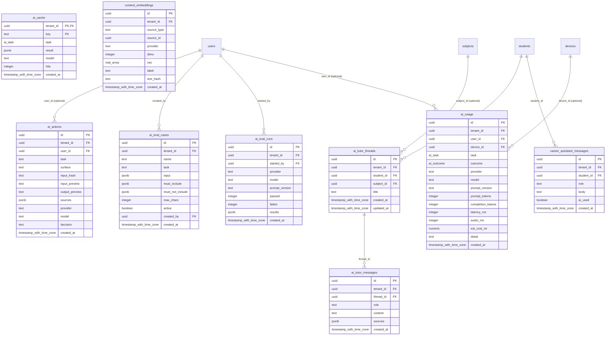

## Campus operations

```mermaid
erDiagram
  amc_contracts {
    uuid id PK
    uuid tenant_id FK
    text title
    uuid asset_id FK
    uuid vendor_id FK
    text vendor_name
    text covers
    date starts_on
    date ends_on
    bigint cost_paise
    smallint visits_per_year
    smallint visits_done
    text contact
    text status
    uuid created_by FK
    timestamp_with_time_zone created_at
  }
  canteen_feedback {
    uuid id PK
    uuid tenant_id FK
    uuid user_id FK
    uuid student_id FK
    uuid child_key
    date meal_date
    text meal
    smallint rating
    text comment
    timestamp_with_time_zone created_at
  }
  canteen_items {
    uuid id PK
    uuid tenant_id FK
    text name
    integer price_paise
    boolean available
  }
  canteen_meal_attendance {
    uuid id PK
    uuid tenant_id FK
    uuid student_id FK
    date meal_date
    text meal
    uuid marked_by FK
    timestamp_with_time_zone created_at
  }
  canteen_stock_log {
    uuid id PK
    uuid tenant_id FK
    text kind
    date logged_on
    text meal
    text item_name
    uuid inv_item_id FK
    uuid vendor_id FK
    uuid purchase_order_id FK
    numeric quantity
    text unit
    bigint cost_paise
    text reason
    uuid recorded_by FK
    timestamp_with_time_zone created_at
  }
  canteen_topups {
    uuid id PK
    uuid tenant_id FK
    uuid student_id FK
    bigint amount_paise
    text provider
    text provider_order_id
    text provider_payment_id
    text status
    uuid payer_user_id FK
    timestamp_with_time_zone paid_at
    timestamp_with_time_zone created_at
  }
  canteen_wallet_txns {
    uuid id PK
    uuid tenant_id FK
    uuid student_id FK
    integer delta_paise
    text kind
    jsonb items
    text idempotency_key
    uuid created_by FK
    timestamp_with_time_zone created_at
  }
  canteen_wallets {
    uuid id PK
    uuid tenant_id FK
    uuid student_id FK
    integer balance_paise
    timestamp_with_time_zone updated_at
  }
  hostel_allotments {
    uuid id PK
    uuid tenant_id FK
    uuid student_id FK
    uuid bed_id FK
    date starts_on
    date vacated_on
    uuid created_by FK
  }
  hostel_beds {
    uuid id PK
    uuid tenant_id FK
    uuid room_id FK
    text label
  }
  hostel_blocks {
    uuid id PK
    uuid tenant_id FK
    text name
    text gender
    timestamp_with_time_zone created_at
  }
  hostel_complaints {
    uuid id PK
    uuid tenant_id FK
    uuid student_id FK
    uuid room_id FK
    uuid raised_by FK
    text category
    text description
    text status
    text resolution
    timestamp_with_time_zone resolved_at
    timestamp_with_time_zone created_at
  }
  hostel_gate_passes {
    uuid id PK
    uuid tenant_id FK
    uuid student_id FK
    text reason
    text destination
    timestamp_with_time_zone expected_back_at
    text status
    timestamp_with_time_zone out_at
    timestamp_with_time_zone in_at
    uuid issued_by FK
    timestamp_with_time_zone created_at
  }
  hostel_night_attendance {
    uuid id PK
    uuid tenant_id FK
    uuid student_id FK
    date night
    text status
    uuid marked_by FK
    timestamp_with_time_zone created_at
  }
  hostel_rooms {
    uuid id PK
    uuid tenant_id FK
    uuid block_id FK
    text number
    integer floor
    integer monthly_fee_paise
  }
  hostel_transfers {
    uuid id PK
    uuid tenant_id FK
    uuid student_id FK
    uuid from_bed_id FK
    uuid to_bed_id FK
    text reason
    date moved_on
    uuid moved_by FK
    timestamp_with_time_zone created_at
  }
  hostel_visitors {
    uuid id PK
    uuid tenant_id FK
    uuid student_id FK
    text visitor_name
    text relation
    text phone
    text id_proof
    timestamp_with_time_zone in_at
    timestamp_with_time_zone out_at
    uuid logged_by FK
  }
  hostel_waitlist {
    uuid id PK
    uuid tenant_id FK
    uuid student_id FK
    uuid block_id FK
    text note
    text status
    uuid requested_by FK
    timestamp_with_time_zone allotted_at
    timestamp_with_time_zone created_at
  }
  hostel_work_orders {
    uuid id PK
    uuid tenant_id FK
    uuid complaint_id FK
    uuid room_id FK
    text title
    text category
    text priority
    text assignee_name
    uuid assignee_user_id FK
    text status
    date due_on
    bigint cost_paise
    text note
    timestamp_with_time_zone completed_at
    uuid verified_by FK
    timestamp_with_time_zone verified_at
    uuid created_by FK
    timestamp_with_time_zone created_at
  }
  incident_updates {
    uuid id PK
    uuid tenant_id FK
    uuid incident_id FK
    text kind
    text body
    text status_after
    uuid author_id FK
    timestamp_with_time_zone created_at
  }
  incidents {
    uuid id PK
    uuid tenant_id FK
    text title
    text severity
    text category
    text status
    text description
    text impact
    timestamp_with_time_zone detected_at
    timestamp_with_time_zone resolved_at
    uuid reported_by FK
    uuid owner_id FK
    boolean personal_data_involved
    timestamp_with_time_zone regulator_notified_at
    text root_cause
    text corrective_actions
    timestamp_with_time_zone created_at
    timestamp_with_time_zone updated_at
  }
  mess_menu {
    uuid id PK
    uuid tenant_id FK
    smallint day_of_week
    text meal
    text items
  }
  mess_plans {
    uuid id PK
    uuid tenant_id FK
    text name
    integer monthly_fee_paise
    jsonb meals
    boolean active
  }
  mess_subscriptions {
    uuid id PK
    uuid tenant_id FK
    uuid student_id FK
    uuid plan_id FK
    date starts_on
    date ended_on
  }
  student_leave_requests {
    uuid id PK
    uuid tenant_id FK
    uuid student_id FK
    date from_date
    date to_date
    text reason
    text status
    uuid requested_by FK
    uuid decided_by FK
    text decision_note
    timestamp_with_time_zone decided_at
    timestamp_with_time_zone created_at
  }
  transport_assignments {
    uuid id PK
    uuid tenant_id FK
    uuid student_id FK
    uuid route_id FK
    uuid stop_id FK
    date starts_on
    date ended_on
    timestamp_with_time_zone created_at
  }
  transport_boardings {
    uuid id PK
    uuid tenant_id FK
    uuid student_id FK
    uuid route_id FK
    uuid device_id FK
    timestamp_with_time_zone boarded_at
    date on_date
  }
  transport_drivers {
    uuid id PK
    uuid tenant_id FK
    uuid user_id FK
    text full_name
    text phone
    text role
    text license_no
    date license_expires_on
    boolean active
    timestamp_with_time_zone created_at
  }
  transport_expenses {
    uuid id PK
    uuid tenant_id FK
    uuid vehicle_id FK
    text kind
    date spent_on
    bigint amount_paise
    numeric litres
    integer odometer_km
    text note
    uuid created_by FK
    timestamp_with_time_zone created_at
  }
  transport_gps_sources {
    uuid id PK
    uuid tenant_id FK
    text name
    text token_hash
    boolean active
    timestamp_with_time_zone last_seen_at
    timestamp_with_time_zone created_at
  }
  transport_incidents {
    uuid id PK
    uuid tenant_id FK
    uuid vehicle_id FK
    uuid trip_id FK
    text kind
    text severity
    text description
    timestamp_with_time_zone occurred_at
    text status
    text resolution
    uuid reported_by FK
    timestamp_with_time_zone resolved_at
    timestamp_with_time_zone created_at
  }
  transport_routes {
    uuid id PK
    uuid tenant_id FK
    text name
    uuid vehicle_id FK
    uuid driver_id FK
    integer monthly_fee_paise
    boolean active
    timestamp_with_time_zone created_at
  }
  transport_stops {
    uuid id PK
    uuid tenant_id FK
    uuid route_id FK
    text name
    integer seq
    numeric lat
    numeric lng
    text pickup_time
  }
  transport_trip_events {
    uuid id PK
    uuid tenant_id FK
    uuid trip_id FK
    text kind
    uuid stop_id FK
    timestamp_with_time_zone at
  }
  transport_trips {
    uuid id PK
    uuid tenant_id FK
    uuid route_id FK
    uuid driver_user_id FK
    text direction
    text status
    timestamp_with_time_zone started_at
    timestamp_with_time_zone ended_at
    integer last_stop_seq
    numeric last_lat
    numeric last_lng
    numeric last_speed_kmh
    timestamp_with_time_zone last_ping_at
    integer pings
  }
  transport_vehicles {
    uuid id PK
    uuid tenant_id FK
    text reg_no
    text model
    integer capacity
    text status
    date insurance_expires_on
    date fitness_expires_on
    date puc_expires_on
    timestamp_with_time_zone created_at
  }
  assets ||--o{ amc_contracts : "asset_id (optional)"
  inv_vendors ||--o{ amc_contracts : "vendor_id (optional)"
  users ||--o{ amc_contracts : "created_by (optional)"
  users ||--o{ canteen_feedback : "user_id"
  students ||--o{ canteen_feedback : "student_id (optional)"
  students ||--o{ canteen_meal_attendance : "student_id"
  users ||--o{ canteen_meal_attendance : "marked_by"
  inv_items ||--o{ canteen_stock_log : "inv_item_id (optional)"
  inv_vendors ||--o{ canteen_stock_log : "vendor_id (optional)"
  inv_purchase_orders ||--o{ canteen_stock_log : "purchase_order_id (optional)"
  users ||--o{ canteen_stock_log : "recorded_by (optional)"
  students ||--o{ canteen_topups : "student_id"
  users ||--o{ canteen_topups : "payer_user_id (optional)"
  students ||--o{ canteen_wallet_txns : "student_id"
  users ||--o{ canteen_wallet_txns : "created_by"
  students ||--o{ canteen_wallets : "student_id"
  students ||--o{ hostel_allotments : "student_id"
  hostel_beds ||--o{ hostel_allotments : "bed_id"
  users ||--o{ hostel_allotments : "created_by"
  hostel_rooms ||--o{ hostel_beds : "room_id"
  students ||--o{ hostel_complaints : "student_id (optional)"
  hostel_rooms ||--o{ hostel_complaints : "room_id (optional)"
  users ||--o{ hostel_complaints : "raised_by"
  students ||--o{ hostel_gate_passes : "student_id"
  users ||--o{ hostel_gate_passes : "issued_by"
  students ||--o{ hostel_night_attendance : "student_id"
  users ||--o{ hostel_night_attendance : "marked_by"
  hostel_blocks ||--o{ hostel_rooms : "block_id"
  students ||--o{ hostel_transfers : "student_id"
  hostel_beds ||--o{ hostel_transfers : "from_bed_id"
  hostel_beds ||--o{ hostel_transfers : "to_bed_id"
  users ||--o{ hostel_transfers : "moved_by"
  students ||--o{ hostel_visitors : "student_id"
  users ||--o{ hostel_visitors : "logged_by"
  students ||--o{ hostel_waitlist : "student_id"
  hostel_blocks ||--o{ hostel_waitlist : "block_id (optional)"
  users ||--o{ hostel_waitlist : "requested_by"
  hostel_complaints ||--o{ hostel_work_orders : "complaint_id (optional)"
  hostel_rooms ||--o{ hostel_work_orders : "room_id (optional)"
  users ||--o{ hostel_work_orders : "assignee_user_id (optional)"
  users ||--o{ hostel_work_orders : "verified_by (optional)"
  users ||--o{ hostel_work_orders : "created_by (optional)"
  incidents ||--o{ incident_updates : "incident_id"
  users ||--o{ incident_updates : "author_id"
  users ||--o{ incidents : "reported_by"
  users ||--o{ incidents : "owner_id (optional)"
  students ||--o{ mess_subscriptions : "student_id"
  mess_plans ||--o{ mess_subscriptions : "plan_id"
  students ||--o{ student_leave_requests : "student_id"
  users ||--o{ student_leave_requests : "requested_by"
  users ||--o{ student_leave_requests : "decided_by (optional)"
  students ||--o{ transport_assignments : "student_id"
  transport_routes ||--o{ transport_assignments : "route_id"
  transport_stops ||--o{ transport_assignments : "stop_id"
  students ||--o{ transport_boardings : "student_id"
  transport_routes ||--o{ transport_boardings : "route_id (optional)"
  access_devices ||--o{ transport_boardings : "device_id (optional)"
  users ||--o{ transport_drivers : "user_id (optional)"
  transport_vehicles ||--o{ transport_expenses : "vehicle_id"
  users ||--o{ transport_expenses : "created_by"
  transport_vehicles ||--o{ transport_incidents : "vehicle_id (optional)"
  transport_trips ||--o{ transport_incidents : "trip_id (optional)"
  users ||--o{ transport_incidents : "reported_by"
  transport_vehicles ||--o{ transport_routes : "vehicle_id (optional)"
  transport_drivers ||--o{ transport_routes : "driver_id (optional)"
  transport_routes ||--o{ transport_stops : "route_id"
  transport_trips ||--o{ transport_trip_events : "trip_id"
  transport_stops ||--o{ transport_trip_events : "stop_id (optional)"
  transport_routes ||--o{ transport_trips : "route_id"
  users ||--o{ transport_trips : "driver_user_id"
```

## Classroom & attendance

```mermaid
erDiagram
  answer_cards {
    uuid tenant_id FK
    uuid section_id PK,FK
    smallint card_no PK
    uuid student_id FK
    timestamp_with_time_zone created_at
  }
  attendance_condonations {
    uuid id PK
    uuid tenant_id FK
    uuid student_id FK
    uuid subject_id FK
    text kind
    text reason
    text document_key
    text document_type
    uuid requested_by FK
    text status
    integer approved_points
    uuid decided_by FK
    timestamp_with_time_zone decided_at
    text decision_note
    timestamp_with_time_zone created_at
  }
  attendance_corrections {
    uuid id PK
    uuid tenant_id FK
    uuid student_id FK
    uuid section_id FK
    uuid timetable_slot_id FK
    date date
    attendance_status from_status
    attendance_status to_status
    text reason
    uuid requested_by FK
    text status
    uuid decided_by FK
    timestamp_with_time_zone decided_at
    text decision_note
    timestamp_with_time_zone created_at
  }
  attendance_overrides {
    uuid id PK
    uuid tenant_id FK
    uuid program_id FK
    integer threshold_pct
    integer lock_hours
    text note
    timestamp_with_time_zone updated_at
  }
  attendance_records {
    uuid id PK
    uuid tenant_id FK
    uuid student_id FK
    uuid section_id FK
    date date
    uuid timetable_slot_id FK
    attendance_status status
    uuid marked_by FK
    timestamp_with_time_zone occurred_at
    timestamp_with_time_zone updated_at
  }
  badges {
    uuid id PK
    uuid tenant_id FK
    uuid student_id FK
    uuid section_id FK
    badge_kind badge
    uuid awarded_by FK
    uuid subject_id FK
    text note
    timestamp_with_time_zone awarded_at
  }
  buzzer_presses {
    uuid id PK
    uuid tenant_id FK
    uuid board_session_id FK
    integer round_no
    uuid student_user_id FK
    integer seq
    timestamp_with_time_zone pressed_at
  }
  buzzer_rounds {
    uuid id PK
    uuid tenant_id FK
    uuid board_session_id FK
    integer round_no
    boolean locked
    timestamp_with_time_zone created_at
  }
  class_meetings {
    uuid id PK
    uuid tenant_id FK
    uuid connector_id FK
    text provider
    uuid slot_id FK
    text topic
    timestamp_with_time_zone starts_at
    integer duration_min
    text external_id
    text join_url
    text host_url
    jsonb participants
    timestamp_with_time_zone participants_pulled_at
    uuid created_by FK
    timestamp_with_time_zone created_at
  }
  class_notes {
    uuid id PK
    uuid tenant_id FK
    uuid board_session_id FK
    uuid teacher_id FK
    uuid section_id FK
    uuid subject_id FK
    text title
    text notes
    jsonb summary
    timestamp_with_time_zone published_at
    text share_token
    timestamp_with_time_zone created_at
  }
  exit_tickets {
    uuid id PK
    uuid tenant_id FK
    uuid board_session_id FK
    uuid section_id FK
    uuid subject_id FK
    uuid teacher_id FK
    text topic
    jsonb poll_ids
    timestamp_with_time_zone created_at
    timestamp_with_time_zone closed_at
  }
  homework {
    uuid id PK
    uuid tenant_id FK
    uuid section_id FK
    uuid subject_id FK
    uuid created_by FK
    uuid board_session_id FK
    text title
    text instructions
    date due_on
    timestamp_with_time_zone created_at
  }
  homework_peer_reviews {
    uuid id PK
    uuid tenant_id FK
    uuid homework_id FK
    uuid author_student_id FK
    uuid reviewer_student_id FK
    jsonb rubric
    text comment
    timestamp_with_time_zone reviewed_at
    timestamp_with_time_zone created_at
  }
  homework_submissions {
    uuid tenant_id FK
    uuid homework_id PK,FK
    uuid student_id PK,FK
    text text
    jsonb files
    submission_status status
    uuid submitted_by FK
    timestamp_with_time_zone submitted_at
    text remark
    uuid checked_by FK
    timestamp_with_time_zone checked_at
  }
  mastery_records {
    uuid id PK
    uuid tenant_id FK
    uuid student_id FK
    uuid outcome_id FK
    text level
    text evidence
    uuid assessed_by FK
    date assessed_on
    timestamp_with_time_zone updated_at
  }
  meeting_attendance_proposals {
    uuid id PK
    uuid tenant_id FK
    uuid meeting_id FK
    uuid student_id FK
    text status
    integer minutes
    text source_name
    text confirmed_status
    uuid confirmed_by FK
    timestamp_with_time_zone confirmed_at
  }
  participation_events {
    uuid id PK
    uuid tenant_id FK
    uuid student_id FK
    uuid board_session_id FK
    uuid subject_id FK
    text topic_code
    participation_outcome outcome
    text note
    uuid poll_id FK
    uuid recorded_by FK
    timestamp_with_time_zone occurred_at
  }
  poll_responses {
    uuid tenant_id FK
    uuid poll_id PK,FK
    uuid student_id PK,FK
    text answer
    poll_answer_source source
    timestamp_with_time_zone answered_at
  }
  polls {
    uuid id PK
    uuid tenant_id FK
    uuid board_session_id FK
    uuid section_id FK
    uuid subject_id FK
    uuid teacher_id FK
    poll_kind kind
    text question
    jsonb options
    text correct
    text topic_code
    timestamp_with_time_zone opened_at
    timestamp_with_time_zone closed_at
  }
  quiz_game_answers {
    uuid tenant_id FK
    uuid game_id PK,FK
    integer question_index PK
    uuid student_id PK,FK
    integer choice
    poll_answer_source source
    integer elapsed_ms
    boolean correct
    integer points
    timestamp_with_time_zone answered_at
  }
  quiz_games {
    uuid id PK
    uuid tenant_id FK
    uuid board_session_id FK
    uuid section_id FK
    uuid subject_id FK
    uuid teacher_id FK
    text title
    jsonb questions
    boolean cards
    text status
    integer current_index
    timestamp_with_time_zone opened_at
    timestamp_with_time_zone closes_at
    jsonb standings
    timestamp_with_time_zone created_at
    timestamp_with_time_zone finished_at
  }
  rubric_scores {
    uuid id PK
    uuid tenant_id FK
    uuid rubric_id FK
    uuid student_id FK
    text context_kind
    uuid context_id
    jsonb selections
    numeric total
    numeric max_total
    uuid scored_by FK
    timestamp_with_time_zone scored_at
  }
  rubrics {
    uuid id PK
    uuid tenant_id FK
    text name
    text scope
    jsonb criteria
    boolean archived
    uuid created_by FK
    timestamp_with_time_zone created_at
  }
  teacher_substitutions {
    uuid id PK
    uuid tenant_id FK
    uuid slot_id FK
    date date
    uuid original_teacher_id FK
    uuid substitute_teacher_id FK
    text reason
    uuid leave_request_id FK
    text status
    uuid created_by FK
    timestamp_with_time_zone created_at
  }
  timetable_slots {
    uuid id PK
    uuid tenant_id FK
    uuid academic_year_id FK
    uuid section_id FK
    uuid subject_id FK
    uuid teacher_id FK
    uuid room_id FK
    smallint day_of_week
    time starts_at
    time ends_at
    timestamp_with_time_zone archived_at
  }
  worksheet_scores {
    uuid id PK
    uuid tenant_id FK
    uuid worksheet_id FK
    uuid student_id FK
    numeric score
    text level
    text remarks
    uuid scored_by FK
    timestamp_with_time_zone scored_at
  }
  worksheets {
    uuid id PK
    uuid tenant_id FK
    text kind
    text title
    text instructions
    uuid section_id FK
    text subject_name
    uuid outcome_id FK
    date due_on
    numeric max_score
    jsonb levels
    uuid created_by FK
    timestamp_with_time_zone created_at
  }
  sections ||--o{ answer_cards : "section_id"
  students ||--o{ answer_cards : "student_id"
  students ||--o{ attendance_condonations : "student_id"
  subjects ||--o{ attendance_condonations : "subject_id (optional)"
  users ||--o{ attendance_condonations : "requested_by"
  users ||--o{ attendance_condonations : "decided_by (optional)"
  students ||--o{ attendance_corrections : "student_id"
  sections ||--o{ attendance_corrections : "section_id"
  timetable_slots ||--o{ attendance_corrections : "timetable_slot_id"
  users ||--o{ attendance_corrections : "requested_by"
  users ||--o{ attendance_corrections : "decided_by (optional)"
  programs ||--o{ attendance_overrides : "program_id"
  students ||--o{ attendance_records : "student_id"
  sections ||--o{ attendance_records : "section_id"
  timetable_slots ||--o{ attendance_records : "timetable_slot_id (optional)"
  users ||--o{ attendance_records : "marked_by"
  students ||--o{ badges : "student_id"
  sections ||--o{ badges : "section_id"
  users ||--o{ badges : "awarded_by"
  subjects ||--o{ badges : "subject_id (optional)"
  board_sessions ||--o{ buzzer_presses : "board_session_id"
  users ||--o{ buzzer_presses : "student_user_id"
  board_sessions ||--o{ buzzer_rounds : "board_session_id"
  connectors ||--o{ class_meetings : "connector_id (optional)"
  timetable_slots ||--o{ class_meetings : "slot_id (optional)"
  users ||--o{ class_meetings : "created_by (optional)"
  board_sessions ||--o{ class_notes : "board_session_id"
  users ||--o{ class_notes : "teacher_id"
  sections ||--o{ class_notes : "section_id (optional)"
  subjects ||--o{ class_notes : "subject_id (optional)"
  board_sessions ||--o{ exit_tickets : "board_session_id"
  sections ||--o{ exit_tickets : "section_id"
  subjects ||--o{ exit_tickets : "subject_id (optional)"
  users ||--o{ exit_tickets : "teacher_id"
  sections ||--o{ homework : "section_id"
  subjects ||--o{ homework : "subject_id"
  users ||--o{ homework : "created_by"
  board_sessions ||--o{ homework : "board_session_id (optional)"
  homework ||--o{ homework_peer_reviews : "homework_id"
  students ||--o{ homework_peer_reviews : "author_student_id"
  students ||--o{ homework_peer_reviews : "reviewer_student_id"
  homework ||--o{ homework_submissions : "homework_id"
  students ||--o{ homework_submissions : "student_id"
  users ||--o{ homework_submissions : "submitted_by"
  users ||--o{ homework_submissions : "checked_by (optional)"
  students ||--o{ mastery_records : "student_id"
  learning_outcomes ||--o{ mastery_records : "outcome_id"
  users ||--o{ mastery_records : "assessed_by (optional)"
  class_meetings ||--o{ meeting_attendance_proposals : "meeting_id"
  students ||--o{ meeting_attendance_proposals : "student_id"
  users ||--o{ meeting_attendance_proposals : "confirmed_by (optional)"
  students ||--o{ participation_events : "student_id"
  board_sessions ||--o{ participation_events : "board_session_id (optional)"
  subjects ||--o{ participation_events : "subject_id (optional)"
  polls ||--o{ participation_events : "poll_id (optional)"
  users ||--o{ participation_events : "recorded_by"
  polls ||--o{ poll_responses : "poll_id"
  students ||--o{ poll_responses : "student_id"
  board_sessions ||--o{ polls : "board_session_id"
  sections ||--o{ polls : "section_id"
  subjects ||--o{ polls : "subject_id (optional)"
  users ||--o{ polls : "teacher_id"
  quiz_games ||--o{ quiz_game_answers : "game_id"
  students ||--o{ quiz_game_answers : "student_id"
  board_sessions ||--o{ quiz_games : "board_session_id"
  sections ||--o{ quiz_games : "section_id"
  subjects ||--o{ quiz_games : "subject_id (optional)"
  users ||--o{ quiz_games : "teacher_id"
  rubrics ||--o{ rubric_scores : "rubric_id"
  students ||--o{ rubric_scores : "student_id"
  users ||--o{ rubric_scores : "scored_by (optional)"
  users ||--o{ rubrics : "created_by (optional)"
  timetable_slots ||--o{ teacher_substitutions : "slot_id"
  users ||--o{ teacher_substitutions : "original_teacher_id"
  users ||--o{ teacher_substitutions : "substitute_teacher_id"
  leave_requests ||--o{ teacher_substitutions : "leave_request_id (optional)"
  users ||--o{ teacher_substitutions : "created_by (optional)"
  academic_years ||--o{ timetable_slots : "academic_year_id"
  sections ||--o{ timetable_slots : "section_id"
  subjects ||--o{ timetable_slots : "subject_id"
  users ||--o{ timetable_slots : "teacher_id"
  rooms ||--o{ timetable_slots : "room_id (optional)"
  worksheets ||--o{ worksheet_scores : "worksheet_id"
  students ||--o{ worksheet_scores : "student_id"
  users ||--o{ worksheet_scores : "scored_by (optional)"
  sections ||--o{ worksheets : "section_id"
  learning_outcomes ||--o{ worksheets : "outcome_id (optional)"
  users ||--o{ worksheets : "created_by (optional)"
```

## Communication

```mermaid
erDiagram
  audience_rules {
    uuid id PK
    uuid tenant_id FK
    text name
    jsonb rule
    uuid created_by FK
    timestamp_with_time_zone created_at
  }
  broadcast_receipts {
    uuid id PK
    uuid tenant_id FK
    uuid broadcast_id FK
    uuid device_id FK
    timestamp_with_time_zone displayed_at
    timestamp_with_time_zone acknowledged_at
    uuid acknowledged_by FK
  }
  broadcasts {
    uuid id PK
    uuid tenant_id FK
    uuid sender_id FK
    text title
    text body
    broadcast_priority priority
    jsonb audience
    boolean requires_ack
    timestamp_with_time_zone expires_at
    timestamp_with_time_zone cleared_at
    timestamp_with_time_zone created_at
  }
  chat_members {
    uuid thread_id PK,FK
    uuid tenant_id FK
    uuid user_id PK,FK
    text role
    boolean pinned
    timestamp_with_time_zone last_read_at
    timestamp_with_time_zone joined_at
  }
  chat_messages {
    uuid id PK
    uuid tenant_id FK
    uuid thread_id FK
    uuid sender_id FK
    text direction
    text body
    text external_from
    text delivery
    text attachment_key
    text attachment_name
    text attachment_type
    integer attachment_size
    timestamp_with_time_zone created_at
  }
  chat_threads {
    uuid id PK
    uuid tenant_id FK
    text kind
    text title
    text description
    text channel
    text contact_name
    text contact_address
    text contact_kind
    uuid created_by FK
    timestamp_with_time_zone created_at
    timestamp_with_time_zone last_message_at
  }
  conversations {
    uuid id PK
    uuid tenant_id FK
    uuid student_id FK
    uuid staff_id FK
    uuid family_id FK
    timestamp_with_time_zone last_message_at
    timestamp_with_time_zone staff_read_at
    timestamp_with_time_zone family_read_at
    timestamp_with_time_zone created_at
  }
  message_campaigns {
    uuid id PK
    uuid tenant_id FK
    text title
    uuid template_id FK
    uuid audience_id FK
    jsonb vars
    timestamp_with_time_zone send_at
    text status
    integer recipients
    integer sent_count
    integer failed_count
    uuid created_by FK
    timestamp_with_time_zone created_at
  }
  message_deliveries {
    uuid id PK
    uuid tenant_id FK
    uuid campaign_id FK
    uuid user_id FK
    text channel
    text status
    smallint attempts
    text error
    timestamp_with_time_zone next_attempt_at
    timestamp_with_time_zone sent_at
    timestamp_with_time_zone read_at
    timestamp_with_time_zone created_at
  }
  message_templates {
    uuid id PK
    uuid tenant_id FK
    text key
    text channel
    text locale
    text subject
    text body
    text dlt_template_id
    boolean active
    timestamp_with_time_zone created_at
    timestamp_with_time_zone updated_at
  }
  messages {
    uuid id PK
    uuid tenant_id FK
    uuid conversation_id FK
    uuid sender_id FK
    text body
    timestamp_with_time_zone created_at
  }
  notifications {
    uuid id PK
    uuid tenant_id FK
    uuid user_id FK
    notification_kind kind
    text title
    text body
    jsonb data
    text dedupe_key
    timestamp_with_time_zone created_at
    timestamp_with_time_zone read_at
    timestamp_with_time_zone retracted_at
  }
  push_devices {
    uuid id PK
    uuid tenant_id FK
    uuid user_id FK
    text token
    push_platform platform
    text app
    timestamp_with_time_zone last_seen_at
    timestamp_with_time_zone created_at
  }
  survey_answers {
    uuid id PK
    uuid tenant_id FK
    uuid survey_id FK
    uuid question_id FK
    uuid response_id FK
    jsonb choices
    smallint rating
    text text
  }
  survey_questions {
    uuid id PK
    uuid tenant_id FK
    uuid survey_id FK
    smallint ord
    text kind
    text prompt
    jsonb options
    boolean required
    uuid co_id FK
    jsonb show_if
  }
  survey_responses {
    uuid id PK
    uuid tenant_id FK
    uuid survey_id FK
    uuid respondent_id FK
    timestamp_with_time_zone submitted_at
  }
  surveys {
    uuid id PK
    uuid tenant_id FK
    text title
    text description
    text audience
    uuid section_id FK
    boolean anonymous
    timestamp_with_time_zone opens_at
    timestamp_with_time_zone closes_at
    text status
    uuid created_by FK
    timestamp_with_time_zone closed_at
    text series_key
    smallint repeat_every_days
    boolean auto_publish
    timestamp_with_time_zone created_at
  }
  users ||--o{ audience_rules : "created_by (optional)"
  broadcasts ||--o{ broadcast_receipts : "broadcast_id"
  devices ||--o{ broadcast_receipts : "device_id"
  users ||--o{ broadcast_receipts : "acknowledged_by (optional)"
  users ||--o{ broadcasts : "sender_id"
  chat_threads ||--o{ chat_members : "thread_id"
  users ||--o{ chat_members : "user_id"
  chat_threads ||--o{ chat_messages : "thread_id"
  users ||--o{ chat_messages : "sender_id (optional)"
  users ||--o{ chat_threads : "created_by (optional)"
  students ||--o{ conversations : "student_id"
  users ||--o{ conversations : "staff_id"
  users ||--o{ conversations : "family_id"
  message_templates ||--o{ message_campaigns : "template_id"
  audience_rules ||--o{ message_campaigns : "audience_id"
  users ||--o{ message_campaigns : "created_by (optional)"
  message_campaigns ||--o{ message_deliveries : "campaign_id"
  users ||--o{ message_deliveries : "user_id"
  conversations ||--o{ messages : "conversation_id"
  users ||--o{ messages : "sender_id"
  users ||--o{ notifications : "user_id"
  users ||--o{ push_devices : "user_id"
  surveys ||--o{ survey_answers : "survey_id"
  survey_questions ||--o{ survey_answers : "question_id"
  survey_responses ||--o{ survey_answers : "response_id (optional)"
  surveys ||--o{ survey_questions : "survey_id"
  course_outcomes ||--o{ survey_questions : "co_id (optional)"
  surveys ||--o{ survey_responses : "survey_id"
  users ||--o{ survey_responses : "respondent_id"
  sections ||--o{ surveys : "section_id (optional)"
  users ||--o{ surveys : "created_by"
```

## Curriculum & teaching plans

```mermaid
erDiagram
  affiliated_institutions {
    uuid id PK
    uuid tenant_id FK
    text code
    text name
    text model
    text university
    text city
    text aishe_code
    date affiliation_valid_to
    boolean active
    timestamp_with_time_zone created_at
  }
  chapters {
    uuid id PK
    uuid tenant_id FK
    uuid course_id FK
    smallint position
    text title
  }
  course_files {
    uuid id PK
    uuid tenant_id FK
    uuid section_id FK
    uuid subject_id FK
    integer version
    text storage_key
    integer size_bytes
    jsonb summary
    uuid generated_by FK
    timestamp_with_time_zone generated_at
    uuid reviewed_by FK
    timestamp_with_time_zone reviewed_at
    text review_remark
    timestamp_with_time_zone created_at
  }
  courses {
    uuid id PK
    text curriculum_code FK
    text code
    text title
    smallint term
    language language
    text source
    boolean reviewed
    timestamp_with_time_zone updated_at
  }
  curricula {
    text code PK
    text name
    program_level level
  }
  curriculum_cos {
    uuid id PK
    uuid tenant_id FK
    uuid subject_id FK
    text code
    text statement
    text bloom_level
  }
  curriculum_frameworks {
    uuid id PK
    uuid tenant_id FK
    text code
    text name
    text kind
    text authority
    text description
    timestamp_with_time_zone created_at
  }
  curriculum_subjects {
    uuid id PK
    uuid tenant_id FK
    uuid version_id FK
    smallint term
    text code
    text name
    numeric credits
    smallint hours
    smallint ord
  }
  curriculum_units {
    uuid id PK
    uuid tenant_id FK
    uuid subject_id FK
    smallint ord
    text title
    smallint hours
    text_array topics
  }
  curriculum_versions {
    uuid id PK
    uuid tenant_id FK
    uuid program_id FK
    uuid regulation_id FK
    smallint regulation_year
    integer version_no
    text label
    text status
    date effective_from
    uuid supersedes_id FK
    text source
    text bos_ref
    text university_ref
    uuid approved_by FK
    timestamp_with_time_zone approved_at
    timestamp_with_time_zone activated_at
    uuid created_by FK
    timestamp_with_time_zone created_at
  }
  learning_outcomes {
    uuid id PK
    uuid tenant_id FK
    text kind
    smallint grade
    text subject_name
    text code
    text statement
  }
  lesson_plan_outcomes {
    uuid id PK
    uuid tenant_id FK
    uuid lesson_plan_id FK
    uuid course_outcome_id FK
    uuid learning_outcome_id FK
    text activity
    text resource
    text assessment
  }
  lesson_plans {
    uuid id PK
    uuid tenant_id FK
    uuid section_id FK
    uuid subject_id FK
    uuid timetable_slot_id FK
    date date
    uuid teacher_id FK
    uuid_array topic_ids
    jsonb content
    boolean ai_drafted
    uuid reviewed_by FK
    timestamp_with_time_zone reviewed_at
    text review_remark
    text status
    timestamp_with_time_zone submitted_at
    timestamp_with_time_zone created_at
    timestamp_with_time_zone updated_at
  }
  outcome_topics {
    uuid id PK
    uuid tenant_id FK
    uuid outcome_id FK
    uuid topic_id FK
  }
  regulations {
    uuid id PK
    uuid tenant_id FK
    text name
    smallint year
    uuid program_id FK
    uuid framework_id
    text authority
    date effective_from
    text notes
    timestamp_with_time_zone created_at
  }
  resource_topic_links {
    uuid id PK
    uuid tenant_id FK
    uuid topic_id FK
    text resource_kind
    uuid resource_id
    uuid created_by FK
    timestamp_with_time_zone created_at
  }
  skill_evidence {
    uuid id PK
    uuid tenant_id FK
    uuid skill_id FK
    uuid student_id FK
    smallint level
    text title
    text note
    uuid recorded_by FK
    timestamp_with_time_zone created_at
  }
  skill_maps {
    uuid id PK
    uuid tenant_id FK
    uuid skill_id FK
    text kind
    text ref
    timestamp_with_time_zone created_at
  }
  skills {
    uuid id PK
    uuid tenant_id FK
    text code
    text name
    text category
    text description
    boolean active
    timestamp_with_time_zone created_at
  }
  student_curriculum_pins {
    uuid id PK
    uuid tenant_id FK
    uuid student_id FK
    uuid version_id FK
    uuid pinned_by FK
    timestamp_with_time_zone pinned_at
  }
  subject_frequency {
    uuid id PK
    uuid tenant_id FK
    uuid subject_id FK
    smallint min_per_week
    smallint max_per_week
    smallint max_per_day
  }
  syllabus_imports {
    uuid id PK
    uuid tenant_id FK
    uuid program_id FK
    smallint regulation_year
    text file_name
    integer extracted_chars
    text status
    boolean preview
    jsonb proposal
    uuid version_id FK
    uuid created_by FK
    timestamp_with_time_zone created_at
  }
  topic_coverage {
    uuid tenant_id FK
    uuid section_id PK,FK
    uuid topic_id PK,FK
    date covered_on
    uuid covered_by FK
    uuid board_session_id FK
    timestamp_with_time_zone created_at
  }
  topics {
    uuid id PK
    uuid tenant_id FK
    uuid chapter_id FK
    smallint position
    text title
    text summary
    jsonb notes
    jsonb outcomes
    jsonb resources
    jsonb lesson
    uuid created_by FK
    timestamp_with_time_zone updated_at
  }
  year_plan_items {
    uuid tenant_id FK
    uuid plan_id PK,FK
    uuid topic_id PK,FK
    date week_of
    smallint periods
  }
  year_plans {
    uuid id PK
    uuid tenant_id FK
    uuid section_id FK
    uuid subject_id FK
    date starts_on
    date ends_on
    uuid created_by FK
    timestamp_with_time_zone created_at
    timestamp_with_time_zone updated_at
  }
  courses ||--o{ chapters : "course_id"
  sections ||--o{ course_files : "section_id"
  subjects ||--o{ course_files : "subject_id"
  users ||--o{ course_files : "generated_by"
  users ||--o{ course_files : "reviewed_by (optional)"
  curricula ||--o{ courses : "curriculum_code"
  curriculum_subjects ||--o{ curriculum_cos : "subject_id"
  curriculum_versions ||--o{ curriculum_subjects : "version_id"
  curriculum_subjects ||--o{ curriculum_units : "subject_id"
  programs ||--o{ curriculum_versions : "program_id"
  regulations ||--o{ curriculum_versions : "regulation_id (optional)"
  curriculum_versions ||--o{ curriculum_versions : "supersedes_id (optional)"
  users ||--o{ curriculum_versions : "approved_by (optional)"
  users ||--o{ curriculum_versions : "created_by (optional)"
  lesson_plans ||--o{ lesson_plan_outcomes : "lesson_plan_id"
  course_outcomes ||--o{ lesson_plan_outcomes : "course_outcome_id (optional)"
  learning_outcomes ||--o{ lesson_plan_outcomes : "learning_outcome_id (optional)"
  sections ||--o{ lesson_plans : "section_id"
  subjects ||--o{ lesson_plans : "subject_id"
  timetable_slots ||--o{ lesson_plans : "timetable_slot_id"
  users ||--o{ lesson_plans : "teacher_id"
  users ||--o{ lesson_plans : "reviewed_by (optional)"
  learning_outcomes ||--o{ outcome_topics : "outcome_id"
  topics ||--o{ outcome_topics : "topic_id"
  programs ||--o{ regulations : "program_id (optional)"
  topics ||--o{ resource_topic_links : "topic_id"
  users ||--o{ resource_topic_links : "created_by (optional)"
  skills ||--o{ skill_evidence : "skill_id"
  students ||--o{ skill_evidence : "student_id"
  users ||--o{ skill_evidence : "recorded_by"
  skills ||--o{ skill_maps : "skill_id"
  students ||--o{ student_curriculum_pins : "student_id"
  curriculum_versions ||--o{ student_curriculum_pins : "version_id"
  users ||--o{ student_curriculum_pins : "pinned_by (optional)"
  subjects ||--o{ subject_frequency : "subject_id"
  programs ||--o{ syllabus_imports : "program_id"
  curriculum_versions ||--o{ syllabus_imports : "version_id (optional)"
  users ||--o{ syllabus_imports : "created_by (optional)"
  sections ||--o{ topic_coverage : "section_id"
  topics ||--o{ topic_coverage : "topic_id"
  users ||--o{ topic_coverage : "covered_by"
  board_sessions ||--o{ topic_coverage : "board_session_id (optional)"
  chapters ||--o{ topics : "chapter_id"
  users ||--o{ topics : "created_by (optional)"
  year_plans ||--o{ year_plan_items : "plan_id"
  topics ||--o{ year_plan_items : "topic_id"
  sections ||--o{ year_plans : "section_id"
  subjects ||--o{ year_plans : "subject_id"
  users ||--o{ year_plans : "created_by"
```

## Exams, evaluation & results

```mermaid
erDiagram
  assessment_schemes {
    uuid id PK
    uuid tenant_id FK
    uuid subject_id FK
    uuid academic_year_id FK
    text name
    numeric credits
    jsonb pass_rules
    smallint max_attempts
    uuid grade_scale_id FK
    uuid created_by FK
    timestamp_with_time_zone created_at
  }
  assessments {
    uuid id PK
    uuid tenant_id FK
    uuid section_id FK
    uuid subject_id FK
    text title
    assessment_kind kind
    numeric max_marks
    date held_on
    timestamp_with_time_zone published_at
    uuid created_by FK
    timestamp_with_time_zone created_at
    uuid component_id FK
    mark_status mark_status
    timestamp_with_time_zone submitted_at
    uuid verified_by FK
    timestamp_with_time_zone verified_at
    uuid moderated_by FK
    timestamp_with_time_zone moderated_at
    timestamp_with_time_zone locked_at
    uuid locked_by FK
  }
  eval_allocations {
    uuid id PK
    uuid tenant_id FK
    uuid script_id FK
    uuid paper_id FK
    uuid examiner_id FK
    smallint round
    text status
    numeric total
    timestamp_with_time_zone submitted_at
    timestamp_with_time_zone created_at
  }
  eval_annotations {
    uuid id PK
    uuid tenant_id FK
    uuid script_id FK
    uuid allocation_id FK
    smallint page_index
    text kind
    numeric x
    numeric y
    numeric w
    numeric h
    text text
    jsonb strokes
    uuid created_by FK
    timestamp_with_time_zone created_at
  }
  eval_configs {
    uuid paper_id PK,FK
    uuid tenant_id FK
    integer per_examiner_cap
    integer second_share_percent
    numeric threshold_marks
    timestamp_with_time_zone second_picked_at
    timestamp_with_time_zone finalised_at
    integer mask_header_percent
  }
  eval_marks {
    uuid tenant_id FK
    uuid allocation_id PK,FK
    uuid question_id PK,FK
    numeric marks
    text comment
  }
  eval_questions {
    uuid id PK
    uuid tenant_id FK
    uuid paper_id FK
    text no
    numeric max_marks
    smallint ord
    uuid co_id
  }
  eval_scripts {
    uuid id PK
    uuid tenant_id FK
    uuid paper_id FK
    uuid student_id FK
    text dummy_no
    jsonb files
    text status
    boolean second_required
    boolean third_required
    numeric final_marks
    boolean header_masked
    uuid uploaded_by FK
    timestamp_with_time_zone created_at
  }
  exam_attendance {
    uuid tenant_id FK
    uuid paper_id PK,FK
    uuid student_id PK,FK
    text status
    text booklet_no
    uuid marked_by FK
    timestamp_with_time_zone marked_at
  }
  exam_fee_dues {
    uuid id PK
    uuid tenant_id FK
    uuid session_id FK
    uuid student_id FK
    integer papers
    bigint amount_paise
    text status
    text receipt_no
    text note
    uuid settled_by FK
    timestamp_with_time_zone settled_at
    timestamp_with_time_zone created_at
  }
  exam_moderations {
    uuid id PK
    uuid tenant_id FK
    uuid session_id FK
    uuid paper_id FK
    text kind
    numeric value
    text reason
    text status
    uuid proposed_by FK
    uuid decided_by FK
    timestamp_with_time_zone decided_at
    text decision_note
    integer applied_count
    timestamp_with_time_zone created_at
  }
  exam_office_settings {
    uuid tenant_id PK,FK
    jsonb settings
    uuid updated_by FK
    timestamp_with_time_zone updated_at
  }
  exam_papers {
    uuid id PK
    uuid tenant_id FK
    uuid session_id FK
    uuid subject_id FK
    uuid section_id FK
    date exam_date
    time starts_at
    time ends_at
    numeric max_marks
    uuid assessment_id FK
  }
  exam_practical_candidates {
    uuid id PK
    uuid tenant_id FK
    uuid slot_id FK
    uuid student_id FK
    boolean present
    numeric marks
    text remarks
  }
  exam_practical_slots {
    uuid id PK
    uuid tenant_id FK
    uuid session_id FK
    uuid subject_id FK
    text kind
    text batch_label
    uuid room_id FK
    date slot_date
    time starts_at
    time ends_at
    uuid internal_examiner_id FK
    text external_examiner_name
    text external_examiner_org
    numeric max_marks
    text status
    uuid created_by FK
    timestamp_with_time_zone created_at
  }
  exam_registration_windows {
    uuid id PK
    uuid tenant_id FK
    uuid session_id FK
    date opens_on
    date closes_on
    numeric min_attendance_percent
    boolean block_on_fee_dues
    integer max_backlogs
    uuid created_by FK
    timestamp_with_time_zone created_at
  }
  exam_registrations {
    uuid tenant_id FK
    uuid session_id PK,FK
    uuid student_id PK,FK
    text status
    jsonb reasons
    uuid overridden_by FK
    text override_reason
    timestamp_with_time_zone registered_at
  }
  exam_result_lines {
    uuid tenant_id FK
    uuid result_id PK,FK
    uuid subject_id PK,FK
    numeric credits
    numeric percent
    text grade
    numeric grade_point
    boolean passed
    jsonb reasons
    jsonb components
  }
  exam_result_rules {
    uuid session_id PK,FK
    uuid tenant_id FK
    numeric grace_max_per_subject
    numeric grace_max_total
    numeric progression_min_credits
    integer progression_max_backlogs
  }
  exam_results {
    uuid id PK
    uuid tenant_id FK
    uuid session_id FK
    uuid student_id FK
    numeric sgpa
    numeric cgpa
    numeric credits_attempted
    numeric credits_earned
    numeric credit_points
    text outcome
    timestamp_with_time_zone computed_at
  }
  exam_room_layouts {
    uuid tenant_id FK
    uuid session_id PK,FK
    uuid room_id PK,FK
    smallint rows
    smallint benches_per_row
    smallint seats_per_bench
  }
  exam_seats {
    uuid tenant_id FK
    uuid paper_id PK,FK
    uuid student_id PK,FK
    uuid room_id FK
    smallint seat_no
  }
  exam_session_stages {
    uuid tenant_id FK
    uuid session_id PK,FK
    text stage PK
    text status
    uuid actor_id FK
    text note
    timestamp_with_time_zone at
  }
  exam_sessions {
    uuid id PK
    uuid tenant_id FK
    uuid academic_year_id FK
    uuid program_id FK
    smallint term
    text name
    exam_session_kind kind
    date starts_on
    date ends_on
    exam_session_status status
    timestamp_with_time_zone processed_at
    timestamp_with_time_zone published_at
    timestamp_with_time_zone locked_at
    boolean approval_required
    uuid approval_requested_by FK
    timestamp_with_time_zone approval_requested_at
    uuid approved_by FK
    timestamp_with_time_zone approved_at
    text approval_note
    uuid created_by FK
    timestamp_with_time_zone created_at
  }
  ext_examiner_assignments {
    uuid id PK
    uuid tenant_id FK
    uuid examiner_id FK
    uuid session_id FK
    uuid subject_id FK
    text role
    bigint rate_paise
    text invite_hash
    timestamp_with_time_zone invite_expires_at
    timestamp_with_time_zone accepted_at
    text status
    uuid created_by FK
    timestamp_with_time_zone created_at
  }
  ext_examiners {
    uuid id PK
    uuid tenant_id FK
    uuid user_id FK
    text organisation
    timestamp_with_time_zone created_at
  }
  ext_question_papers {
    uuid id PK
    uuid tenant_id FK
    uuid session_id FK
    uuid subject_id FK
    uuid setter_assignment_id FK
    text title
    text content
    text status
    text scrutiny_note
    text code
    integer version
    timestamp_with_time_zone submitted_at
    uuid approved_by FK
    timestamp_with_time_zone approved_at
    timestamp_with_time_zone locked_at
    text content_hash
    timestamp_with_time_zone release_at
    uuid released_by FK
    timestamp_with_time_zone released_at
    timestamp_with_time_zone updated_at
    timestamp_with_time_zone created_at
  }
  ext_remuneration_claims {
    uuid id PK
    uuid tenant_id FK
    uuid examiner_id FK
    uuid assignment_id FK
    integer units
    bigint amount_paise
    text status
    text note
    uuid decided_by FK
    timestamp_with_time_zone decided_at
    timestamp_with_time_zone created_at
  }
  ext_valuation_scripts {
    uuid id PK
    uuid tenant_id FK
    uuid assignment_id FK
    uuid paper_id FK
    uuid student_id FK
    text script_code
    numeric max_marks
    numeric marks
    text remarks
    text status
    timestamp_with_time_zone valued_at
    timestamp_with_time_zone applied_at
  }
  grace_awards {
    uuid tenant_id FK
    uuid session_id PK,FK
    uuid student_id PK,FK
    uuid subject_id PK,FK
    numeric marks
    uuid applied_by FK
    timestamp_with_time_zone applied_at
  }
  grade_scales {
    uuid id PK
    uuid tenant_id FK
    text name
    jsonb rules
    boolean is_default
    timestamp_with_time_zone created_at
  }
  grade_suggestions {
    uuid id PK
    uuid tenant_id FK
    text kind
    uuid allocation_id FK
    uuid question_id FK
    uuid homework_id FK
    uuid student_id FK
    numeric max_marks
    numeric suggested_marks
    text rationale
    jsonb criteria
    boolean preview
    text status
    numeric final_marks
    uuid requested_by FK
    uuid decided_by FK
    timestamp_with_time_zone decided_at
    timestamp_with_time_zone created_at
  }
  hall_tickets {
    uuid tenant_id FK
    uuid session_id PK,FK
    uuid student_id PK,FK
    text ticket_no
    boolean blocked
    text blocked_reason
    timestamp_with_time_zone issued_at
  }
  integrity_checks {
    uuid id PK
    uuid tenant_id FK
    text source_kind
    uuid source_id
    numeric threshold
    integer compared
    integer flagged
    uuid created_by FK
    timestamp_with_time_zone created_at
  }
  integrity_flags {
    uuid id PK
    uuid tenant_id FK
    uuid student_id FK
    text context_kind
    uuid context_id
    text kind
    text severity
    jsonb details
    text status
    uuid reviewed_by FK
    timestamp_with_time_zone reviewed_at
    text review_note
    timestamp_with_time_zone created_at
  }
  integrity_matches {
    uuid id PK
    uuid tenant_id FK
    uuid check_id FK
    uuid student_id FK
    uuid matched_student_id FK
    numeric similarity
    text shared_phrase
    text reviewed
    uuid reviewed_by FK
    timestamp_with_time_zone created_at
  }
  invigilation_duties {
    uuid id PK
    uuid tenant_id FK
    uuid session_id FK
    uuid staff_id FK
    uuid room_id FK
    date duty_date
    time starts_at
    time ends_at
    text role
    text status
    uuid substituted_from FK
    uuid created_by FK
    timestamp_with_time_zone created_at
  }
  malpractice_cases {
    uuid id PK
    uuid tenant_id FK
    uuid session_id FK
    uuid paper_id FK
    uuid student_id FK
    uuid room_id FK
    text description
    uuid reported_by FK
    text status
    text penalty
    text decision_note
    uuid decided_by FK
    timestamp_with_time_zone decided_at
    timestamp_with_time_zone created_at
  }
  mark_normalisations {
    uuid id PK
    uuid tenant_id FK
    uuid assessment_id FK
    text method
    numeric value
    integer affected
    jsonb before
    text reason
    uuid applied_by FK
    timestamp_with_time_zone applied_at
    timestamp_with_time_zone reverted_at
  }
  marks {
    uuid tenant_id FK
    uuid assessment_id PK,FK
    uuid student_id PK,FK
    numeric marks
    boolean absent
    text remark
    numeric moderated_marks
    text moderation_note
    timestamp_with_time_zone updated_at
  }
  past_exam_questions {
    uuid id PK
    uuid tenant_id FK
    uuid subject_id FK
    text question
    text exam
    integer year
    integer marks
    timestamp_with_time_zone created_at
  }
  qb_blueprints {
    uuid id PK
    uuid tenant_id FK
    uuid subject_id FK
    text title
    integer total_marks
    integer duration_minutes
    jsonb sections
    uuid created_by FK
    timestamp_with_time_zone created_at
  }
  qb_paper_items {
    uuid id PK
    uuid tenant_id FK
    uuid paper_id FK
    uuid question_id FK
    smallint section
    smallint position
    integer marks
    jsonb snapshot
  }
  qb_paper_releases {
    uuid id PK
    uuid tenant_id FK
    uuid paper_id FK
    timestamp_with_time_zone release_at
    uuid controller_id FK
    text status
    timestamp_with_time_zone released_at
    uuid created_by FK
    timestamp_with_time_zone created_at
  }
  qb_papers {
    uuid id PK
    uuid tenant_id FK
    uuid blueprint_id FK
    uuid subject_id FK
    text title
    text seed
    integer avoid_last
    integer repeats
    text status
    uuid setter_id FK
    uuid moderator_id FK
    text remarks
    timestamp_with_time_zone decided_at
    timestamp_with_time_zone locked_at
    uuid locked_by FK
    timestamp_with_time_zone created_at
  }
  qb_question_versions {
    uuid id PK
    uuid tenant_id FK
    uuid question_id FK
    integer version
    jsonb snapshot
    uuid edited_by FK
    timestamp_with_time_zone created_at
  }
  qb_questions {
    uuid id PK
    uuid tenant_id FK
    uuid subject_id FK
    text unit
    text topic
    uuid co_id FK
    text bloom
    text difficulty
    integer marks
    text type
    text text
    jsonb options
    text answer
    text k_level
    jsonb competency_tags
    jsonb skill_tags
    jsonb type_config
    text status
    integer version
    uuid author_id FK
    uuid reviewed_by FK
    timestamp_with_time_zone reviewed_at
    uuid approved_by FK
    timestamp_with_time_zone approved_at
    timestamp_with_time_zone created_at
    timestamp_with_time_zone updated_at
  }
  readiness_mocks {
    uuid id PK
    uuid tenant_id FK
    uuid student_id FK
    text exam
    date taken_on
    numeric score
    numeric max_score
    jsonb breakdown
    timestamp_with_time_zone created_at
  }
  readiness_targets {
    uuid id PK
    uuid tenant_id FK
    uuid student_id FK
    text exam
    date exam_on
    numeric target_pct
    timestamp_with_time_zone created_at
  }
  reattempt_requests {
    uuid id PK
    uuid tenant_id FK
    uuid student_id FK
    uuid scheme_id FK
    smallint attempt_no
    text reason
    text status
    uuid decided_by FK
    timestamp_with_time_zone decided_at
    text decision_note
    timestamp_with_time_zone created_at
  }
  remedial_plans {
    uuid id PK
    uuid tenant_id FK
    uuid student_id FK
    text subject_name
    text source
    uuid outcome_id FK
    uuid topic_id FK
    uuid section_id FK
    text plan
    uuid assigned_to FK
    date due_on
    text status
    text result_note
    uuid created_by FK
    timestamp_with_time_zone created_at
    timestamp_with_time_zone closed_at
  }
  report_card_lines {
    uuid id PK
    uuid tenant_id FK
    uuid report_card_id FK
    text subject_name
    numeric marks
    numeric max_marks
    text grade
    text remark
  }
  report_cards {
    uuid id PK
    uuid tenant_id FK
    uuid student_id FK
    uuid academic_year_id FK
    text term_label
    text remarks
    text behaviour_grade
    text promotion_status
    text promoted_to
    uuid created_by FK
    timestamp_with_time_zone updated_at
  }
  result_class_bands {
    uuid id PK
    uuid tenant_id FK
    jsonb bands
    uuid updated_by FK
    timestamp_with_time_zone updated_at
  }
  revaluation_requests {
    uuid id PK
    uuid tenant_id FK
    uuid session_id FK
    uuid student_id FK
    uuid subject_id FK
    revaluation_status status
    text reason
    numeric previous_percent
    numeric new_percent
    text decision_note
    uuid requested_by FK
    uuid decided_by FK
    timestamp_with_time_zone created_at
    timestamp_with_time_zone decided_at
    text kind
    bigint fee_paise
  }
  scheme_components {
    uuid id PK
    uuid tenant_id FK
    uuid scheme_id FK
    text code
    text name
    component_kind kind
    numeric weight
    smallint ord
  }
  similarity_checks {
    uuid id PK
    uuid tenant_id FK
    uuid thesis_id FK
    text engine
    numeric score_percent
    jsonb matches
    uuid checked_by FK
    timestamp_with_time_zone created_at
  }
  supplementary_registrations {
    uuid id PK
    uuid tenant_id FK
    uuid session_id FK
    uuid student_id FK
    uuid subject_id FK
    uuid failed_in_session_id FK
    uuid registered_by FK
    timestamp_with_time_zone created_at
  }
  tabulation_registers {
    uuid id PK
    uuid tenant_id FK
    uuid template_id FK
    text label
    text source
    jsonb payload
    uuid created_by FK
    timestamp_with_time_zone created_at
  }
  university_templates {
    uuid id PK
    uuid tenant_id FK
    text code
    text name
    text university
    jsonb config
    boolean active
    uuid created_by FK
    timestamp_with_time_zone created_at
  }
  subjects ||--o{ assessment_schemes : "subject_id"
  academic_years ||--o{ assessment_schemes : "academic_year_id"
  grade_scales ||--o{ assessment_schemes : "grade_scale_id"
  users ||--o{ assessment_schemes : "created_by"
  sections ||--o{ assessments : "section_id"
  subjects ||--o{ assessments : "subject_id"
  users ||--o{ assessments : "created_by"
  scheme_components ||--o{ assessments : "component_id (optional)"
  users ||--o{ assessments : "verified_by (optional)"
  users ||--o{ assessments : "moderated_by (optional)"
  users ||--o{ assessments : "locked_by (optional)"
  eval_scripts ||--o{ eval_allocations : "script_id"
  exam_papers ||--o{ eval_allocations : "paper_id"
  users ||--o{ eval_allocations : "examiner_id"
  eval_scripts ||--o{ eval_annotations : "script_id"
  eval_allocations ||--o{ eval_annotations : "allocation_id"
  users ||--o{ eval_annotations : "created_by"
  exam_papers ||--o{ eval_configs : "paper_id"
  eval_allocations ||--o{ eval_marks : "allocation_id"
  eval_questions ||--o{ eval_marks : "question_id"
  exam_papers ||--o{ eval_questions : "paper_id"
  exam_papers ||--o{ eval_scripts : "paper_id"
  students ||--o{ eval_scripts : "student_id"
  users ||--o{ eval_scripts : "uploaded_by"
  exam_papers ||--o{ exam_attendance : "paper_id"
  students ||--o{ exam_attendance : "student_id"
  users ||--o{ exam_attendance : "marked_by"
  exam_sessions ||--o{ exam_fee_dues : "session_id"
  students ||--o{ exam_fee_dues : "student_id"
  users ||--o{ exam_fee_dues : "settled_by (optional)"
  exam_sessions ||--o{ exam_moderations : "session_id"
  exam_papers ||--o{ exam_moderations : "paper_id"
  users ||--o{ exam_moderations : "proposed_by"
  users ||--o{ exam_moderations : "decided_by (optional)"
  users ||--o{ exam_office_settings : "updated_by (optional)"
  exam_sessions ||--o{ exam_papers : "session_id"
  subjects ||--o{ exam_papers : "subject_id"
  sections ||--o{ exam_papers : "section_id"
  assessments ||--o{ exam_papers : "assessment_id (optional)"
  exam_practical_slots ||--o{ exam_practical_candidates : "slot_id"
  students ||--o{ exam_practical_candidates : "student_id"
  exam_sessions ||--o{ exam_practical_slots : "session_id"
  subjects ||--o{ exam_practical_slots : "subject_id"
  rooms ||--o{ exam_practical_slots : "room_id (optional)"
  users ||--o{ exam_practical_slots : "internal_examiner_id"
  users ||--o{ exam_practical_slots : "created_by (optional)"
  exam_sessions ||--o{ exam_registration_windows : "session_id"
  users ||--o{ exam_registration_windows : "created_by"
  exam_sessions ||--o{ exam_registrations : "session_id"
  students ||--o{ exam_registrations : "student_id"
  users ||--o{ exam_registrations : "overridden_by (optional)"
  exam_results ||--o{ exam_result_lines : "result_id"
  subjects ||--o{ exam_result_lines : "subject_id"
  exam_sessions ||--o{ exam_result_rules : "session_id"
  exam_sessions ||--o{ exam_results : "session_id"
  students ||--o{ exam_results : "student_id"
  exam_sessions ||--o{ exam_room_layouts : "session_id"
  rooms ||--o{ exam_room_layouts : "room_id"
  exam_papers ||--o{ exam_seats : "paper_id"
  students ||--o{ exam_seats : "student_id"
  rooms ||--o{ exam_seats : "room_id"
  exam_sessions ||--o{ exam_session_stages : "session_id"
  users ||--o{ exam_session_stages : "actor_id (optional)"
  academic_years ||--o{ exam_sessions : "academic_year_id"
  programs ||--o{ exam_sessions : "program_id"
  users ||--o{ exam_sessions : "approval_requested_by (optional)"
  users ||--o{ exam_sessions : "approved_by (optional)"
  users ||--o{ exam_sessions : "created_by"
  ext_examiners ||--o{ ext_examiner_assignments : "examiner_id"
  exam_sessions ||--o{ ext_examiner_assignments : "session_id"
  subjects ||--o{ ext_examiner_assignments : "subject_id"
  users ||--o{ ext_examiner_assignments : "created_by (optional)"
  users ||--o{ ext_examiners : "user_id"
  exam_sessions ||--o{ ext_question_papers : "session_id"
  subjects ||--o{ ext_question_papers : "subject_id"
  ext_examiner_assignments ||--o{ ext_question_papers : "setter_assignment_id (optional)"
  users ||--o{ ext_question_papers : "approved_by (optional)"
  users ||--o{ ext_question_papers : "released_by (optional)"
  ext_examiners ||--o{ ext_remuneration_claims : "examiner_id"
  ext_examiner_assignments ||--o{ ext_remuneration_claims : "assignment_id"
  users ||--o{ ext_remuneration_claims : "decided_by (optional)"
  ext_examiner_assignments ||--o{ ext_valuation_scripts : "assignment_id"
  exam_papers ||--o{ ext_valuation_scripts : "paper_id"
  students ||--o{ ext_valuation_scripts : "student_id"
  exam_sessions ||--o{ grace_awards : "session_id"
  students ||--o{ grace_awards : "student_id"
  subjects ||--o{ grace_awards : "subject_id"
  users ||--o{ grace_awards : "applied_by"
  eval_allocations ||--o{ grade_suggestions : "allocation_id (optional)"
  eval_questions ||--o{ grade_suggestions : "question_id (optional)"
  homework ||--o{ grade_suggestions : "homework_id (optional)"
  students ||--o{ grade_suggestions : "student_id (optional)"
  users ||--o{ grade_suggestions : "requested_by"
  users ||--o{ grade_suggestions : "decided_by (optional)"
  exam_sessions ||--o{ hall_tickets : "session_id"
  students ||--o{ hall_tickets : "student_id"
  users ||--o{ integrity_checks : "created_by"
  students ||--o{ integrity_flags : "student_id"
  users ||--o{ integrity_flags : "reviewed_by (optional)"
  integrity_checks ||--o{ integrity_matches : "check_id"
  students ||--o{ integrity_matches : "student_id"
  students ||--o{ integrity_matches : "matched_student_id"
  users ||--o{ integrity_matches : "reviewed_by (optional)"
  exam_sessions ||--o{ invigilation_duties : "session_id"
  users ||--o{ invigilation_duties : "staff_id"
  rooms ||--o{ invigilation_duties : "room_id"
  users ||--o{ invigilation_duties : "substituted_from (optional)"
  users ||--o{ invigilation_duties : "created_by"
  exam_sessions ||--o{ malpractice_cases : "session_id"
  exam_papers ||--o{ malpractice_cases : "paper_id (optional)"
  students ||--o{ malpractice_cases : "student_id"
  rooms ||--o{ malpractice_cases : "room_id (optional)"
  users ||--o{ malpractice_cases : "reported_by"
  users ||--o{ malpractice_cases : "decided_by (optional)"
  assessments ||--o{ mark_normalisations : "assessment_id"
  users ||--o{ mark_normalisations : "applied_by (optional)"
  assessments ||--o{ marks : "assessment_id"
  students ||--o{ marks : "student_id"
  subjects ||--o{ past_exam_questions : "subject_id (optional)"
  subjects ||--o{ qb_blueprints : "subject_id"
  users ||--o{ qb_blueprints : "created_by"
  qb_papers ||--o{ qb_paper_items : "paper_id"
  qb_questions ||--o{ qb_paper_items : "question_id"
  qb_papers ||--o{ qb_paper_releases : "paper_id"
  users ||--o{ qb_paper_releases : "controller_id"
  users ||--o{ qb_paper_releases : "created_by (optional)"
  qb_blueprints ||--o{ qb_papers : "blueprint_id"
  subjects ||--o{ qb_papers : "subject_id"
  users ||--o{ qb_papers : "setter_id"
  users ||--o{ qb_papers : "moderator_id (optional)"
  users ||--o{ qb_papers : "locked_by (optional)"
  qb_questions ||--o{ qb_question_versions : "question_id"
  users ||--o{ qb_question_versions : "edited_by"
  subjects ||--o{ qb_questions : "subject_id"
  course_outcomes ||--o{ qb_questions : "co_id (optional)"
  users ||--o{ qb_questions : "author_id"
  users ||--o{ qb_questions : "reviewed_by (optional)"
  users ||--o{ qb_questions : "approved_by (optional)"
  students ||--o{ readiness_mocks : "student_id"
  students ||--o{ readiness_targets : "student_id"
  students ||--o{ reattempt_requests : "student_id"
  assessment_schemes ||--o{ reattempt_requests : "scheme_id"
  users ||--o{ reattempt_requests : "decided_by (optional)"
  students ||--o{ remedial_plans : "student_id (optional)"
  learning_outcomes ||--o{ remedial_plans : "outcome_id (optional)"
  topics ||--o{ remedial_plans : "topic_id (optional)"
  sections ||--o{ remedial_plans : "section_id (optional)"
  users ||--o{ remedial_plans : "assigned_to (optional)"
  users ||--o{ remedial_plans : "created_by (optional)"
  report_cards ||--o{ report_card_lines : "report_card_id"
  students ||--o{ report_cards : "student_id"
  academic_years ||--o{ report_cards : "academic_year_id"
  users ||--o{ report_cards : "created_by (optional)"
  users ||--o{ result_class_bands : "updated_by (optional)"
  exam_sessions ||--o{ revaluation_requests : "session_id"
  students ||--o{ revaluation_requests : "student_id"
  subjects ||--o{ revaluation_requests : "subject_id"
  users ||--o{ revaluation_requests : "requested_by"
  users ||--o{ revaluation_requests : "decided_by (optional)"
  assessment_schemes ||--o{ scheme_components : "scheme_id"
  thesis_records ||--o{ similarity_checks : "thesis_id"
  users ||--o{ similarity_checks : "checked_by (optional)"
  exam_sessions ||--o{ supplementary_registrations : "session_id"
  students ||--o{ supplementary_registrations : "student_id"
  subjects ||--o{ supplementary_registrations : "subject_id"
  exam_sessions ||--o{ supplementary_registrations : "failed_in_session_id"
  users ||--o{ supplementary_registrations : "registered_by"
  university_templates ||--o{ tabulation_registers : "template_id"
  users ||--o{ tabulation_registers : "created_by (optional)"
  users ||--o{ university_templates : "created_by (optional)"
```

## Fees, finance & accounts

```mermaid
erDiagram
  acct_accounts {
    uuid id PK
    uuid tenant_id FK
    text code
    text name
    text group_type
    uuid parent_id
    boolean is_cash_bank
    bigint opening_paise
    boolean active
    timestamp_with_time_zone created_at
  }
  acct_fy_closes {
    uuid id PK
    uuid tenant_id FK
    text financial_year
    bigint surplus_paise
    uuid closing_voucher_id FK
    uuid closed_by FK
    timestamp_with_time_zone closed_at
  }
  acct_period_closes {
    uuid id PK
    uuid tenant_id FK
    text period
    uuid closed_by FK
    timestamp_with_time_zone closed_at
    text note
    timestamp_with_time_zone created_at
  }
  acct_voucher_lines {
    uuid id PK
    uuid tenant_id FK
    uuid voucher_id FK
    uuid account_id FK
    bigint debit_paise
    bigint credit_paise
  }
  acct_voucher_requests {
    uuid id PK
    uuid tenant_id FK
    text number
    text voucher_type
    date voucher_date
    text narration
    jsonb lines
    bigint amount_paise
    text status
    uuid requested_by FK
    uuid decided_by FK
    timestamp_with_time_zone decided_at
    text decision_note
    uuid voucher_id FK
    timestamp_with_time_zone created_at
  }
  acct_vouchers {
    uuid id PK
    uuid tenant_id FK
    text financial_year
    text voucher_type
    text number
    date voucher_date
    text narration
    text source_type
    text source_id
    boolean is_closing
    uuid posted_by FK
    timestamp_with_time_zone voided_at
    timestamp_with_time_zone created_at
  }
  bank_transfer_submissions {
    uuid id PK
    uuid tenant_id FK
    uuid invoice_id FK
    uuid student_id FK
    uuid submitted_by FK
    bigint amount_paise
    text utr
    date transfer_date
    text proof_key
    text proof_type
    text status
    uuid reviewed_by FK
    timestamp_with_time_zone reviewed_at
    text review_note
    uuid payment_id FK
    timestamp_with_time_zone created_at
  }
  budgets {
    uuid id PK
    uuid tenant_id FK
    uuid department_id FK
    text fiscal_year
    bigint amount_paise
    text note
    timestamp_with_time_zone created_at
  }
  cost_expenses {
    uuid id PK
    uuid tenant_id FK
    uuid department_id FK
    date spent_on
    text description
    bigint amount_paise
    uuid created_by FK
    timestamp_with_time_zone created_at
  }
  fee_accounts_settings {
    uuid id PK
    uuid tenant_id FK
    jsonb series
    jsonb fee_heads
    jsonb payment_modes
    text gateway
    jsonb mappings
    jsonb approvals
    uuid updated_by FK
    timestamp_with_time_zone updated_at
    timestamp_with_time_zone created_at
  }
  fee_cash_closings {
    uuid id PK
    uuid tenant_id FK
    date closing_date
    uuid cashier_id FK
    bigint system_paise
    bigint counted_paise
    integer receipt_count
    jsonb denominations
    text note
    text status
    uuid verified_by FK
    timestamp_with_time_zone verified_at
    text decision_note
    timestamp_with_time_zone created_at
  }
  fee_cheques {
    uuid id PK
    uuid tenant_id FK
    uuid payment_id FK
    uuid student_id FK
    text cheque_no
    text bank_name
    date cheque_date
    bigint amount_paise
    text status
    date deposited_on
    date cleared_on
    date bounced_on
    text bounce_reason
    bigint bounce_charge_paise
    uuid charge_invoice_id FK
    uuid created_by FK
    timestamp_with_time_zone created_at
  }
  fee_concessions {
    uuid id PK
    uuid tenant_id FK
    text number
    uuid student_id FK
    uuid invoice_id FK
    text kind
    text sponsor_name
    integer percent
    bigint amount_paise
    bigint applied_paise
    text reason
    text status
    uuid requested_by FK
    uuid decided_by FK
    timestamp_with_time_zone decided_at
    text decision_note
    timestamp_with_time_zone created_at
  }
  fee_instalment_plans {
    uuid id PK
    uuid tenant_id FK
    text name
    jsonb parts
    boolean active
    timestamp_with_time_zone created_at
  }
  fee_instalments {
    uuid id PK
    uuid tenant_id FK
    uuid invoice_id FK
    uuid plan_id FK
    smallint seq
    date due_on
    bigint amount_paise
    timestamp_with_time_zone created_at
  }
  fee_invoices {
    uuid id PK
    uuid tenant_id FK
    uuid student_id FK
    uuid section_id FK
    uuid batch_id
    text title
    text invoice_no
    bigint amount_paise
    bigint paid_paise
    date due_on
    invoice_status status
    uuid created_by FK
    timestamp_with_time_zone created_at
    timestamp_with_time_zone updated_at
  }
  fee_late_fee_rules {
    uuid id PK
    uuid tenant_id FK
    text name
    integer grace_days
    bigint flat_paise
    bigint per_day_paise
    bigint cap_paise
    boolean active
    timestamp_with_time_zone created_at
  }
  fee_late_fees {
    uuid id PK
    uuid tenant_id FK
    uuid invoice_id FK
    uuid rule_id FK
    integer days_late
    bigint applied_paise
    bigint waived_paise
    text waive_reason
    date last_run_on
    timestamp_with_time_zone created_at
  }
  fee_payments {
    uuid id PK
    uuid tenant_id FK
    uuid invoice_id FK
    uuid student_id FK
    bigint amount_paise
    payment_method method
    payment_status status
    text provider
    text provider_order_id
    text provider_payment_id
    text reference
    text receipt_no
    uuid payer_user_id FK
    uuid recorded_by FK
    timestamp_with_time_zone paid_at
    timestamp_with_time_zone created_at
  }
  fee_refund_requests {
    uuid id PK
    uuid tenant_id FK
    text number
    uuid payment_id FK
    uuid invoice_id FK
    uuid student_id FK
    bigint amount_paise
    text reason
    text status
    text pay_mode
    text pay_reference
    uuid refund_id FK
    uuid requested_by FK
    uuid decided_by FK
    timestamp_with_time_zone decided_at
    text decision_note
    uuid paid_by FK
    timestamp_with_time_zone paid_at
    timestamp_with_time_zone created_at
  }
  fee_refunds {
    uuid id PK
    uuid tenant_id FK
    uuid payment_id FK
    uuid invoice_id FK
    uuid student_id FK
    bigint amount_paise
    text reason
    uuid refunded_by FK
    timestamp_with_time_zone refunded_at
  }
  fee_structures {
    uuid id PK
    uuid tenant_id FK
    uuid campus_id FK
    uuid program_id FK
    text name
    jsonb items
    integer due_in_days
    boolean active
    text status
    text academic_year
    uuid submitted_by FK
    timestamp_with_time_zone submitted_at
    uuid decided_by FK
    timestamp_with_time_zone decided_at
    text decision_note
    timestamp_with_time_zone published_at
    uuid created_by FK
    timestamp_with_time_zone created_at
  }
  fee_write_offs {
    uuid id PK
    uuid tenant_id FK
    text number
    uuid invoice_id FK
    uuid student_id FK
    bigint amount_paise
    text reason
    text status
    uuid requested_by FK
    uuid decided_by FK
    timestamp_with_time_zone decided_at
    text decision_note
    uuid voucher_id FK
    timestamp_with_time_zone created_at
  }
  payment_gateway_accounts {
    uuid tenant_id PK,FK
    text provider
    text key_id
    text key_secret_enc
    text key_secret_last4
    text webhook_secret_enc
    uuid updated_by FK
    timestamp_with_time_zone created_at
    timestamp_with_time_zone updated_at
  }
  receipt_counters {
    uuid tenant_id PK,FK
    text financial_year PK
    integer last_no
  }
  refund_requests {
    uuid id PK
    uuid tenant_id FK
    uuid payment_id FK
    bigint amount_paise
    text reason
    uuid requested_by FK
    text status
    uuid refund_id
    timestamp_with_time_zone decided_at
    timestamp_with_time_zone created_at
  }
  scholarship_applications {
    uuid id PK
    uuid tenant_id FK
    uuid scheme_id FK
    uuid student_id FK
    bigint income_paise
    text note
    text status
    uuid requested_by FK
    uuid decided_by FK
    text decision_note
    timestamp_with_time_zone decided_at
    bigint awarded_paise
    jsonb adjustments
    timestamp_with_time_zone created_at
  }
  scholarship_schemes {
    uuid id PK
    uuid tenant_id FK
    text name
    text kind
    bigint value
    numeric min_percentage
    bigint max_income_paise
    date valid_until
    boolean active
    timestamp_with_time_zone created_at
  }
  settlement_batches {
    uuid id PK
    uuid tenant_id FK
    text provider
    text source
    text reference
    date settlement_date
    bigint gross_paise
    bigint fee_paise
    bigint net_paise
    integer line_count
    integer exception_count
    uuid imported_by FK
    timestamp_with_time_zone created_at
  }
  settlement_lines {
    uuid id PK
    uuid tenant_id FK
    uuid batch_id FK
    text kind
    text provider_payment_id
    text provider_order_id
    bigint amount_paise
    bigint fee_paise
    bigint net_paise
    text status
    text exception_reason
    uuid fee_payment_id FK
    uuid resolved_by FK
    timestamp_with_time_zone resolved_at
    text note
    timestamp_with_time_zone created_at
  }
  sponsor_invoice_lines {
    uuid id PK
    uuid tenant_id FK
    uuid invoice_id FK
    uuid student_id FK
    text description
    bigint amount_paise
  }
  sponsor_invoices {
    uuid id PK
    uuid tenant_id FK
    uuid sponsor_id FK
    text invoice_no
    text po_number
    text title
    bigint amount_paise
    bigint paid_paise
    date due_on
    text status
    uuid created_by FK
    timestamp_with_time_zone created_at
  }
  sponsor_payments {
    uuid id PK
    uuid tenant_id FK
    uuid invoice_id FK
    bigint amount_paise
    text method
    text reference
    date received_on
    uuid recorded_by FK
    timestamp_with_time_zone created_at
  }
  sponsors {
    uuid id PK
    uuid tenant_id FK
    text name
    text contact_name
    text contact_email
    text gstin
    uuid created_by FK
    timestamp_with_time_zone created_at
  }
  tds_challans {
    uuid id PK
    uuid tenant_id FK
    text financial_year
    text pay_month
    text section
    text bsr_code
    text challan_serial
    date deposited_on
    bigint tds_paise
    bigint interest_paise
    uuid created_by FK
    timestamp_with_time_zone created_at
  }
  acct_vouchers ||--o{ acct_fy_closes : "closing_voucher_id (optional)"
  users ||--o{ acct_fy_closes : "closed_by (optional)"
  users ||--o{ acct_period_closes : "closed_by (optional)"
  acct_vouchers ||--o{ acct_voucher_lines : "voucher_id"
  acct_accounts ||--o{ acct_voucher_lines : "account_id"
  users ||--o{ acct_voucher_requests : "requested_by (optional)"
  users ||--o{ acct_voucher_requests : "decided_by (optional)"
  acct_vouchers ||--o{ acct_voucher_requests : "voucher_id (optional)"
  users ||--o{ acct_vouchers : "posted_by (optional)"
  fee_invoices ||--o{ bank_transfer_submissions : "invoice_id"
  students ||--o{ bank_transfer_submissions : "student_id"
  users ||--o{ bank_transfer_submissions : "submitted_by"
  users ||--o{ bank_transfer_submissions : "reviewed_by (optional)"
  fee_payments ||--o{ bank_transfer_submissions : "payment_id (optional)"
  departments ||--o{ budgets : "department_id"
  departments ||--o{ cost_expenses : "department_id"
  users ||--o{ cost_expenses : "created_by"
  users ||--o{ fee_accounts_settings : "updated_by (optional)"
  users ||--o{ fee_cash_closings : "cashier_id"
  users ||--o{ fee_cash_closings : "verified_by (optional)"
  fee_payments ||--o{ fee_cheques : "payment_id"
  students ||--o{ fee_cheques : "student_id"
  fee_invoices ||--o{ fee_cheques : "charge_invoice_id (optional)"
  users ||--o{ fee_cheques : "created_by (optional)"
  students ||--o{ fee_concessions : "student_id"
  fee_invoices ||--o{ fee_concessions : "invoice_id (optional)"
  users ||--o{ fee_concessions : "requested_by (optional)"
  users ||--o{ fee_concessions : "decided_by (optional)"
  fee_invoices ||--o{ fee_instalments : "invoice_id"
  fee_instalment_plans ||--o{ fee_instalments : "plan_id (optional)"
  students ||--o{ fee_invoices : "student_id"
  sections ||--o{ fee_invoices : "section_id"
  users ||--o{ fee_invoices : "created_by"
  fee_invoices ||--o{ fee_late_fees : "invoice_id"
  fee_late_fee_rules ||--o{ fee_late_fees : "rule_id (optional)"
  fee_invoices ||--o{ fee_payments : "invoice_id"
  students ||--o{ fee_payments : "student_id"
  users ||--o{ fee_payments : "payer_user_id (optional)"
  users ||--o{ fee_payments : "recorded_by (optional)"
  fee_payments ||--o{ fee_refund_requests : "payment_id"
  fee_invoices ||--o{ fee_refund_requests : "invoice_id"
  students ||--o{ fee_refund_requests : "student_id"
  fee_refunds ||--o{ fee_refund_requests : "refund_id (optional)"
  users ||--o{ fee_refund_requests : "requested_by (optional)"
  users ||--o{ fee_refund_requests : "decided_by (optional)"
  users ||--o{ fee_refund_requests : "paid_by (optional)"
  fee_payments ||--o{ fee_refunds : "payment_id"
  fee_invoices ||--o{ fee_refunds : "invoice_id"
  students ||--o{ fee_refunds : "student_id"
  users ||--o{ fee_refunds : "refunded_by"
  campuses ||--o{ fee_structures : "campus_id (optional)"
  programs ||--o{ fee_structures : "program_id (optional)"
  users ||--o{ fee_structures : "submitted_by (optional)"
  users ||--o{ fee_structures : "decided_by (optional)"
  users ||--o{ fee_structures : "created_by (optional)"
  fee_invoices ||--o{ fee_write_offs : "invoice_id"
  students ||--o{ fee_write_offs : "student_id"
  users ||--o{ fee_write_offs : "requested_by (optional)"
  users ||--o{ fee_write_offs : "decided_by (optional)"
  acct_vouchers ||--o{ fee_write_offs : "voucher_id (optional)"
  users ||--o{ payment_gateway_accounts : "updated_by (optional)"
  fee_payments ||--o{ refund_requests : "payment_id"
  users ||--o{ refund_requests : "requested_by (optional)"
  scholarship_schemes ||--o{ scholarship_applications : "scheme_id"
  students ||--o{ scholarship_applications : "student_id"
  users ||--o{ scholarship_applications : "requested_by"
  users ||--o{ scholarship_applications : "decided_by (optional)"
  users ||--o{ settlement_batches : "imported_by (optional)"
  settlement_batches ||--o{ settlement_lines : "batch_id"
  fee_payments ||--o{ settlement_lines : "fee_payment_id (optional)"
  users ||--o{ settlement_lines : "resolved_by (optional)"
  sponsor_invoices ||--o{ sponsor_invoice_lines : "invoice_id"
  students ||--o{ sponsor_invoice_lines : "student_id"
  sponsors ||--o{ sponsor_invoices : "sponsor_id"
  users ||--o{ sponsor_invoices : "created_by (optional)"
  sponsor_invoices ||--o{ sponsor_payments : "invoice_id"
  users ||--o{ sponsor_payments : "recorded_by (optional)"
  users ||--o{ sponsors : "created_by (optional)"
  users ||--o{ tds_challans : "created_by (optional)"
```

## HR & payroll

```mermaid
erDiagram
  appraisal_cycles {
    uuid id PK
    uuid tenant_id FK
    text period
    date opens_on
    date closes_on
    text status
    timestamp_with_time_zone created_at
  }
  appraisals {
    uuid id PK
    uuid tenant_id FK
    uuid cycle_id FK
    uuid user_id FK
    text status
    jsonb self_scores
    jsonb hod_scores
    text hod_remarks
    uuid hod_id FK
    numeric final_score
    text grade
    text principal_remarks
    uuid principal_id FK
    timestamp_with_time_zone created_at
    timestamp_with_time_zone updated_at
  }
  designations {
    uuid id PK
    uuid tenant_id FK
    text name
    text grade
    timestamp_with_time_zone created_at
  }
  exit_clearances {
    uuid id PK
    uuid tenant_id FK
    uuid separation_id FK
    text department
    text status
    bigint dues_paise
    text remarks
    uuid cleared_by FK
    timestamp_with_time_zone cleared_at
    timestamp_with_time_zone created_at
  }
  hr_settings {
    uuid tenant_id PK,FK
    jsonb employee_series
    jsonb payslip_series
    smallint leave_levels
    jsonb encashment
    jsonb attendance
    jsonb loans
    timestamp_with_time_zone updated_at
  }
  job_applicants {
    uuid id PK
    uuid tenant_id FK
    uuid opening_id FK
    text full_name
    text email
    text phone
    text notes
    text stage
    jsonb stage_history
    timestamp_with_time_zone created_at
  }
  job_openings {
    uuid id PK
    uuid tenant_id FK
    text title
    uuid department_id FK
    uuid designation_id FK
    smallint positions
    text description
    text status
    text justification
    uuid approved_by FK
    timestamp_with_time_zone approved_at
    text decision_note
    date closes_on
    uuid created_by FK
    timestamp_with_time_zone created_at
  }
  leave_balances {
    uuid tenant_id FK
    uuid user_id PK,FK
    uuid leave_type_id PK,FK
    smallint year PK
    numeric opening
  }
  leave_encashments {
    uuid id PK
    uuid tenant_id FK
    uuid user_id FK
    uuid leave_type_id FK
    smallint year
    numeric days
    bigint amount_paise
    text pay_month
    text status
    uuid adjustment_id FK
    uuid decided_by FK
    timestamp_with_time_zone decided_at
    text decision_note
    uuid created_by FK
    timestamp_with_time_zone created_at
  }
  leave_requests {
    uuid id PK
    uuid tenant_id FK
    uuid user_id FK
    uuid leave_type_id FK
    date from_date
    date to_date
    boolean half_day
    numeric days
    text reason
    text status
    uuid decided_by FK
    timestamp_with_time_zone decided_at
    uuid recommended_by FK
    timestamp_with_time_zone recommended_at
    text recommend_note
    text decision_note
    timestamp_with_time_zone created_at
  }
  leave_types {
    uuid id PK
    uuid tenant_id FK
    text code
    text name
    boolean paid
    numeric annual_days
    text accrual
    numeric carry_forward_max
    boolean encashable
    boolean active
  }
  offer_letters {
    uuid id PK
    uuid tenant_id FK
    uuid applicant_id FK
    text offer_no
    text position
    bigint annual_ctc_paise
    date joining_on
    date valid_until
    text terms
    text status
    uuid issued_by FK
    timestamp_with_time_zone created_at
  }
  onboarding_items {
    uuid id PK
    uuid tenant_id FK
    uuid user_id FK
    text title
    text owner
    date due_on
    boolean done
    timestamp_with_time_zone done_at
    uuid done_by FK
    timestamp_with_time_zone created_at
  }
  payroll_adjustments {
    uuid id PK
    uuid tenant_id FK
    uuid user_id FK
    text kind
    text pay_month
    numeric hours
    bigint rate_paise
    bigint amount_paise
    text reason
    text status
    uuid run_id FK
    uuid loan_id
    uuid created_by FK
    uuid decided_by FK
    timestamp_with_time_zone decided_at
    timestamp_with_time_zone created_at
  }
  payroll_runs {
    uuid id PK
    uuid tenant_id FK
    text month
    text status
    integer version
    jsonb skipped
    uuid created_by FK
    uuid approved_by FK
    timestamp_with_time_zone approved_at
    uuid locked_by FK
    timestamp_with_time_zone locked_at
    uuid verified_by FK
    timestamp_with_time_zone verified_at
    timestamp_with_time_zone bank_file_at
    uuid published_by FK
    timestamp_with_time_zone published_at
    timestamp_with_time_zone created_at
  }
  payroll_settings {
    uuid tenant_id PK,FK
    boolean pf_cap_at_ceiling
    bigint pf_wage_ceiling_paise
    bigint esi_gross_limit_paise
    text pt_state
    jsonb pt_slabs
    jsonb weekly_offs
    jsonb ledgers
    timestamp_with_time_zone updated_at
  }
  payroll_tax_profile {
    uuid id PK
    uuid tenant_id FK
    text tan
    text pan
    text deductor_name
    text deductor_address
    text responsible_person
    text responsible_designation
    timestamp_with_time_zone updated_at
  }
  payslips {
    uuid id PK
    uuid tenant_id FK
    uuid run_id FK
    uuid user_id FK
    bigint gross_paise
    bigint deductions_paise
    bigint net_paise
    bigint employer_cost_paise
    bigint taxable_gross_paise
    bigint pt_paise
    bigint employee_pf_paise
    bigint tds_paise
    jsonb data
    text payslip_no
    timestamp_with_time_zone created_at
  }
  probation_reviews {
    uuid id PK
    uuid tenant_id FK
    uuid user_id FK
    date due_on
    text status
    uuid hod_id FK
    text recommendation
    text hod_remarks
    timestamp_with_time_zone recommended_at
    uuid decided_by FK
    timestamp_with_time_zone decided_at
    text decision_remarks
    date extended_until
    text letter_no
    timestamp_with_time_zone created_at
  }
  salary_components {
    uuid id PK
    uuid tenant_id FK
    text code
    text name
    text kind
    boolean pf_wage
    boolean taxable
    boolean active
    smallint sort_order
  }
  salary_structure_lines {
    uuid tenant_id FK
    uuid structure_id PK,FK
    uuid component_id PK,FK
    bigint monthly_paise
  }
  salary_structures {
    uuid id PK
    uuid tenant_id FK
    uuid user_id FK
    date effective_from
    uuid created_by FK
    timestamp_with_time_zone created_at
  }
  separations {
    uuid id PK
    uuid tenant_id FK
    uuid user_id FK
    date resigned_on
    integer notice_days
    date last_working_day
    text reason
    text status
    integer notice_shortfall_days
    bigint settlement_paise
    text settlement_note
    date relieved_on
    timestamp_with_time_zone created_at
    timestamp_with_time_zone updated_at
  }
  service_book_entries {
    uuid id PK
    uuid tenant_id FK
    uuid user_id FK
    text kind
    date on_date
    text title
    text details
    text order_no
    uuid created_by FK
    timestamp_with_time_zone created_at
  }
  staff_attendance {
    uuid tenant_id FK
    uuid user_id PK,FK
    date date PK
    text status
    timestamp_with_time_zone check_in_at
    timestamp_with_time_zone check_out_at
    text source
    text note
    uuid marked_by FK
    timestamp_with_time_zone updated_at
  }
  staff_loans {
    uuid id PK
    uuid tenant_id FK
    text loan_no
    uuid user_id FK
    text kind
    bigint amount_paise
    smallint installments
    bigint emi_paise
    text start_month
    text purpose
    text status
    uuid decided_by FK
    timestamp_with_time_zone decided_at
    text decision_note
    uuid created_by FK
    timestamp_with_time_zone created_at
  }
  staff_profiles {
    uuid user_id PK,FK
    uuid tenant_id FK
    text employee_code
    uuid department_id FK
    uuid designation_id FK
    text employment_type
    date date_of_joining
    date date_of_leaving
    text status
    text gender
    date date_of_birth
    text pan
    text uan
    text esi_number
    text tax_regime
    bigint tax_80c_paise
    bigint tax_other_deductions_paise
    boolean pf_enabled
    boolean esi_enabled
    boolean pt_enabled
    text bank_account_holder
    text bank_name
    text bank_ifsc
    text bank_account_enc
    text bank_account_last4
    integer version
    timestamp_with_time_zone created_at
    timestamp_with_time_zone updated_at
  }
  staff_qualifications {
    uuid id PK
    uuid tenant_id FK
    uuid user_id FK
    text kind
    text title
    text institution
    smallint year
    text level
    uuid verified_by FK
    timestamp_with_time_zone verified_at
    timestamp_with_time_zone created_at
  }
  staff_transfers {
    uuid id PK
    uuid tenant_id FK
    uuid user_id FK
    uuid from_department_id FK
    uuid to_department_id FK
    uuid from_designation_id FK
    uuid to_designation_id FK
    uuid from_campus_id FK
    uuid to_campus_id FK
    date effective_on
    text reason
    text status
    uuid created_by FK
    timestamp_with_time_zone applied_at
    timestamp_with_time_zone created_at
  }
  teaching_evaluations {
    uuid id PK
    uuid tenant_id FK
    uuid staff_user_id FK
    uuid academic_year_id FK
    uuid subject_id FK
    text rater_kind
    uuid rater_user_id FK
    jsonb scores
    numeric average
    text comment
    timestamp_with_time_zone created_at
  }
  training_records {
    uuid id PK
    uuid tenant_id FK
    uuid user_id FK
    text title
    text kind
    text organiser
    date starts_on
    date ends_on
    numeric hours
    text certificate_ref
    text certificate_key
    text certificate_type
    text certificate_name
    boolean verified
    timestamp_with_time_zone created_at
  }
  training_requests {
    uuid id PK
    uuid tenant_id FK
    uuid requested_by FK
    uuid device_id FK
    timestamp_with_time_zone slot_at
    text topic
    text notes
    text status
    text admin_note
    timestamp_with_time_zone created_at
  }
  appraisal_cycles ||--o{ appraisals : "cycle_id"
  users ||--o{ appraisals : "user_id"
  users ||--o{ appraisals : "hod_id (optional)"
  users ||--o{ appraisals : "principal_id (optional)"
  separations ||--o{ exit_clearances : "separation_id"
  users ||--o{ exit_clearances : "cleared_by (optional)"
  job_openings ||--o{ job_applicants : "opening_id"
  departments ||--o{ job_openings : "department_id (optional)"
  designations ||--o{ job_openings : "designation_id (optional)"
  users ||--o{ job_openings : "approved_by (optional)"
  users ||--o{ job_openings : "created_by (optional)"
  users ||--o{ leave_balances : "user_id"
  leave_types ||--o{ leave_balances : "leave_type_id"
  users ||--o{ leave_encashments : "user_id"
  leave_types ||--o{ leave_encashments : "leave_type_id"
  payroll_adjustments ||--o{ leave_encashments : "adjustment_id (optional)"
  users ||--o{ leave_encashments : "decided_by (optional)"
  users ||--o{ leave_encashments : "created_by (optional)"
  users ||--o{ leave_requests : "user_id"
  leave_types ||--o{ leave_requests : "leave_type_id"
  users ||--o{ leave_requests : "decided_by (optional)"
  users ||--o{ leave_requests : "recommended_by (optional)"
  job_applicants ||--o{ offer_letters : "applicant_id"
  users ||--o{ offer_letters : "issued_by (optional)"
  users ||--o{ onboarding_items : "user_id"
  users ||--o{ onboarding_items : "done_by (optional)"
  users ||--o{ payroll_adjustments : "user_id"
  payroll_runs ||--o{ payroll_adjustments : "run_id (optional)"
  users ||--o{ payroll_adjustments : "created_by (optional)"
  users ||--o{ payroll_adjustments : "decided_by (optional)"
  users ||--o{ payroll_runs : "created_by (optional)"
  users ||--o{ payroll_runs : "approved_by (optional)"
  users ||--o{ payroll_runs : "locked_by (optional)"
  users ||--o{ payroll_runs : "verified_by (optional)"
  users ||--o{ payroll_runs : "published_by (optional)"
  payroll_runs ||--o{ payslips : "run_id"
  users ||--o{ payslips : "user_id"
  users ||--o{ probation_reviews : "user_id"
  users ||--o{ probation_reviews : "hod_id (optional)"
  users ||--o{ probation_reviews : "decided_by (optional)"
  salary_structures ||--o{ salary_structure_lines : "structure_id"
  salary_components ||--o{ salary_structure_lines : "component_id"
  users ||--o{ salary_structures : "user_id"
  users ||--o{ salary_structures : "created_by (optional)"
  users ||--o{ separations : "user_id"
  users ||--o{ service_book_entries : "user_id"
  users ||--o{ service_book_entries : "created_by (optional)"
  users ||--o{ staff_attendance : "user_id"
  users ||--o{ staff_attendance : "marked_by (optional)"
  users ||--o{ staff_loans : "user_id"
  users ||--o{ staff_loans : "decided_by (optional)"
  users ||--o{ staff_loans : "created_by (optional)"
  users ||--o{ staff_profiles : "user_id"
  departments ||--o{ staff_profiles : "department_id (optional)"
  designations ||--o{ staff_profiles : "designation_id (optional)"
  users ||--o{ staff_qualifications : "user_id"
  users ||--o{ staff_qualifications : "verified_by (optional)"
  users ||--o{ staff_transfers : "user_id"
  departments ||--o{ staff_transfers : "from_department_id (optional)"
  departments ||--o{ staff_transfers : "to_department_id (optional)"
  designations ||--o{ staff_transfers : "from_designation_id (optional)"
  designations ||--o{ staff_transfers : "to_designation_id (optional)"
  campuses ||--o{ staff_transfers : "from_campus_id (optional)"
  campuses ||--o{ staff_transfers : "to_campus_id (optional)"
  users ||--o{ staff_transfers : "created_by (optional)"
  users ||--o{ teaching_evaluations : "staff_user_id"
  academic_years ||--o{ teaching_evaluations : "academic_year_id"
  subjects ||--o{ teaching_evaluations : "subject_id (optional)"
  users ||--o{ teaching_evaluations : "rater_user_id"
  users ||--o{ training_records : "user_id"
  users ||--o{ training_requests : "requested_by"
  devices ||--o{ training_requests : "device_id (optional)"
```

## Integrations, migration & reports

```mermaid
erDiagram
  api_tokens {
    uuid id PK
    uuid tenant_id FK
    text name
    text_array scopes
    text secret_hash
    uuid created_by FK
    timestamp_with_time_zone revoked_at
    timestamp_with_time_zone last_used_at
    timestamp_with_time_zone created_at
  }
  connector_deliveries {
    uuid id PK
    uuid tenant_id FK
    uuid connector_id FK
    uuid event_id
    text event_type
    jsonb payload
    text status
    integer attempts
    timestamp_with_time_zone next_attempt_at
    integer response_status
    text last_error
    timestamp_with_time_zone delivered_at
    timestamp_with_time_zone created_at
  }
  connectors {
    uuid id PK
    uuid tenant_id FK
    text type
    text name
    boolean enabled
    text config_enc
    jsonb config_public
    timestamp_with_time_zone last_test_at
    text last_test_status
    text last_test_message
    uuid created_by FK
    timestamp_with_time_zone created_at
    timestamp_with_time_zone updated_at
  }
  custom_reports {
    uuid id PK
    uuid tenant_id FK
    text name
    text description
    text dataset
    jsonb definition
    uuid created_by FK
    timestamp_with_time_zone created_at
    timestamp_with_time_zone updated_at
  }
  dl_documents {
    uuid id PK
    uuid tenant_id FK
    uuid student_id FK
    text doc_type
    text title
    text doc_ref
    text uri
    text status
    text sha256
    text signature
    text error
    integer attempts
    jsonb payload
    uuid nad_export_id FK
    timestamp_with_time_zone issued_at
    uuid created_by FK
    timestamp_with_time_zone created_at
  }
  integration_exports {
    uuid id PK
    uuid tenant_id FK
    text kind
    text ref
    integer rows
    text status
    text content
    text error
    uuid created_by FK
    timestamp_with_time_zone created_at
    timestamp_with_time_zone sent_at
  }
  integration_settings {
    uuid id PK
    uuid tenant_id FK
    text key
    jsonb value
    timestamp_with_time_zone updated_at
  }
  legacy_attendance {
    uuid id PK
    uuid tenant_id FK
    uuid batch_id FK
    text roll_no
    uuid student_id FK
    text academic_year
    smallint term
    integer classes_held
    integer classes_attended
  }
  legacy_fee_entries {
    uuid id PK
    uuid tenant_id FK
    uuid batch_id FK
    text roll_no
    uuid student_id FK
    text academic_year
    text entry_type
    text head
    text reference
    date entry_date
    bigint amount_paise
  }
  legacy_marks {
    uuid id PK
    uuid tenant_id FK
    uuid batch_id FK
    text roll_no
    uuid student_id FK
    text academic_year
    smallint term
    text subject_code
    text subject_name
    numeric credits
    numeric internal_marks
    numeric external_marks
    numeric max_internal
    numeric max_external
    text grade
    numeric grade_point
    text result
  }
  lti_platforms {
    uuid id PK
    uuid tenant_id FK
    text name
    text issuer
    text client_id
    text auth_url
    text jwks_url
    text deployment_id
    boolean active
    timestamp_with_time_zone created_at
  }
  lti_states {
    uuid id PK
    uuid tenant_id FK
    text kind
    text state
    text nonce
    jsonb ref
    timestamp_with_time_zone expires_at
    timestamp_with_time_zone used_at
  }
  lti_tools {
    uuid id PK
    uuid tenant_id FK
    text name
    text client_id
    text login_url
    text launch_url
    text jwks_url
    text deployment_id
    boolean active
    timestamp_with_time_zone created_at
  }
  migration_batch_records {
    uuid id PK
    uuid tenant_id FK
    uuid batch_id FK
    text table_name
    uuid record_id
  }
  migration_batches {
    uuid id PK
    uuid tenant_id FK
    text entity
    text file_name
    text fingerprint
    text status
    integer row_count
    integer created_count
    integer updated_count
    integer skipped_count
    jsonb reconciliation
    uuid created_by FK
    timestamp_with_time_zone created_at
    timestamp_with_time_zone rolled_back_at
    uuid rolled_back_by FK
  }
  migration_mappings {
    uuid id PK
    uuid tenant_id FK
    text entity
    text name
    jsonb mapping
    uuid created_by FK
    timestamp_with_time_zone created_at
  }
  report_runs {
    uuid id PK
    uuid tenant_id FK
    uuid schedule_id FK
    text report_key
    jsonb params
    text format
    integer row_count
    text status
    jsonb delivered_to
    text error
    uuid requested_by
    timestamp_with_time_zone created_at
  }
  report_schedules {
    uuid id PK
    uuid tenant_id FK
    text report_key
    jsonb params
    text frequency
    text format
    jsonb recipients
    timestamp_with_time_zone next_run_at
    timestamp_with_time_zone last_run_at
    boolean active
    uuid created_by FK
    timestamp_with_time_zone created_at
  }
  scorm_attempts {
    uuid id PK
    uuid tenant_id FK
    uuid package_id FK
    uuid user_id FK
    jsonb cmi
    text lesson_status
    numeric score_raw
    text total_time
    timestamp_with_time_zone updated_at
  }
  scorm_files {
    uuid tenant_id FK
    uuid package_id PK,FK
    text path PK
    text mime
    bytea content
  }
  scorm_packages {
    uuid id PK
    uuid tenant_id FK
    uuid course_id FK
    text title
    text version
    text launch_href
    jsonb manifest
    integer file_count
    uuid created_by FK
    timestamp_with_time_zone created_at
  }
  tally_ledger_map {
    uuid id PK
    uuid tenant_id FK
    uuid account_id FK
    text tally_ledger
    text tally_parent
  }
  tally_settings {
    uuid id PK
    uuid tenant_id FK
    text host
    integer port
    text company
    boolean enabled
    timestamp_with_time_zone updated_at
  }
  tally_sync_log {
    uuid id PK
    uuid tenant_id FK
    text kind
    uuid ref_id
    text label
    text status
    integer attempts
    text last_error
    text request_xml
    timestamp_with_time_zone created_at
    timestamp_with_time_zone updated_at
  }
  users ||--o{ api_tokens : "created_by"
  connectors ||--o{ connector_deliveries : "connector_id"
  users ||--o{ connectors : "created_by (optional)"
  users ||--o{ custom_reports : "created_by"
  students ||--o{ dl_documents : "student_id"
  integration_exports ||--o{ dl_documents : "nad_export_id (optional)"
  users ||--o{ dl_documents : "created_by (optional)"
  users ||--o{ integration_exports : "created_by (optional)"
  migration_batches ||--o{ legacy_attendance : "batch_id"
  students ||--o{ legacy_attendance : "student_id (optional)"
  migration_batches ||--o{ legacy_fee_entries : "batch_id"
  students ||--o{ legacy_fee_entries : "student_id (optional)"
  migration_batches ||--o{ legacy_marks : "batch_id"
  students ||--o{ legacy_marks : "student_id (optional)"
  migration_batches ||--o{ migration_batch_records : "batch_id"
  users ||--o{ migration_batches : "created_by (optional)"
  users ||--o{ migration_batches : "rolled_back_by (optional)"
  users ||--o{ migration_mappings : "created_by (optional)"
  report_schedules ||--o{ report_runs : "schedule_id (optional)"
  users ||--o{ report_schedules : "created_by"
  scorm_packages ||--o{ scorm_attempts : "package_id"
  users ||--o{ scorm_attempts : "user_id"
  scorm_packages ||--o{ scorm_files : "package_id"
  courses ||--o{ scorm_packages : "course_id (optional)"
  users ||--o{ scorm_packages : "created_by"
  acct_accounts ||--o{ tally_ledger_map : "account_id"
```

## Inventory & assets

```mermaid
erDiagram
  asset_allocations {
    uuid id PK
    uuid tenant_id FK
    uuid asset_id FK
    text assigned_to
    uuid user_id FK
    date allocated_on
    date returned_on
  }
  asset_gl_postings {
    uuid id PK
    uuid tenant_id FK
    uuid asset_id FK
    text kind
    text fiscal_year
    date posted_on
    text voucher_no
    text narration
    jsonb lines
    uuid posted_by FK
    timestamp_with_time_zone created_at
  }
  asset_maintenance {
    uuid id PK
    uuid tenant_id FK
    uuid asset_id FK
    text kind
    text description
    bigint cost_paise
    date done_on
    date next_due_on
    uuid created_by FK
  }
  assets {
    uuid id PK
    uuid tenant_id FK
    text tag
    text name
    text category
    text location
    date purchased_on
    bigint cost_paise
    bigint salvage_paise
    integer useful_life_years
    text method
    numeric wdv_rate_pct
    text status
    date disposed_on
    bigint disposal_paise
    date warranty_until
    text serial_no
    uuid room_id FK
    uuid device_id
    timestamp_with_time_zone created_at
  }
  inv_goods_receipt_lines {
    uuid id PK
    uuid tenant_id FK
    uuid receipt_id FK
    uuid po_line_id FK
    integer qty
  }
  inv_goods_receipts {
    uuid id PK
    uuid tenant_id FK
    uuid po_id FK
    uuid received_by FK
    text note
    text idempotency_key
    timestamp_with_time_zone received_at
  }
  inv_invoices {
    uuid id PK
    uuid tenant_id FK
    uuid po_id FK
    uuid vendor_id FK
    text invoice_no
    bigint amount_paise
    bigint expected_paise
    text status
    text note
    uuid created_by FK
    timestamp_with_time_zone created_at
  }
  inv_items {
    uuid id PK
    uuid tenant_id FK
    text sku
    text name
    text category
    text unit
    integer reorder_level
    boolean active
  }
  inv_po_lines {
    uuid id PK
    uuid tenant_id FK
    uuid po_id FK
    uuid item_id FK
    integer qty
    integer unit_price_paise
    integer received_qty
  }
  inv_purchase_orders {
    uuid id PK
    uuid tenant_id FK
    text number
    uuid requisition_id FK
    uuid vendor_id FK
    uuid store_id FK
    text status
    bigint total_paise
    uuid department_id FK
    uuid created_by FK
    timestamp_with_time_zone created_at
  }
  inv_quote_lines {
    uuid id PK
    uuid tenant_id FK
    uuid quote_id FK
    uuid item_id FK
    bigint unit_price_paise
  }
  inv_quotes {
    uuid id PK
    uuid tenant_id FK
    uuid rfq_id FK
    uuid vendor_id FK
    integer delivery_days
    text note
    bigint total_paise
    timestamp_with_time_zone created_at
  }
  inv_requisition_lines {
    uuid id PK
    uuid tenant_id FK
    uuid requisition_id FK
    uuid item_id FK
    integer qty
  }
  inv_requisitions {
    uuid id PK
    uuid tenant_id FK
    text number
    uuid requested_by FK
    text reason
    text status
    uuid decided_by FK
    timestamp_with_time_zone decided_at
    text decision_note
    timestamp_with_time_zone created_at
  }
  inv_returns {
    uuid id PK
    uuid tenant_id FK
    text number
    text kind
    uuid store_id FK
    uuid item_id FK
    integer qty
    uuid vendor_id FK
    uuid po_id FK
    text issued_to
    text reason
    bigint credit_paise
    uuid created_by FK
    timestamp_with_time_zone created_at
  }
  inv_rfqs {
    uuid id PK
    uuid tenant_id FK
    text number
    uuid requisition_id FK
    text status
    date closes_on
    uuid awarded_quote_id
    uuid created_by FK
    timestamp_with_time_zone created_at
  }
  inv_stock {
    uuid id PK
    uuid tenant_id FK
    uuid store_id FK
    uuid item_id FK
    integer qty
  }
  inv_stock_moves {
    uuid id PK
    uuid tenant_id FK
    uuid store_id FK
    uuid item_id FK
    integer delta
    text kind
    text ref_type
    uuid ref_id
    text issued_to
    text note
    uuid created_by FK
    timestamp_with_time_zone created_at
  }
  inv_stores {
    uuid id PK
    uuid tenant_id FK
    text name
    text location
  }
  inv_transfers {
    uuid id PK
    uuid tenant_id FK
    text number
    uuid from_store_id FK
    uuid to_store_id FK
    uuid item_id FK
    integer qty
    text note
    uuid created_by FK
    timestamp_with_time_zone created_at
  }
  inv_vendors {
    uuid id PK
    uuid tenant_id FK
    text name
    text gstin
    text phone
    text email
    boolean active
  }
  assets ||--o{ asset_allocations : "asset_id"
  users ||--o{ asset_allocations : "user_id (optional)"
  assets ||--o{ asset_gl_postings : "asset_id"
  users ||--o{ asset_gl_postings : "posted_by"
  assets ||--o{ asset_maintenance : "asset_id"
  users ||--o{ asset_maintenance : "created_by"
  rooms ||--o{ assets : "room_id (optional)"
  inv_goods_receipts ||--o{ inv_goods_receipt_lines : "receipt_id"
  inv_po_lines ||--o{ inv_goods_receipt_lines : "po_line_id"
  inv_purchase_orders ||--o{ inv_goods_receipts : "po_id"
  users ||--o{ inv_goods_receipts : "received_by"
  inv_purchase_orders ||--o{ inv_invoices : "po_id"
  inv_vendors ||--o{ inv_invoices : "vendor_id"
  users ||--o{ inv_invoices : "created_by"
  inv_purchase_orders ||--o{ inv_po_lines : "po_id"
  inv_items ||--o{ inv_po_lines : "item_id"
  inv_requisitions ||--o{ inv_purchase_orders : "requisition_id (optional)"
  inv_vendors ||--o{ inv_purchase_orders : "vendor_id"
  inv_stores ||--o{ inv_purchase_orders : "store_id"
  departments ||--o{ inv_purchase_orders : "department_id (optional)"
  users ||--o{ inv_purchase_orders : "created_by"
  inv_quotes ||--o{ inv_quote_lines : "quote_id"
  inv_items ||--o{ inv_quote_lines : "item_id"
  inv_rfqs ||--o{ inv_quotes : "rfq_id"
  inv_vendors ||--o{ inv_quotes : "vendor_id"
  inv_requisitions ||--o{ inv_requisition_lines : "requisition_id"
  inv_items ||--o{ inv_requisition_lines : "item_id"
  users ||--o{ inv_requisitions : "requested_by"
  users ||--o{ inv_requisitions : "decided_by (optional)"
  inv_stores ||--o{ inv_returns : "store_id"
  inv_items ||--o{ inv_returns : "item_id"
  inv_vendors ||--o{ inv_returns : "vendor_id (optional)"
  inv_purchase_orders ||--o{ inv_returns : "po_id (optional)"
  users ||--o{ inv_returns : "created_by"
  inv_requisitions ||--o{ inv_rfqs : "requisition_id"
  users ||--o{ inv_rfqs : "created_by"
  inv_stores ||--o{ inv_stock : "store_id"
  inv_items ||--o{ inv_stock : "item_id"
  inv_stores ||--o{ inv_stock_moves : "store_id"
  inv_items ||--o{ inv_stock_moves : "item_id"
  users ||--o{ inv_stock_moves : "created_by"
  inv_stores ||--o{ inv_transfers : "from_store_id"
  inv_stores ||--o{ inv_transfers : "to_store_id"
  inv_items ||--o{ inv_transfers : "item_id"
  users ||--o{ inv_transfers : "created_by"
```

## Library & LMS

```mermaid
erDiagram
  concept_videos {
    uuid id PK
    uuid topic_id FK
    text youtube_video_id
    text title
    language language
    integer duration_seconds
    text channel_title
    text playlist_id
    smallint position
    uuid created_by FK
    timestamp_with_time_zone created_at
    text scope
    uuid tenant_id FK
    uuid_array section_ids
    text share_status
    text review_reason
    uuid reviewed_by FK
    timestamp_with_time_zone reviewed_at
  }
  content_licenses {
    uuid id PK
    text content_type
    uuid content_id
    text rights_holder
    text licence
    date expires_on
    uuid_array allowed_tenants
    text notes
    timestamp_with_time_zone created_at
    timestamp_with_time_zone updated_at
  }
  forum_posts {
    uuid id PK
    uuid tenant_id FK
    uuid thread_id FK
    uuid author_id FK
    text body
    boolean hidden
    timestamp_with_time_zone created_at
  }
  forum_threads {
    uuid id PK
    uuid tenant_id FK
    uuid course_id FK
    uuid author_id FK
    text title
    text body
    boolean pinned
    boolean locked
    boolean hidden
    timestamp_with_time_zone created_at
    timestamp_with_time_zone last_post_at
  }
  library_books {
    uuid id PK
    uuid tenant_id FK
    text title
    text author
    text isbn
    text call_no
    smallint copies
    text barcode
    integer price_paise
    timestamp_with_time_zone created_at
  }
  library_eresource_access {
    uuid id PK
    uuid tenant_id FK
    uuid resource_id FK
    uuid user_id FK
    timestamp_with_time_zone accessed_at
  }
  library_eresources {
    uuid id PK
    uuid tenant_id FK
    text title
    text kind
    text publisher
    text url
    date licence_until
    integer seats
    text status
    uuid created_by FK
    timestamp_with_time_zone created_at
  }
  library_loans {
    uuid id PK
    uuid tenant_id FK
    uuid book_id FK
    uuid student_id FK
    timestamp_with_time_zone issued_at
    date due_on
    timestamp_with_time_zone returned_at
    integer fine_paise
    timestamp_with_time_zone fine_paid_at
    uuid issued_by FK
    smallint renew_count
    text condition
    text condition_note
  }
  library_reservations {
    uuid id PK
    uuid tenant_id FK
    uuid book_id FK
    uuid student_id FK
    text status
    timestamp_with_time_zone ready_at
    timestamp_with_time_zone expires_at
    uuid loan_id FK
    timestamp_with_time_zone created_at
  }
  library_stock_check_items {
    uuid id PK
    uuid tenant_id FK
    uuid check_id FK
    uuid book_id FK
    integer found
    uuid scanned_by FK
    timestamp_with_time_zone scanned_at
  }
  library_stock_checks {
    uuid id PK
    uuid tenant_id FK
    text number
    text status
    text note
    uuid started_by FK
    uuid closed_by FK
    timestamp_with_time_zone closed_at
    jsonb summary
    timestamp_with_time_zone created_at
  }
  lms_announcements {
    uuid id PK
    uuid tenant_id FK
    uuid course_id FK
    text title
    text body
    uuid created_by FK
    timestamp_with_time_zone created_at
  }
  lms_courses {
    uuid id PK
    uuid tenant_id FK
    uuid section_id FK
    uuid subject_id FK
    text title
    text description
    uuid cloned_from
    text status
    uuid created_by FK
    timestamp_with_time_zone created_at
  }
  lms_grade_categories {
    uuid id PK
    uuid tenant_id FK
    uuid course_id FK
    text name
    text source
    numeric weight
    integer position
  }
  lms_grade_overrides {
    uuid tenant_id FK
    uuid category_id PK,FK
    uuid student_id PK,FK
    numeric percent
    text reason
    uuid set_by FK
    timestamp_with_time_zone set_at
  }
  lms_items {
    uuid id PK
    uuid tenant_id FK
    uuid module_id FK
    integer position
    text kind
    text title
    uuid ref_id
    text url
  }
  lms_modules {
    uuid id PK
    uuid tenant_id FK
    uuid course_id FK
    text title
    integer position
  }
  recordings {
    uuid id PK
    uuid tenant_id FK
    uuid owner_id FK
    uuid device_id FK
    uuid board_session_id FK
    uuid timetable_slot_id FK
    uuid section_id FK
    uuid subject_id FK
    text title
    language language
    timestamp_with_time_zone started_at
    integer duration_ms
    text events_key
    integer events_bytes
    text audio_key
    text audio_mime
    bigint audio_bytes
    timestamp_with_time_zone finished_at
    processing_state transcript_state
    text transcript
    processing_state summary_state
    jsonb summary
    timestamp_with_time_zone shared_at
    boolean keep
    timestamp_with_time_zone expiry_notified_at
    timestamp_with_time_zone created_at
    timestamp_with_time_zone updated_at
  }
  topics ||--o{ concept_videos : "topic_id"
  users ||--o{ concept_videos : "created_by (optional)"
  users ||--o{ concept_videos : "reviewed_by (optional)"
  forum_threads ||--o{ forum_posts : "thread_id"
  users ||--o{ forum_posts : "author_id"
  lms_courses ||--o{ forum_threads : "course_id"
  users ||--o{ forum_threads : "author_id"
  library_eresources ||--o{ library_eresource_access : "resource_id"
  users ||--o{ library_eresource_access : "user_id"
  users ||--o{ library_eresources : "created_by (optional)"
  library_books ||--o{ library_loans : "book_id"
  students ||--o{ library_loans : "student_id"
  users ||--o{ library_loans : "issued_by"
  library_books ||--o{ library_reservations : "book_id"
  students ||--o{ library_reservations : "student_id"
  library_loans ||--o{ library_reservations : "loan_id (optional)"
  library_stock_checks ||--o{ library_stock_check_items : "check_id"
  library_books ||--o{ library_stock_check_items : "book_id"
  users ||--o{ library_stock_check_items : "scanned_by (optional)"
  users ||--o{ library_stock_checks : "started_by (optional)"
  users ||--o{ library_stock_checks : "closed_by (optional)"
  lms_courses ||--o{ lms_announcements : "course_id"
  users ||--o{ lms_announcements : "created_by"
  sections ||--o{ lms_courses : "section_id"
  subjects ||--o{ lms_courses : "subject_id"
  users ||--o{ lms_courses : "created_by"
  lms_courses ||--o{ lms_grade_categories : "course_id"
  lms_grade_categories ||--o{ lms_grade_overrides : "category_id"
  students ||--o{ lms_grade_overrides : "student_id"
  users ||--o{ lms_grade_overrides : "set_by"
  lms_modules ||--o{ lms_items : "module_id"
  lms_courses ||--o{ lms_modules : "course_id"
  users ||--o{ recordings : "owner_id"
  devices ||--o{ recordings : "device_id (optional)"
  board_sessions ||--o{ recordings : "board_session_id (optional)"
  timetable_slots ||--o{ recordings : "timetable_slot_id (optional)"
  sections ||--o{ recordings : "section_id (optional)"
  subjects ||--o{ recordings : "subject_id (optional)"
```

## OBE & accreditation (NBA/NAAC)

```mermaid
erDiagram
  academic_audit_results {
    uuid id PK
    uuid tenant_id FK
    uuid audit_id FK
    smallint ord
    text category
    text item_text
    text result
    text remark
    timestamp_with_time_zone updated_at
  }
  academic_audits {
    uuid id PK
    uuid tenant_id FK
    uuid template_id FK
    uuid department_id FK
    uuid academic_term_id FK
    text title
    text status
    uuid auditor_user_id FK
    date conducted_on
    timestamp_with_time_zone completed_at
    timestamp_with_time_zone created_at
  }
  accreditation_criteria {
    uuid id PK
    uuid tenant_id FK
    uuid framework_id FK
    uuid parent_id
    text code
    text title
    text metric
    text unit
    numeric target
    numeric actual
    numeric weight
    uuid owner_id FK
    text harvest_source
    integer sort
    timestamp_with_time_zone created_at
  }
  accreditation_entries {
    uuid id PK
    uuid tenant_id FK
    text body
    text cycle
    text metric_code
    numeric value
    text text_value
    jsonb data_rows
    numeric self_score
    text note
    uuid updated_by FK
    timestamp_with_time_zone updated_at
  }
  accreditation_frameworks {
    uuid id PK
    uuid tenant_id FK
    text body
    text name
    text version
    text status
    uuid created_by FK
    timestamp_with_time_zone created_at
  }
  assessment_co_map {
    uuid tenant_id FK
    uuid assessment_id PK,FK
    uuid co_id PK,FK
    numeric share
  }
  attainment_snapshots {
    uuid id PK
    uuid tenant_id FK
    uuid program_id FK
    uuid academic_year_id FK
    text scope
    uuid target_id
    text code
    uuid subject_id FK
    numeric direct
    numeric indirect
    numeric combined
    numeric target
    numeric gap
    boolean met
    jsonb detail
    uuid computed_by FK
    timestamp_with_time_zone computed_at
  }
  audit_non_conformities {
    uuid id PK
    uuid tenant_id FK
    uuid audit_id FK
    uuid result_id FK
    text description
    text severity
    text corrective_action
    uuid owner_user_id FK
    date due_on
    text status
    text closure_note
    uuid closed_by FK
    timestamp_with_time_zone closed_at
    timestamp_with_time_zone created_at
  }
  audit_template_items {
    uuid id PK
    uuid tenant_id FK
    uuid template_id FK
    smallint ord
    text category
    text text
  }
  audit_templates {
    uuid id PK
    uuid tenant_id FK
    text name
    text description
    boolean active
    uuid created_by FK
    timestamp_with_time_zone created_at
  }
  co_curricular_grades {
    uuid id PK
    uuid tenant_id FK
    uuid report_card_id FK
    text activity
    text grade
    text remark
  }
  co_outcome_map {
    uuid tenant_id FK
    uuid co_id PK,FK
    uuid outcome_id PK,FK
    smallint strength
  }
  co_sets {
    uuid id PK
    uuid tenant_id FK
    uuid subject_id FK
    integer version
    co_set_status status
    text note
    uuid created_by FK
    timestamp_with_time_zone created_at
    timestamp_with_time_zone activated_at
  }
  committee_evidence {
    uuid id PK
    uuid tenant_id FK
    uuid committee_id FK
    uuid meeting_id FK
    text title
    text kind
    text url
    text storage_key
    text content_type
    integer size_bytes
    uuid uploaded_by FK
    timestamp_with_time_zone created_at
  }
  course_outcomes {
    uuid id PK
    uuid tenant_id FK
    uuid co_set_id FK
    text code
    text statement
    text bloom_level
    smallint ord
  }
  dvv_queries {
    uuid id PK
    uuid tenant_id FK
    text cycle
    text metric_code
    text query
    text response
    text status
    uuid raised_by FK
    timestamp_with_time_zone created_at
    timestamp_with_time_zone answered_at
  }
  faculty_evidence {
    uuid id PK
    uuid tenant_id FK
    uuid user_id FK
    text kind
    text title
    smallint year
    text venue
    text url
    text file_key
    text file_name
    boolean verified
    uuid verified_by FK
    timestamp_with_time_zone created_at
  }
  impact_frameworks {
    uuid id PK
    uuid tenant_id FK
    text code
    text name
    text description
    jsonb indicators
    boolean active
    timestamp_with_time_zone created_at
  }
  impact_records {
    uuid id PK
    uuid tenant_id FK
    uuid framework_id FK
    text indicator_code
    text subject_kind
    text subject_ref
    numeric quantity
    text note
    date recorded_on
    uuid recorded_by FK
    timestamp_with_time_zone created_at
  }
  improvement_actions {
    uuid id PK
    uuid tenant_id FK
    uuid program_id FK
    text scope
    uuid target_id
    text title
    text detail
    uuid owner_id FK
    date due_on
    action_status status
    uuid created_by FK
    timestamp_with_time_zone created_at
    timestamp_with_time_zone closed_at
    text root_cause
    numeric baseline_value
    numeric target_value
    date remeasure_on
    numeric remeasured_value
    text remeasure_note
    timestamp_with_time_zone remeasured_at
  }
  iqac_actions {
    uuid id PK
    uuid tenant_id FK
    uuid meeting_id FK
    text action
    text owner_name
    date due_on
    text status
    text action_taken
    timestamp_with_time_zone closed_at
    timestamp_with_time_zone created_at
  }
  iqac_feedback_reports {
    uuid id PK
    uuid tenant_id FK
    text cycle
    text stakeholder
    text summary
    numeric average_rating
    smallint responses
    text action_taken
    text status
    uuid created_by FK
    timestamp_with_time_zone created_at
  }
  iqac_meetings {
    uuid id PK
    uuid tenant_id FK
    text title
    date meeting_on
    text agenda
    text minutes
    text attendees
    uuid created_by FK
    timestamp_with_time_zone created_at
  }
  iqac_practices {
    uuid id PK
    uuid tenant_id FK
    text kind
    text title
    text year
    text objectives
    text context
    text practice
    text evidence
    text problems
    uuid created_by FK
    timestamp_with_time_zone created_at
  }
  obe_configs {
    uuid program_id PK,FK
    uuid tenant_id FK
    jsonb config
    uuid updated_by FK
    timestamp_with_time_zone updated_at
  }
  obe_evidence {
    uuid id PK
    uuid tenant_id FK
    uuid program_id FK
    text scope
    uuid target_id
    text title
    text url
    text note
    uuid uploaded_by FK
    timestamp_with_time_zone created_at
    text file_key
    text file_name
    text source
    text source_ref
  }
  obe_survey_ratings {
    uuid id PK
    uuid tenant_id FK
    uuid survey_id FK
    uuid co_id FK
    uuid outcome_id FK
    numeric rating
    timestamp_with_time_zone created_at
  }
  obe_surveys {
    uuid id PK
    uuid tenant_id FK
    uuid program_id FK
    uuid subject_id FK
    uuid academic_year_id FK
    survey_kind kind
    text title
    smallint scale_max
    smallint min_responses
    numeric weight
    uuid created_by FK
    timestamp_with_time_zone created_at
  }
  outcome_passports {
    uuid id PK
    uuid tenant_id FK
    uuid student_id FK
    text verify_token
    uuid verified_by FK
    timestamp_with_time_zone verified_at
    timestamp_with_time_zone revoked_at
    timestamp_with_time_zone created_at
  }
  poll_co_map {
    uuid tenant_id FK
    uuid poll_id PK,FK
    uuid co_id PK,FK
    uuid created_by FK
    timestamp_with_time_zone created_at
  }
  program_outcomes {
    uuid id PK
    uuid tenant_id FK
    uuid program_id FK
    outcome_kind kind
    text code
    text statement
    smallint ord
    timestamp_with_time_zone created_at
  }
  sdg_goals {
    smallint number PK
    text name
  }
  sdg_tags {
    uuid id PK
    uuid tenant_id FK
    smallint sdg_number FK
    text item_type
    uuid item_id
    text note
    uuid tagged_by FK
    timestamp_with_time_zone created_at
  }
  academic_audits ||--o{ academic_audit_results : "audit_id"
  audit_templates ||--o{ academic_audits : "template_id"
  departments ||--o{ academic_audits : "department_id"
  academic_terms ||--o{ academic_audits : "academic_term_id (optional)"
  users ||--o{ academic_audits : "auditor_user_id"
  accreditation_frameworks ||--o{ accreditation_criteria : "framework_id"
  users ||--o{ accreditation_criteria : "owner_id (optional)"
  users ||--o{ accreditation_entries : "updated_by (optional)"
  users ||--o{ accreditation_frameworks : "created_by (optional)"
  assessments ||--o{ assessment_co_map : "assessment_id"
  course_outcomes ||--o{ assessment_co_map : "co_id"
  programs ||--o{ attainment_snapshots : "program_id"
  academic_years ||--o{ attainment_snapshots : "academic_year_id"
  subjects ||--o{ attainment_snapshots : "subject_id (optional)"
  users ||--o{ attainment_snapshots : "computed_by"
  academic_audits ||--o{ audit_non_conformities : "audit_id"
  academic_audit_results ||--o{ audit_non_conformities : "result_id (optional)"
  users ||--o{ audit_non_conformities : "owner_user_id (optional)"
  users ||--o{ audit_non_conformities : "closed_by (optional)"
  audit_templates ||--o{ audit_template_items : "template_id"
  users ||--o{ audit_templates : "created_by"
  report_cards ||--o{ co_curricular_grades : "report_card_id"
  course_outcomes ||--o{ co_outcome_map : "co_id"
  program_outcomes ||--o{ co_outcome_map : "outcome_id"
  subjects ||--o{ co_sets : "subject_id"
  users ||--o{ co_sets : "created_by"
  committees ||--o{ committee_evidence : "committee_id"
  committee_meetings ||--o{ committee_evidence : "meeting_id (optional)"
  users ||--o{ committee_evidence : "uploaded_by (optional)"
  co_sets ||--o{ course_outcomes : "co_set_id"
  users ||--o{ dvv_queries : "raised_by (optional)"
  users ||--o{ faculty_evidence : "user_id"
  users ||--o{ faculty_evidence : "verified_by (optional)"
  impact_frameworks ||--o{ impact_records : "framework_id"
  users ||--o{ impact_records : "recorded_by (optional)"
  programs ||--o{ improvement_actions : "program_id"
  users ||--o{ improvement_actions : "owner_id (optional)"
  users ||--o{ improvement_actions : "created_by"
  iqac_meetings ||--o{ iqac_actions : "meeting_id"
  users ||--o{ iqac_feedback_reports : "created_by (optional)"
  users ||--o{ iqac_meetings : "created_by (optional)"
  users ||--o{ iqac_practices : "created_by (optional)"
  programs ||--o{ obe_configs : "program_id"
  users ||--o{ obe_configs : "updated_by"
  programs ||--o{ obe_evidence : "program_id (optional)"
  users ||--o{ obe_evidence : "uploaded_by"
  obe_surveys ||--o{ obe_survey_ratings : "survey_id"
  course_outcomes ||--o{ obe_survey_ratings : "co_id (optional)"
  program_outcomes ||--o{ obe_survey_ratings : "outcome_id (optional)"
  programs ||--o{ obe_surveys : "program_id"
  subjects ||--o{ obe_surveys : "subject_id (optional)"
  academic_years ||--o{ obe_surveys : "academic_year_id"
  users ||--o{ obe_surveys : "created_by"
  students ||--o{ outcome_passports : "student_id"
  users ||--o{ outcome_passports : "verified_by (optional)"
  polls ||--o{ poll_co_map : "poll_id"
  course_outcomes ||--o{ poll_co_map : "co_id"
  users ||--o{ poll_co_map : "created_by (optional)"
  programs ||--o{ program_outcomes : "program_id"
  sdg_goals ||--o{ sdg_tags : "sdg_number"
  users ||--o{ sdg_tags : "tagged_by"
```

## Placements, internships & alumni

```mermaid
erDiagram
  alumni_campaigns {
    uuid id PK
    uuid tenant_id FK
    text name
    text description
    bigint goal_paise
    date starts_on
    date ends_on
    text status
    text receipt_note
    uuid created_by FK
    timestamp_with_time_zone created_at
  }
  alumni_donations {
    uuid id PK
    uuid tenant_id FK
    uuid campaign_id FK
    uuid alumni_id FK
    uuid pledge_id FK
    text donor_name
    text donor_pan
    text donor_address
    bigint amount_paise
    text mode
    text reference
    date received_on
    text receipt_serial
    text note
    uuid recorded_by FK
    timestamp_with_time_zone created_at
  }
  alumni_event_rsvps {
    uuid tenant_id FK
    uuid event_id PK,FK
    uuid alumni_id PK,FK
    timestamp_with_time_zone created_at
  }
  alumni_events {
    uuid id PK
    uuid tenant_id FK
    text title
    date starts_on
    text venue
    text description
    text status
    uuid created_by FK
    timestamp_with_time_zone created_at
  }
  alumni_pledges {
    uuid id PK
    uuid tenant_id FK
    uuid campaign_id FK
    uuid alumni_id FK
    text donor_name
    bigint amount_paise
    date pledged_on
    date due_on
    text status
    text note
    uuid created_by FK
    timestamp_with_time_zone created_at
  }
  alumni_profiles {
    uuid id PK
    uuid tenant_id FK
    uuid student_id FK
    uuid user_id FK
    text full_name
    smallint graduation_year
    text program
    text email
    text phone
    text employer
    text designation
    text city
    text bio
    boolean directory_visible
    boolean mentor_available
    timestamp_with_time_zone created_at
  }
  alumni_success_stories {
    uuid id PK
    uuid tenant_id FK
    uuid alumni_id FK
    text title
    text body
    text status
    boolean featured
    timestamp_with_time_zone published_at
    uuid reviewed_by FK
    text review_note
    timestamp_with_time_zone created_at
  }
  alumni_volunteer_opportunities {
    uuid id PK
    uuid tenant_id FK
    text title
    text description
    date starts_on
    integer slots
    text status
    uuid created_by FK
    timestamp_with_time_zone created_at
  }
  alumni_volunteer_signups {
    uuid opportunity_id PK,FK
    uuid alumni_id PK,FK
    uuid tenant_id FK
    text note
    timestamp_with_time_zone created_at
  }
  aptitude_attempts {
    uuid id PK
    uuid tenant_id FK
    uuid test_id FK
    uuid student_id FK
    jsonb answers
    integer score
    integer total
    numeric percent
    boolean passed
    jsonb topic_scores
    timestamp_with_time_zone started_at
    timestamp_with_time_zone submitted_at
  }
  aptitude_tests {
    uuid id PK
    uuid tenant_id FK
    text title
    text category
    smallint duration_min
    smallint pass_percent
    jsonb questions
    uuid drive_id FK
    boolean active
    uuid created_by FK
    timestamp_with_time_zone created_at
  }
  career_paths {
    uuid id PK
    uuid tenant_id FK
    text title
    text family
    text description
    jsonb required_skills
    jsonb roles
    jsonb steps
    boolean active
    timestamp_with_time_zone created_at
  }
  drive_registrations {
    uuid id PK
    uuid tenant_id FK
    uuid drive_id FK
    uuid student_id FK
    text status
    numeric cgpa_at
    smallint backlogs_at
    timestamp_with_time_zone created_at
  }
  drive_rounds {
    uuid id PK
    uuid tenant_id FK
    uuid drive_id FK
    smallint seq
    text name
    text kind
    date scheduled_on
  }
  internship_attendance {
    uuid id PK
    uuid tenant_id FK
    uuid internship_id FK
    date on_date
    boolean present
    numeric hours
    text note
    uuid marked_by FK
    timestamp_with_time_zone created_at
  }
  internship_certificates {
    uuid id PK
    uuid tenant_id FK
    uuid internship_id FK
    uuid certificate_id FK
    timestamp_with_time_zone created_at
  }
  internship_diary {
    uuid id PK
    uuid tenant_id FK
    uuid internship_id FK
    date entry_date
    text entry
    text evidence_ref
    timestamp_with_time_zone created_at
  }
  internship_links {
    uuid id PK
    uuid tenant_id FK
    uuid internship_id FK
    text kind
    uuid skill_id FK
    uuid subject_id FK
    uuid course_outcome_id FK
    text note
    timestamp_with_time_zone created_at
  }
  internships {
    uuid id PK
    uuid tenant_id FK
    uuid student_id FK
    uuid company_id FK
    text org_name
    text title
    date starts_on
    date ends_on
    integer stipend_monthly
    uuid mentor_user_id FK
    text industry_mentor
    text status
    numeric evaluation_score
    text evaluation_remarks
    uuid evaluated_by FK
    text employer_feedback
    integer version
    timestamp_with_time_zone created_at
  }
  mock_interviews {
    uuid id PK
    uuid tenant_id FK
    uuid student_id FK
    text kind
    text role
    jsonb questions
    jsonb answers
    jsonb feedback
    numeric score
    text status
    boolean ai_used
    timestamp_with_time_zone created_at
    timestamp_with_time_zone completed_at
  }
  placement_companies {
    uuid id PK
    uuid tenant_id FK
    text name
    text sector
    text website
    text contact_name
    text contact_email
    text contact_phone
    text status
    timestamp_with_time_zone created_at
  }
  placement_drives {
    uuid id PK
    uuid tenant_id FK
    uuid company_id FK
    text title
    text kind
    text role_title
    numeric ctc_lpa
    integer stipend_monthly
    text location
    text description
    date drive_date
    date registration_closes_on
    numeric min_cgpa
    smallint max_backlogs
    uuid_array program_ids
    text status
    integer version
    uuid created_by FK
    timestamp_with_time_zone created_at
  }
  placement_offers {
    uuid id PK
    uuid tenant_id FK
    uuid drive_id FK
    uuid registration_id FK
    uuid student_id FK
    text role_title
    numeric ctc_lpa
    text status
    date offered_on
    date respond_by
    timestamp_with_time_zone responded_at
    text decline_reason
    timestamp_with_time_zone created_at
  }
  portfolio_items {
    uuid id PK
    uuid tenant_id FK
    uuid student_id FK
    uuid project_id FK
    text title
    text summary
    text url
    text kind
    boolean published
    timestamp_with_time_zone created_at
  }
  round_results {
    uuid tenant_id FK
    uuid round_id PK,FK
    uuid registration_id PK,FK
    text result
    text note
    timestamp_with_time_zone recorded_at
  }
  student_resumes {
    uuid id PK
    uuid tenant_id FK
    uuid student_id FK
    text headline
    text summary
    jsonb education
    jsonb experience
    jsonb projects
    jsonb skills
    jsonb interests
    jsonb links
    boolean visible_to_recruiters
    timestamp_with_time_zone created_at
    timestamp_with_time_zone updated_at
  }
  users ||--o{ alumni_campaigns : "created_by (optional)"
  alumni_campaigns ||--o{ alumni_donations : "campaign_id"
  alumni_profiles ||--o{ alumni_donations : "alumni_id (optional)"
  alumni_pledges ||--o{ alumni_donations : "pledge_id (optional)"
  users ||--o{ alumni_donations : "recorded_by (optional)"
  alumni_events ||--o{ alumni_event_rsvps : "event_id"
  alumni_profiles ||--o{ alumni_event_rsvps : "alumni_id"
  users ||--o{ alumni_events : "created_by (optional)"
  alumni_campaigns ||--o{ alumni_pledges : "campaign_id"
  alumni_profiles ||--o{ alumni_pledges : "alumni_id (optional)"
  users ||--o{ alumni_pledges : "created_by (optional)"
  students ||--o{ alumni_profiles : "student_id (optional)"
  users ||--o{ alumni_profiles : "user_id (optional)"
  alumni_profiles ||--o{ alumni_success_stories : "alumni_id"
  users ||--o{ alumni_success_stories : "reviewed_by (optional)"
  users ||--o{ alumni_volunteer_opportunities : "created_by (optional)"
  alumni_volunteer_opportunities ||--o{ alumni_volunteer_signups : "opportunity_id"
  alumni_profiles ||--o{ alumni_volunteer_signups : "alumni_id"
  aptitude_tests ||--o{ aptitude_attempts : "test_id"
  students ||--o{ aptitude_attempts : "student_id"
  placement_drives ||--o{ aptitude_tests : "drive_id (optional)"
  users ||--o{ aptitude_tests : "created_by (optional)"
  placement_drives ||--o{ drive_registrations : "drive_id"
  students ||--o{ drive_registrations : "student_id"
  placement_drives ||--o{ drive_rounds : "drive_id"
  internships ||--o{ internship_attendance : "internship_id"
  users ||--o{ internship_attendance : "marked_by (optional)"
  internships ||--o{ internship_certificates : "internship_id"
  certificates ||--o{ internship_certificates : "certificate_id"
  internships ||--o{ internship_diary : "internship_id"
  internships ||--o{ internship_links : "internship_id"
  skills ||--o{ internship_links : "skill_id (optional)"
  subjects ||--o{ internship_links : "subject_id (optional)"
  course_outcomes ||--o{ internship_links : "course_outcome_id (optional)"
  students ||--o{ internships : "student_id"
  placement_companies ||--o{ internships : "company_id (optional)"
  users ||--o{ internships : "mentor_user_id (optional)"
  users ||--o{ internships : "evaluated_by (optional)"
  students ||--o{ mock_interviews : "student_id"
  placement_companies ||--o{ placement_drives : "company_id"
  users ||--o{ placement_drives : "created_by (optional)"
  placement_drives ||--o{ placement_offers : "drive_id"
  drive_registrations ||--o{ placement_offers : "registration_id"
  students ||--o{ placement_offers : "student_id"
  students ||--o{ portfolio_items : "student_id"
  research_projects ||--o{ portfolio_items : "project_id (optional)"
  drive_rounds ||--o{ round_results : "round_id"
  drive_registrations ||--o{ round_results : "registration_id"
  students ||--o{ student_resumes : "student_id"
```

## Platform, identity & compliance

```mermaid
erDiagram
  audit_log {
    bigint id PK
    uuid tenant_id FK
    text actor_type
    uuid actor_id
    text action
    text subject_type
    uuid subject_id
    jsonb data
    timestamp_with_time_zone at
  }
  campuses {
    uuid id PK
    uuid tenant_id FK
    text name
    text city
    timestamp_with_time_zone created_at
  }
  consents {
    uuid id PK
    uuid tenant_id FK
    uuid student_id FK
    consent_purpose purpose
    boolean granted
    text notice_version
    uuid given_by FK
    timestamp_with_time_zone created_at
  }
  credential_tags {
    uuid id PK
    uuid tenant_id FK
    text kind
    text value
    text subject_type
    uuid subject_id
    boolean active
    timestamp_with_time_zone created_at
  }
  data_retention_rules {
    uuid id PK
    uuid tenant_id FK
    text target
    text category
    integer keep_days
    text action
    boolean active
    timestamp_with_time_zone last_run_at
    integer last_affected
    timestamp_with_time_zone created_at
  }
  document_retention_policies {
    uuid id PK
    uuid tenant_id FK
    text category
    integer retain_months
    text note
    uuid created_by FK
    timestamp_with_time_zone created_at
  }
  domain_events {
    uuid id PK
    uuid tenant_id FK
    text type
    text aggregate_type
    uuid aggregate_id
    jsonb payload
    uuid actor_id
    timestamp_with_time_zone created_at
    timestamp_with_time_zone dispatched_at
    integer attempts
    timestamp_with_time_zone next_attempt_at
    text last_error
  }
  dpdp_requests {
    uuid id PK
    uuid tenant_id FK
    uuid user_id FK
    text kind
    text status
    text details
    jsonb correction
    text resolution_note
    jsonb retention_reasons
    uuid processed_by FK
    timestamp_with_time_zone processed_at
    timestamp_with_time_zone created_at
  }
  event_consumptions {
    text consumer PK
    uuid event_id PK,FK
    timestamp_with_time_zone processed_at
  }
  feature_flags {
    uuid tenant_id PK,FK
    text key PK
    boolean enabled
    uuid updated_by
    timestamp_with_time_zone updated_at
  }
  institution_profiles {
    uuid id PK
    uuid tenant_id FK,UK
    text legal_name
    text affiliation_body
    text affiliation_no
    text aishe_code
    text naac_grade
    integer established_year
    text address_line
    text city
    text state
    text pincode
    text phone
    text email
    text website
    text academic_model
    text board_or_university
    jsonb disabled_modules
    text institution_type
    text structure_model
    text governance_model
    text fee_model
    text quality_framework
    jsonb languages
    jsonb ai_policy
    jsonb privacy_settings
    jsonb comms_channels
    jsonb terminology
    text preset_key
    timestamp_with_time_zone updated_at
  }
  jobs {
    uuid id PK
    uuid tenant_id FK
    text kind
    jsonb payload
    job_state state
    smallint attempts
    timestamp_with_time_zone run_after
    timestamp_with_time_zone locked_at
    text last_error
    timestamp_with_time_zone created_at
  }
  module_settings {
    uuid id PK
    uuid tenant_id FK
    text module
    jsonb settings
    jsonb numbering
    uuid updated_by FK
    timestamp_with_time_zone updated_at
  }
  otp_codes {
    uuid id PK
    uuid tenant_id FK
    uuid user_id FK
    text phone
    text code_hash
    timestamp_with_time_zone expires_at
    integer attempts
    timestamp_with_time_zone used_at
    timestamp_with_time_zone created_at
  }
  platform_admins {
    uuid user_id PK,FK
    text note
    timestamp_with_time_zone created_at
  }
  retention_rules {
    uuid id PK
    uuid tenant_id FK
    text data_class
    integer retain_months
    text action
    boolean active
    timestamp_with_time_zone last_run_at
    integer last_run_count
    uuid updated_by FK
    timestamp_with_time_zone created_at
  }
  saas_invoices {
    uuid id PK
    uuid tenant_id FK
    text number
    date period_start
    date period_end
    text plan_code
    jsonb lines
    bigint subtotal_paise
    bigint tax_paise
    jsonb tax_breakdown
    bigint total_paise
    text status
    date issued_on
    date due_on
    date paid_on
    text payment_ref
    timestamp_with_time_zone created_at
  }
  saas_subscriptions {
    uuid id PK
    uuid tenant_id FK
    text plan_code
    text interval
    text status
    date started_on
    date current_period_start
    date current_period_end
    date trial_ends_on
    boolean auto_renew
    text billing_state_code
    text gstin
    timestamp_with_time_zone cancelled_at
    timestamp_with_time_zone created_at
    timestamp_with_time_zone updated_at
  }
  saas_usage_snapshots {
    uuid id PK
    uuid tenant_id FK
    date period_start
    integer students
    integer staff
    integer boards
    integer ai_calls
    integer storage_mb
    timestamp_with_time_zone taken_at
  }
  sso_identities {
    uuid id PK
    uuid tenant_id FK
    uuid provider_id FK
    uuid user_id FK
    text subject
    text email
    timestamp_with_time_zone linked_at
  }
  sso_login_tickets {
    uuid id PK
    uuid tenant_id FK
    uuid user_id FK
    timestamp_with_time_zone expires_at
    timestamp_with_time_zone used_at
  }
  sso_providers {
    uuid id PK
    uuid tenant_id FK
    text kind
    text name
    text issuer
    text client_id
    text client_secret_enc
    text authorization_endpoint
    text token_endpoint
    text jwks_uri
    text scopes
    text_array allowed_domains
    text_array redirect_allowlist
    boolean enabled
    timestamp_with_time_zone created_at
  }
  tenant_security_policies {
    uuid tenant_id PK,FK
    jsonb mfa_required_roles
    uuid updated_by
    timestamp_with_time_zone updated_at
  }
  tenant_signing_keys {
    uuid tenant_id PK,FK
    text key_id
    text public_key_pem
    text private_key_enc
    timestamp_with_time_zone created_at
  }
  tenants {
    uuid id PK
    text slug UK
    text name
    institution_kind kind
    text timezone
    jsonb settings
    timestamp_with_time_zone created_at
  }
  trusted_devices {
    uuid id PK
    uuid tenant_id FK
    uuid user_id FK
    text device_hash
    text label
    text platform
    timestamp_with_time_zone trusted_at
    timestamp_with_time_zone last_seen_at
    timestamp_with_time_zone revoked_at
  }
  upload_scans {
    uuid id PK
    uuid tenant_id FK
    text subject_type
    uuid subject_id
    text storage_key
    text status
    text signature
    integer attempts
    timestamp_with_time_zone scanned_at
    timestamp_with_time_zone created_at
  }
  user_mfa {
    uuid user_id PK,FK
    uuid tenant_id FK
    text secret_enc
    timestamp_with_time_zone confirmed_at
    jsonb backup_codes
    bigint last_step
    timestamp_with_time_zone created_at
  }
  user_roles {
    uuid id PK
    uuid tenant_id FK
    uuid user_id FK
    role_name role
    uuid campus_id FK
  }
  user_sessions {
    uuid id PK
    uuid tenant_id FK
    uuid user_id FK
    text label
    text ip
    text user_agent
    boolean mfa_verified
    timestamp_with_time_zone created_at
    timestamp_with_time_zone last_seen_at
    timestamp_with_time_zone revoked_at
  }
  users {
    uuid id PK
    uuid tenant_id FK
    text full_name
    text phone
    text email
    text password_hash
    boolean password_must_change
    language preferred_language
    user_status status
    text photo_key
    timestamp_with_time_zone photo_updated_at
    jsonb teaching_subjects
    timestamp_with_time_zone created_at
    timestamp_with_time_zone updated_at
  }
  students ||--o{ consents : "student_id"
  users ||--o{ consents : "given_by"
  users ||--o{ document_retention_policies : "created_by"
  users ||--o{ dpdp_requests : "user_id"
  users ||--o{ dpdp_requests : "processed_by (optional)"
  domain_events ||--o{ event_consumptions : "event_id"
  users ||--o{ module_settings : "updated_by (optional)"
  users ||--o{ otp_codes : "user_id"
  users ||--o{ platform_admins : "user_id"
  users ||--o{ retention_rules : "updated_by (optional)"
  sso_providers ||--o{ sso_identities : "provider_id"
  users ||--o{ sso_identities : "user_id"
  users ||--o{ sso_login_tickets : "user_id"
  users ||--o{ trusted_devices : "user_id"
  users ||--o{ user_mfa : "user_id"
  users ||--o{ user_roles : "user_id"
  campuses ||--o{ user_roles : "campus_id (optional)"
  users ||--o{ user_sessions : "user_id"
```

## Research & projects

```mermaid
erDiagram
  conferences {
    uuid id PK
    uuid tenant_id FK
    text name
    text role
    text level
    date held_on
    text location
    uuid user_id FK
    text paper_title
    uuid publication_id FK
    timestamp_with_time_zone created_at
  }
  grant_expenses {
    uuid id PK
    uuid tenant_id FK
    uuid grant_id FK
    text head
    bigint amount_paise
    date spent_on
    text description
    text voucher_ref
    uuid created_by FK
    timestamp_with_time_zone created_at
  }
  patents {
    uuid id PK
    uuid tenant_id FK
    uuid project_id FK
    uuid owner_user_id FK
    text title
    text kind
    jsonb inventors
    text application_no
    date filed_on
    text status
    date granted_on
    timestamp_with_time_zone created_at
  }
  project_comments {
    uuid id PK
    uuid tenant_id FK
    uuid project_id FK
    uuid author_user_id FK
    uuid parent_id
    text body
    timestamp_with_time_zone created_at
  }
  project_files {
    uuid id PK
    uuid tenant_id FK
    uuid project_id FK
    text title
    text kind
    text url
    text storage_key
    text content_type
    integer size_bytes
    uuid uploaded_by FK
    timestamp_with_time_zone created_at
  }
  project_hub {
    uuid id PK
    uuid tenant_id FK
    uuid project_id FK
    boolean showcase
    text summary
    boolean recruiting
    jsonb looking_for
    smallint openings
    timestamp_with_time_zone updated_at
  }
  project_join_requests {
    uuid id PK
    uuid tenant_id FK
    uuid project_id FK
    uuid student_id FK
    text message
    text status
    uuid decided_by FK
    timestamp_with_time_zone decided_at
    timestamp_with_time_zone created_at
  }
  project_members {
    uuid id PK
    uuid tenant_id FK
    uuid project_id FK
    uuid user_id FK
    uuid student_id FK
    text role
    timestamp_with_time_zone created_at
  }
  project_milestones {
    uuid id PK
    uuid tenant_id FK
    uuid project_id FK
    text title
    date due_on
    date completed_on
    text evidence_ref
    timestamp_with_time_zone created_at
  }
  project_reviews {
    uuid id PK
    uuid tenant_id FK
    uuid project_id FK
    uuid reviewer_user_id FK
    text kind
    jsonb rubric
    smallint max_per_criterion
    numeric total
    numeric percent
    text comment
    timestamp_with_time_zone created_at
  }
  project_vivas {
    uuid id PK
    uuid tenant_id FK
    uuid project_id FK
    timestamp_with_time_zone scheduled_at
    text venue
    jsonb panel
    text status
    text outcome
    numeric score
    text remarks
    uuid created_by FK
    timestamp_with_time_zone created_at
  }
  publications {
    uuid id PK
    uuid tenant_id FK
    uuid project_id FK
    uuid owner_user_id FK
    text title
    text kind
    text venue
    smallint year
    text doi
    text issn
    text_array indexed_in
    jsonb authors
    timestamp_with_time_zone created_at
  }
  research_datasets {
    uuid id PK
    uuid tenant_id FK
    text title
    text description
    uuid owner_user_id FK
    uuid project_id FK
    text license
    text access
    date embargo_until
    text doi
    jsonb keywords
    jsonb files
    timestamp_with_time_zone created_at
  }
  research_grants {
    uuid id PK
    uuid tenant_id FK
    uuid project_id FK
    text agency
    text scheme
    text sanction_ref
    bigint sanctioned_paise
    date starts_on
    date ends_on
    text status
    timestamp_with_time_zone created_at
  }
  research_projects {
    uuid id PK
    uuid tenant_id FK
    uuid proposal_id FK
    text code
    text title
    text kind
    uuid pi_user_id FK
    uuid department_id FK
    text sponsor_org
    date starts_on
    date ends_on
    text status
    text outcome_summary
    integer version
    timestamp_with_time_zone created_at
  }
  research_proposals {
    uuid id PK
    uuid tenant_id FK
    text title
    text abstract
    text kind
    uuid pi_user_id FK
    uuid department_id FK
    text sponsor_org
    bigint funding_sought_paise
    boolean ethics_required
    text ethics_status
    text ethics_ref
    text status
    text review_note
    uuid decided_by FK
    timestamp_with_time_zone decided_at
    integer version
    timestamp_with_time_zone created_at
  }
  research_scholars {
    uuid id PK
    uuid tenant_id FK
    uuid student_id FK
    text full_name
    text programme
    uuid supervisor_user_id FK
    uuid project_id FK
    date enrolled_on
    text thesis_title
    text status
    date completed_on
    timestamp_with_time_zone created_at
  }
  supervisor_allocations {
    uuid id PK
    uuid tenant_id FK
    uuid scholar_id FK
    uuid supervisor_user_id FK
    text role
    date allocated_on
    date ended_on
    text reason
    timestamp_with_time_zone created_at
  }
  supervisor_capacity {
    uuid id PK
    uuid tenant_id FK
    uuid user_id FK
    smallint max_scholars
    jsonb areas
    timestamp_with_time_zone created_at
  }
  thesis_events {
    uuid id PK
    uuid tenant_id FK
    uuid thesis_id FK
    text stage
    text note
    uuid actor_id FK
    timestamp_with_time_zone created_at
  }
  thesis_records {
    uuid id PK
    uuid tenant_id FK
    uuid scholar_id FK
    text title
    text stage
    text abstract
    text content_text
    date submitted_on
    jsonb examiners
    integer version
    timestamp_with_time_zone created_at
    timestamp_with_time_zone updated_at
  }
  thesis_vivas {
    uuid id PK
    uuid tenant_id FK
    uuid thesis_id FK
    text kind
    timestamp_with_time_zone scheduled_at
    text venue
    jsonb panel
    text status
    text outcome
    text remarks
    uuid created_by FK
    timestamp_with_time_zone created_at
  }
  users ||--o{ conferences : "user_id"
  publications ||--o{ conferences : "publication_id (optional)"
  research_grants ||--o{ grant_expenses : "grant_id"
  users ||--o{ grant_expenses : "created_by (optional)"
  research_projects ||--o{ patents : "project_id (optional)"
  users ||--o{ patents : "owner_user_id"
  research_projects ||--o{ project_comments : "project_id"
  users ||--o{ project_comments : "author_user_id"
  research_projects ||--o{ project_files : "project_id"
  users ||--o{ project_files : "uploaded_by (optional)"
  research_projects ||--o{ project_hub : "project_id"
  research_projects ||--o{ project_join_requests : "project_id"
  students ||--o{ project_join_requests : "student_id"
  users ||--o{ project_join_requests : "decided_by (optional)"
  research_projects ||--o{ project_members : "project_id"
  users ||--o{ project_members : "user_id (optional)"
  students ||--o{ project_members : "student_id (optional)"
  research_projects ||--o{ project_milestones : "project_id"
  research_projects ||--o{ project_reviews : "project_id"
  users ||--o{ project_reviews : "reviewer_user_id"
  research_projects ||--o{ project_vivas : "project_id"
  users ||--o{ project_vivas : "created_by (optional)"
  research_projects ||--o{ publications : "project_id (optional)"
  users ||--o{ publications : "owner_user_id"
  users ||--o{ research_datasets : "owner_user_id"
  research_projects ||--o{ research_datasets : "project_id (optional)"
  research_projects ||--o{ research_grants : "project_id"
  research_proposals ||--o{ research_projects : "proposal_id (optional)"
  users ||--o{ research_projects : "pi_user_id"
  departments ||--o{ research_projects : "department_id (optional)"
  users ||--o{ research_proposals : "pi_user_id"
  departments ||--o{ research_proposals : "department_id (optional)"
  users ||--o{ research_proposals : "decided_by (optional)"
  students ||--o{ research_scholars : "student_id (optional)"
  users ||--o{ research_scholars : "supervisor_user_id"
  research_projects ||--o{ research_scholars : "project_id (optional)"
  research_scholars ||--o{ supervisor_allocations : "scholar_id"
  users ||--o{ supervisor_allocations : "supervisor_user_id"
  users ||--o{ supervisor_capacity : "user_id"
  thesis_records ||--o{ thesis_events : "thesis_id"
  users ||--o{ thesis_events : "actor_id (optional)"
  research_scholars ||--o{ thesis_records : "scholar_id"
  thesis_records ||--o{ thesis_vivas : "thesis_id"
  users ||--o{ thesis_vivas : "created_by (optional)"
```

## School life (K-12)

```mermaid
erDiagram
  diary_acks {
    uuid id PK
    uuid tenant_id FK
    uuid entry_id FK
    uuid student_id FK
    uuid guardian_user_id FK
    timestamp_with_time_zone acknowledged_at
  }
  diary_entries {
    uuid id PK
    uuid tenant_id FK
    uuid section_id FK
    uuid subject_id FK
    date entry_date
    text classwork
    text homework_note
    text notice
    uuid author_id FK
    timestamp_with_time_zone created_at
  }
  ey_milestone_status {
    uuid id PK
    uuid tenant_id FK
    uuid student_id FK
    uuid milestone_id FK
    text status
    uuid updated_by FK
    timestamp_with_time_zone updated_at
  }
  ey_milestones {
    uuid id PK
    uuid tenant_id FK
    text domain
    text age_band
    text title
    text description
    boolean active
    timestamp_with_time_zone created_at
  }
  ey_observations {
    uuid id PK
    uuid tenant_id FK
    uuid student_id FK
    uuid milestone_id FK
    text domain
    text note
    text photo_key
    text status
    date observed_on
    uuid observed_by FK
    timestamp_with_time_zone created_at
  }
  health_profiles {
    uuid id PK
    uuid tenant_id FK
    uuid student_id FK
    text blood_group
    text_array allergies
    text_array conditions
    text_array medications
    jsonb emergency_contacts
    text notes
    uuid updated_by FK
    timestamp_with_time_zone updated_at
  }
  health_vaccinations {
    uuid id PK
    uuid tenant_id FK
    uuid student_id FK
    text vaccine
    text dose
    date given_on
    date next_due_on
    text notes
    uuid recorded_by FK
    timestamp_with_time_zone created_at
  }
  health_visits {
    uuid id PK
    uuid tenant_id FK
    uuid student_id FK
    timestamp_with_time_zone visited_at
    text complaint
    text action
    boolean sent_home
    uuid recorded_by FK
    timestamp_with_time_zone created_at
  }
  house_members {
    uuid id PK
    uuid tenant_id FK
    uuid house_id FK
    uuid student_id FK
    boolean is_captain
  }
  house_points {
    uuid id PK
    uuid tenant_id FK
    uuid house_id FK
    uuid student_id FK
    integer points
    text category
    text reason
    date awarded_on
    uuid awarded_by FK
  }
  houses {
    uuid id PK
    uuid tenant_id FK
    text name
    text colour
    text motto
  }
  ptm_events {
    uuid id PK
    uuid tenant_id FK
    text title
    date event_date
    text location
    text status
    uuid created_by FK
    timestamp_with_time_zone created_at
  }
  ptm_slots {
    uuid id PK
    uuid tenant_id FK
    uuid event_id FK
    uuid teacher_id FK
    timestamp_with_time_zone starts_at
    timestamp_with_time_zone ends_at
    uuid student_id FK
    uuid booked_by FK
    timestamp_with_time_zone booked_at
    timestamp_with_time_zone reminder_sent_at
    timestamp_with_time_zone created_at
  }
  puc_combinations {
    uuid id PK
    uuid tenant_id FK
    uuid stream_id FK
    text code
    text name
    jsonb subjects
    integer seats
  }
  puc_enrollments {
    uuid id PK
    uuid tenant_id FK
    uuid student_id FK
    uuid academic_year_id FK
    uuid combination_id FK
    timestamp_with_time_zone created_at
  }
  puc_marks {
    uuid id PK
    uuid tenant_id FK
    uuid student_id FK
    uuid academic_year_id FK
    text subject_name
    numeric theory
    numeric practical
    numeric internal
    uuid entered_by FK
    timestamp_with_time_zone updated_at
  }
  puc_streams {
    uuid id PK
    uuid tenant_id FK
    text code
    text name
  }
  diary_entries ||--o{ diary_acks : "entry_id"
  students ||--o{ diary_acks : "student_id"
  users ||--o{ diary_acks : "guardian_user_id"
  sections ||--o{ diary_entries : "section_id"
  subjects ||--o{ diary_entries : "subject_id (optional)"
  users ||--o{ diary_entries : "author_id"
  students ||--o{ ey_milestone_status : "student_id"
  ey_milestones ||--o{ ey_milestone_status : "milestone_id"
  users ||--o{ ey_milestone_status : "updated_by"
  students ||--o{ ey_observations : "student_id"
  ey_milestones ||--o{ ey_observations : "milestone_id (optional)"
  users ||--o{ ey_observations : "observed_by"
  students ||--o{ health_profiles : "student_id"
  users ||--o{ health_profiles : "updated_by (optional)"
  students ||--o{ health_vaccinations : "student_id"
  users ||--o{ health_vaccinations : "recorded_by"
  students ||--o{ health_visits : "student_id"
  users ||--o{ health_visits : "recorded_by"
  houses ||--o{ house_members : "house_id"
  students ||--o{ house_members : "student_id"
  houses ||--o{ house_points : "house_id"
  students ||--o{ house_points : "student_id (optional)"
  users ||--o{ house_points : "awarded_by (optional)"
  users ||--o{ ptm_events : "created_by"
  ptm_events ||--o{ ptm_slots : "event_id"
  users ||--o{ ptm_slots : "teacher_id"
  students ||--o{ ptm_slots : "student_id (optional)"
  users ||--o{ ptm_slots : "booked_by (optional)"
  puc_streams ||--o{ puc_combinations : "stream_id"
  students ||--o{ puc_enrollments : "student_id"
  academic_years ||--o{ puc_enrollments : "academic_year_id"
  puc_combinations ||--o{ puc_enrollments : "combination_id"
  students ||--o{ puc_marks : "student_id"
  academic_years ||--o{ puc_marks : "academic_year_id"
  users ||--o{ puc_marks : "entered_by (optional)"
```

## Smartboard & devices

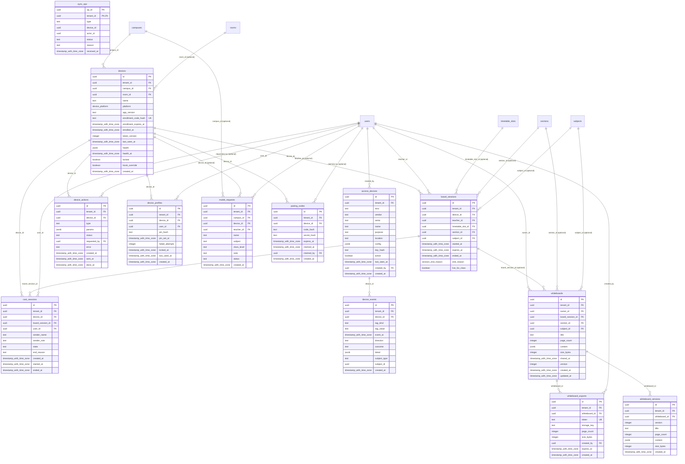

## Student records & certificates

```mermaid
erDiagram
  academic_doc_requests {
    uuid id PK
    uuid tenant_id FK
    uuid student_id FK
    text kind
    text purpose
    text status
    uuid requested_by FK
    uuid decided_by FK
    text decision_note
    timestamp_with_time_zone decided_at
    timestamp_with_time_zone issued_at
    text serial_no
    text verify_token
    jsonb snapshot
    timestamp_with_time_zone created_at
  }
  certificate_counters {
    uuid tenant_id PK,FK
    text prefix PK
    text financial_year PK
    integer last_no
  }
  certificate_templates {
    uuid id PK
    uuid tenant_id FK
    text kind
    text name
    text subject_type
    text title
    text body
    jsonb fields
    text serial_prefix
    boolean active
    integer version
    timestamp_with_time_zone updated_at
  }
  certificates {
    uuid id PK
    uuid tenant_id FK
    uuid template_id FK
    text subject_type
    uuid student_id FK
    uuid staff_user_id FK
    text purpose
    jsonb fields
    text status
    uuid requested_by FK
    uuid decided_by FK
    timestamp_with_time_zone decided_at
    text decision_note
    text serial_no
    uuid issued_by FK
    timestamp_with_time_zone issued_at
    text rendered_title
    text rendered_body
    text verify_token
    timestamp_with_time_zone revoked_at
    uuid revoked_by FK
    text revoked_reason
    timestamp_with_time_zone created_at
  }
  convocation_candidates {
    uuid id PK
    uuid tenant_id FK
    uuid convocation_id FK
    uuid student_id FK
    text status
    numeric cgpa
    text degree_title
    timestamp_with_time_zone registered_at
    text certificate_no
    timestamp_with_time_zone issued_at
  }
  convocations {
    uuid id PK
    uuid tenant_id FK
    text name
    date held_on
    smallint graduation_year
    uuid program_id FK
    text status
    uuid created_by FK
    timestamp_with_time_zone created_at
  }
  doc_counters {
    uuid tenant_id PK,FK
    text kind PK
    integer last_no
  }
  guardians {
    uuid id PK
    uuid tenant_id FK
    uuid user_id FK
    uuid student_id FK
    text relation
    boolean is_primary
    boolean is_emergency_contact
    timestamp_with_time_zone created_at
  }
  parent_visibility {
    uuid id PK
    uuid tenant_id FK
    text section
    boolean visible
    uuid updated_by FK
    timestamp_with_time_zone updated_at
  }
  promotion_batches {
    uuid id PK
    uuid tenant_id FK
    text label
    jsonb summary
    uuid run_by FK
    timestamp_with_time_zone created_at
  }
  promotion_decisions {
    uuid id PK
    uuid tenant_id FK
    uuid academic_year_id FK
    uuid student_id FK
    uuid rule_id FK
    text decision
    jsonb failed_subjects
    numeric attendance_pct
    jsonb reasons
    text status
    uuid decided_by FK
    timestamp_with_time_zone decided_at
    timestamp_with_time_zone parent_notified_at
    timestamp_with_time_zone created_at
  }
  promotion_rules {
    uuid id PK
    uuid tenant_id FK
    uuid program_id FK
    text name
    integer min_attendance_pct
    integer subject_pass_pct
    integer max_compartment_subjects
    integer grace_marks
    boolean is_default
    timestamp_with_time_zone created_at
  }
  student_academic_ids {
    uuid id PK
    uuid tenant_id FK
    uuid student_id FK
    text apaar_id
    text abc_id
    text source
    uuid captured_by FK
    timestamp_with_time_zone captured_at
  }
  student_biometric_ids {
    uuid id PK
    uuid tenant_id FK
    uuid student_id FK
    text device_user_id
  }
  student_credits {
    uuid id PK
    uuid tenant_id FK
    uuid student_id FK
    bigint amount_paise
    text kind
    uuid invoice_id FK
    text note
    uuid created_by FK
    timestamp_with_time_zone created_at
  }
  student_lifecycle_events {
    uuid id PK
    uuid tenant_id FK
    uuid student_id FK
    lifecycle_event_kind kind
    text from_status
    text to_status
    uuid from_section_id FK
    uuid to_section_id FK
    text reason
    date effective_on
    date return_on
    uuid approver_id FK
    uuid certificate_id FK
    uuid batch_id FK
    jsonb data
    uuid actor_id FK
    timestamp_with_time_zone created_at
  }
  student_prior_education {
    uuid id PK
    uuid tenant_id FK
    uuid student_id FK
    uuid application_id FK
    text level
    text institution
    text board
    smallint passing_year
    numeric percentage
    text tc_number
    text medium
    text notes
    timestamp_with_time_zone created_at
  }
  students {
    uuid id PK
    uuid tenant_id FK
    uuid user_id FK
    uuid section_id FK
    text roll_no
    text full_name
    text status
    timestamp_with_time_zone status_changed_at
    date enrolled_on
    uuid application_id FK
    timestamp_with_time_zone updated_at
  }
  vault_documents {
    uuid id PK
    uuid tenant_id FK
    text owner_type
    uuid student_id FK
    uuid staff_user_id FK
    text title
    text category
    text content_type
    integer size_bytes
    text storage_key
    integer version
    uuid replaces_id
    text visibility
    date expires_on
    text scan_status
    boolean legal_hold
    uuid uploaded_by FK
    timestamp_with_time_zone archived_at
    timestamp_with_time_zone created_at
  }
  students ||--o{ academic_doc_requests : "student_id"
  users ||--o{ academic_doc_requests : "requested_by"
  users ||--o{ academic_doc_requests : "decided_by (optional)"
  certificate_templates ||--o{ certificates : "template_id"
  students ||--o{ certificates : "student_id (optional)"
  users ||--o{ certificates : "staff_user_id (optional)"
  users ||--o{ certificates : "requested_by"
  users ||--o{ certificates : "decided_by (optional)"
  users ||--o{ certificates : "issued_by (optional)"
  users ||--o{ certificates : "revoked_by (optional)"
  convocations ||--o{ convocation_candidates : "convocation_id"
  students ||--o{ convocation_candidates : "student_id"
  programs ||--o{ convocations : "program_id (optional)"
  users ||--o{ convocations : "created_by (optional)"
  users ||--o{ guardians : "user_id"
  students ||--o{ guardians : "student_id"
  users ||--o{ parent_visibility : "updated_by (optional)"
  users ||--o{ promotion_batches : "run_by (optional)"
  academic_years ||--o{ promotion_decisions : "academic_year_id"
  students ||--o{ promotion_decisions : "student_id"
  promotion_rules ||--o{ promotion_decisions : "rule_id (optional)"
  users ||--o{ promotion_decisions : "decided_by (optional)"
  programs ||--o{ promotion_rules : "program_id (optional)"
  students ||--o{ student_academic_ids : "student_id"
  users ||--o{ student_academic_ids : "captured_by (optional)"
  students ||--o{ student_biometric_ids : "student_id"
  students ||--o{ student_credits : "student_id"
  fee_invoices ||--o{ student_credits : "invoice_id (optional)"
  users ||--o{ student_credits : "created_by (optional)"
  students ||--o{ student_lifecycle_events : "student_id"
  sections ||--o{ student_lifecycle_events : "from_section_id (optional)"
  sections ||--o{ student_lifecycle_events : "to_section_id (optional)"
  users ||--o{ student_lifecycle_events : "approver_id (optional)"
  certificates ||--o{ student_lifecycle_events : "certificate_id (optional)"
  promotion_batches ||--o{ student_lifecycle_events : "batch_id (optional)"
  users ||--o{ student_lifecycle_events : "actor_id (optional)"
  students ||--o{ student_prior_education : "student_id (optional)"
  applications ||--o{ student_prior_education : "application_id (optional)"
  users ||--o{ students : "user_id (optional)"
  sections ||--o{ students : "section_id"
  applications ||--o{ students : "application_id (optional)"
  students ||--o{ vault_documents : "student_id (optional)"
  users ||--o{ vault_documents : "staff_user_id (optional)"
  users ||--o{ vault_documents : "uploaded_by"
```

## Student support & activities

```mermaid
erDiagram
  campus_events {
    uuid id PK
    uuid tenant_id FK
    text title
    text description
    text event_type
    text venue
    integer capacity
    timestamp_with_time_zone starts_at
    timestamp_with_time_zone ends_at
    text audience
    bigint fee_paise
    text status
    uuid created_by FK
    timestamp_with_time_zone created_at
  }
  club_achievements {
    uuid id PK
    uuid tenant_id FK
    uuid club_id FK
    text title
    text level
    text position
    date achieved_on
    jsonb participants
    text description
    uuid recorded_by FK
    timestamp_with_time_zone created_at
  }
  club_activities {
    uuid id PK
    uuid tenant_id FK
    uuid club_id FK
    text title
    text description
    date activity_on
    integer points
    uuid created_by FK
    timestamp_with_time_zone created_at
  }
  club_activity_attendance {
    uuid id PK
    uuid tenant_id FK
    uuid activity_id FK
    uuid student_id FK
    integer points
    timestamp_with_time_zone created_at
  }
  club_members {
    uuid id PK
    uuid tenant_id FK
    uuid club_id FK
    uuid student_id FK
    text role
    text status
    uuid decided_by FK
    timestamp_with_time_zone decided_at
    timestamp_with_time_zone created_at
  }
  club_office_bearers {
    uuid id PK
    uuid tenant_id FK
    uuid club_id FK
    uuid student_id FK
    text post
    date from_on
    date to_on
    boolean active
    timestamp_with_time_zone created_at
  }
  clubs {
    uuid id PK
    uuid tenant_id FK
    text name
    text category
    text description
    uuid faculty_coordinator_id FK
    boolean active
    timestamp_with_time_zone created_at
  }
  committee_action_items {
    uuid id PK
    uuid tenant_id FK
    uuid meeting_id FK
    uuid committee_id FK
    text title
    uuid owner_user_id FK
    date due_on
    text status
    timestamp_with_time_zone completed_at
    timestamp_with_time_zone created_at
  }
  committee_meetings {
    uuid id PK
    uuid tenant_id FK
    uuid committee_id FK
    text title
    date meeting_on
    text agenda
    text minutes
    text status
    uuid created_by FK
    timestamp_with_time_zone created_at
  }
  committee_members {
    uuid id PK
    uuid tenant_id FK
    uuid committee_id FK
    uuid user_id FK
    text role
    date tenure_start
    date tenure_end
    timestamp_with_time_zone created_at
  }
  committees {
    uuid id PK
    uuid tenant_id FK
    text name
    boolean statutory
    text description
    boolean active
    timestamp_with_time_zone created_at
  }
  counselling_sessions {
    uuid id PK
    uuid tenant_id FK
    uuid student_id FK
    uuid counsellor_user_id FK
    uuid requested_by FK
    text reason
    timestamp_with_time_zone scheduled_at
    text status
    text confidential_notes
    timestamp_with_time_zone created_at
  }
  discipline_actions {
    uuid id PK
    uuid tenant_id FK
    uuid incident_id FK
    text action
    text detail
    date starts_on
    date ends_on
    bigint fine_paise
    text status
    uuid decided_by FK
    timestamp_with_time_zone created_at
  }
  discipline_appeals {
    uuid id PK
    uuid tenant_id FK
    uuid incident_id FK
    uuid action_id FK
    uuid appellant_user_id FK
    text grounds
    text status
    text decision_note
    uuid decided_by FK
    timestamp_with_time_zone decided_at
    timestamp_with_time_zone created_at
  }
  discipline_incidents {
    uuid id PK
    uuid tenant_id FK
    uuid student_id FK
    date incident_on
    text kind
    text severity
    text description
    uuid reported_by FK
    uuid grievance_id FK
    text status
    integer version
    timestamp_with_time_zone created_at
  }
  discipline_parent_contacts {
    uuid id PK
    uuid tenant_id FK
    uuid incident_id FK
    uuid guardian_user_id FK
    text method
    text summary
    date meeting_on
    timestamp_with_time_zone acknowledged_at
    uuid created_by FK
    timestamp_with_time_zone created_at
  }
  discipline_witnesses {
    uuid id PK
    uuid tenant_id FK
    uuid incident_id FK
    text name
    text role
    uuid student_id FK
    text statement
    uuid recorded_by FK
    timestamp_with_time_zone created_at
  }
  early_alert_flags {
    uuid id PK
    uuid tenant_id FK
    uuid student_id FK
    text level
    integer score
    jsonb reasons
    text status
    uuid mentor_user_id FK
    timestamp_with_time_zone computed_at
    timestamp_with_time_zone resolved_at
  }
  early_alert_interventions {
    uuid id PK
    uuid tenant_id FK
    uuid flag_id FK
    uuid student_id FK
    uuid by_user_id FK
    text action
    text note
    date due_on
    text outcome
    timestamp_with_time_zone created_at
  }
  event_certificates {
    uuid id PK
    uuid tenant_id FK
    uuid registration_id FK
    uuid certificate_id FK
    timestamp_with_time_zone created_at
  }
  event_feedback {
    uuid id PK
    uuid tenant_id FK
    uuid event_id FK
    uuid registration_id FK
    integer rating
    text comment
    timestamp_with_time_zone created_at
  }
  event_media {
    uuid id PK
    uuid tenant_id FK
    uuid event_id FK
    text caption
    text kind
    text url
    text storage_key
    text content_type
    integer size_bytes
    boolean approved
    uuid uploaded_by FK
    timestamp_with_time_zone created_at
  }
  event_registrations {
    uuid id PK
    uuid tenant_id FK
    uuid event_id FK
    uuid student_id FK
    uuid registered_by FK
    text status
    text qr_token
    timestamp_with_time_zone checked_in_at
    timestamp_with_time_zone created_at
  }
  grievance_events {
    uuid id PK
    uuid tenant_id FK
    uuid ticket_id FK
    uuid actor_user_id FK
    text actor_role
    text kind
    text visibility
    text body
    timestamp_with_time_zone created_at
  }
  grievance_evidence {
    uuid id PK
    uuid tenant_id FK
    uuid ticket_id FK
    text title
    text content_type
    integer size_bytes
    text storage_key
    uuid added_by FK
    timestamp_with_time_zone created_at
  }
  grievance_tickets {
    uuid id PK
    uuid tenant_id FK
    text ticket_no
    text category
    text severity
    text subject
    text description
    boolean anonymous
    text committee
    text committee_stage
    uuid raised_by FK
    uuid student_id FK
    text status
    uuid assignee_user_id FK
    timestamp_with_time_zone sla_due_at
    smallint escalation_level
    timestamp_with_time_zone escalated_at
    text resolution
    timestamp_with_time_zone resolved_at
    smallint rating
    text rating_comment
    integer version
    timestamp_with_time_zone created_at
  }
  intervention_plans {
    uuid id PK
    uuid tenant_id FK
    uuid student_id FK
    uuid mentor_user_id FK
    text goal
    jsonb actions
    date review_on
    jsonb remedial
    jsonb baseline
    jsonb remeasure
    text status
    text outcome
    text outcome_rating
    timestamp_with_time_zone closed_at
    timestamp_with_time_zone created_at
  }
  intervention_reassessments {
    uuid id PK
    uuid tenant_id FK
    uuid plan_id FK
    uuid student_id FK
    smallint score_before
    smallint score_after
    jsonb signals_before
    jsonb signals_after
    date due_on
    timestamp_with_time_zone assessed_at
    text outcome
    timestamp_with_time_zone created_at
  }
  intervention_support {
    uuid id PK
    uuid tenant_id FK
    uuid plan_id FK
    text kind
    text title
    text ref
    date due_on
    boolean done
    uuid created_by FK
    timestamp_with_time_zone created_at
  }
  mentor_assignments {
    uuid id PK
    uuid tenant_id FK
    uuid student_id FK
    uuid mentor_user_id FK
    date started_on
    date ended_on
    uuid assigned_by FK
    timestamp_with_time_zone created_at
  }
  mentoring_requests {
    uuid id PK
    uuid tenant_id FK
    uuid student_id FK
    uuid alumni_id FK
    text topic
    text message
    text status
    timestamp_with_time_zone responded_at
    timestamp_with_time_zone created_at
  }
  mentoring_sessions {
    uuid id PK
    uuid tenant_id FK
    uuid student_id FK
    uuid mentor_user_id FK
    date held_on
    text mode
    text summary
    text private_notes
    date follow_up_on
    timestamp_with_time_zone created_at
  }
  welfare_requests {
    uuid id PK
    uuid tenant_id FK
    uuid student_id FK
    uuid requested_by FK
    text kind
    text title
    text details
    bigint amount_requested_paise
    text status
    bigint amount_approved_paise
    text decision_note
    uuid decided_by FK
    timestamp_with_time_zone decided_at
    date disbursed_on
    integer version
    timestamp_with_time_zone created_at
  }
  users ||--o{ campus_events : "created_by"
  clubs ||--o{ club_achievements : "club_id"
  users ||--o{ club_achievements : "recorded_by (optional)"
  clubs ||--o{ club_activities : "club_id"
  users ||--o{ club_activities : "created_by"
  club_activities ||--o{ club_activity_attendance : "activity_id"
  students ||--o{ club_activity_attendance : "student_id"
  clubs ||--o{ club_members : "club_id"
  students ||--o{ club_members : "student_id"
  users ||--o{ club_members : "decided_by (optional)"
  clubs ||--o{ club_office_bearers : "club_id"
  students ||--o{ club_office_bearers : "student_id"
  users ||--o{ clubs : "faculty_coordinator_id (optional)"
  committee_meetings ||--o{ committee_action_items : "meeting_id"
  committees ||--o{ committee_action_items : "committee_id"
  users ||--o{ committee_action_items : "owner_user_id"
  committees ||--o{ committee_meetings : "committee_id"
  users ||--o{ committee_meetings : "created_by"
  committees ||--o{ committee_members : "committee_id"
  users ||--o{ committee_members : "user_id"
  students ||--o{ counselling_sessions : "student_id"
  users ||--o{ counselling_sessions : "counsellor_user_id (optional)"
  users ||--o{ counselling_sessions : "requested_by"
  discipline_incidents ||--o{ discipline_actions : "incident_id"
  users ||--o{ discipline_actions : "decided_by"
  discipline_incidents ||--o{ discipline_appeals : "incident_id"
  discipline_actions ||--o{ discipline_appeals : "action_id"
  users ||--o{ discipline_appeals : "appellant_user_id"
  users ||--o{ discipline_appeals : "decided_by (optional)"
  students ||--o{ discipline_incidents : "student_id"
  users ||--o{ discipline_incidents : "reported_by"
  grievance_tickets ||--o{ discipline_incidents : "grievance_id (optional)"
  discipline_incidents ||--o{ discipline_parent_contacts : "incident_id"
  users ||--o{ discipline_parent_contacts : "guardian_user_id (optional)"
  users ||--o{ discipline_parent_contacts : "created_by (optional)"
  discipline_incidents ||--o{ discipline_witnesses : "incident_id"
  students ||--o{ discipline_witnesses : "student_id (optional)"
  users ||--o{ discipline_witnesses : "recorded_by (optional)"
  students ||--o{ early_alert_flags : "student_id"
  users ||--o{ early_alert_flags : "mentor_user_id (optional)"
  early_alert_flags ||--o{ early_alert_interventions : "flag_id"
  students ||--o{ early_alert_interventions : "student_id"
  users ||--o{ early_alert_interventions : "by_user_id"
  event_registrations ||--o{ event_certificates : "registration_id"
  certificates ||--o{ event_certificates : "certificate_id"
  campus_events ||--o{ event_feedback : "event_id"
  event_registrations ||--o{ event_feedback : "registration_id"
  campus_events ||--o{ event_media : "event_id"
  users ||--o{ event_media : "uploaded_by (optional)"
  campus_events ||--o{ event_registrations : "event_id"
  students ||--o{ event_registrations : "student_id"
  users ||--o{ event_registrations : "registered_by"
  grievance_tickets ||--o{ grievance_events : "ticket_id"
  users ||--o{ grievance_events : "actor_user_id (optional)"
  grievance_tickets ||--o{ grievance_evidence : "ticket_id"
  users ||--o{ grievance_evidence : "added_by (optional)"
  users ||--o{ grievance_tickets : "raised_by"
  students ||--o{ grievance_tickets : "student_id (optional)"
  users ||--o{ grievance_tickets : "assignee_user_id (optional)"
  students ||--o{ intervention_plans : "student_id"
  users ||--o{ intervention_plans : "mentor_user_id"
  intervention_plans ||--o{ intervention_reassessments : "plan_id"
  students ||--o{ intervention_reassessments : "student_id"
  intervention_plans ||--o{ intervention_support : "plan_id"
  users ||--o{ intervention_support : "created_by (optional)"
  students ||--o{ mentor_assignments : "student_id"
  users ||--o{ mentor_assignments : "mentor_user_id"
  users ||--o{ mentor_assignments : "assigned_by"
  students ||--o{ mentoring_requests : "student_id"
  alumni_profiles ||--o{ mentoring_requests : "alumni_id"
  students ||--o{ mentoring_sessions : "student_id"
  users ||--o{ mentoring_sessions : "mentor_user_id"
  students ||--o{ welfare_requests : "student_id"
  users ||--o{ welfare_requests : "requested_by"
  users ||--o{ welfare_requests : "decided_by (optional)"
```

## Workflow & approvals

```mermaid
erDiagram
  approval_delegations {
    uuid id PK
    uuid tenant_id FK
    uuid delegator_id FK
    uuid delegate_id FK
    text scope
    date starts_on
    date ends_on
    text reason
    timestamp_with_time_zone revoked_at
    uuid revoked_by FK
    timestamp_with_time_zone created_at
  }
  business_rules {
    uuid id PK
    uuid tenant_id FK
    text domain
    text key
    integer version
    text title
    text description
    jsonb params
    text status
    date effective_from
    date effective_to
    uuid author_id FK
    uuid approver_id FK
    timestamp_with_time_zone approved_at
    timestamp_with_time_zone created_at
  }
  tasks {
    uuid id PK
    uuid tenant_id FK
    text title
    text description
    uuid owner_id FK
    uuid assignee_id FK
    timestamp_with_time_zone due_at
    text priority
    text status
    text source_module
    text source_id
    integer sla_hours
    timestamp_with_time_zone escalated_at
    text escalate_role
    uuid escalate_user_id FK
    integer reminder_hours
    timestamp_with_time_zone reminded_at
    timestamp_with_time_zone completed_at
    integer version
    timestamp_with_time_zone created_at
    timestamp_with_time_zone updated_at
  }
  workflow_actions {
    uuid id PK
    uuid tenant_id FK
    bigint seq
    uuid request_id FK
    integer step_index
    text step_name
    uuid actor_id FK
    text action
    text comment
    timestamp_with_time_zone created_at
  }
  workflow_definitions {
    uuid id PK
    uuid tenant_id FK
    text request_type
    text name
    text description
    jsonb fields
    jsonb steps
    boolean active
    integer version
    text module
    jsonb graph
    jsonb draft
    jsonb notify_rules
    integer published_version
    timestamp_with_time_zone published_at
    uuid created_by FK
    timestamp_with_time_zone created_at
    timestamp_with_time_zone updated_at
  }
  workflow_requests {
    uuid id PK
    uuid tenant_id FK
    uuid definition_id FK
    text request_type
    text title
    jsonb payload
    numeric amount
    uuid requester_id FK
    text status
    jsonb steps
    integer current_step
    uuid approver_user_id FK
    text approver_role
    uuid task_id FK
    timestamp_with_time_zone step_entered_at
    timestamp_with_time_zone reminded_at
    timestamp_with_time_zone escalated_at
    text source_module
    text source_id
    timestamp_with_time_zone decided_at
    integer version
    timestamp_with_time_zone created_at
    timestamp_with_time_zone updated_at
  }
  workflow_step_approvals {
    uuid id PK
    uuid tenant_id FK
    uuid request_id FK
    integer step_index
    text kind
    text role
    uuid user_id FK
    uuid task_id FK
    boolean escalation
    uuid decided_by FK
    timestamp_with_time_zone decided_at
    timestamp_with_time_zone created_at
  }
  users ||--o{ approval_delegations : "delegator_id"
  users ||--o{ approval_delegations : "delegate_id"
  users ||--o{ approval_delegations : "revoked_by (optional)"
  users ||--o{ business_rules : "author_id"
  users ||--o{ business_rules : "approver_id (optional)"
  users ||--o{ tasks : "owner_id"
  users ||--o{ tasks : "assignee_id"
  users ||--o{ tasks : "escalate_user_id (optional)"
  workflow_requests ||--o{ workflow_actions : "request_id"
  users ||--o{ workflow_actions : "actor_id (optional)"
  users ||--o{ workflow_definitions : "created_by (optional)"
  workflow_definitions ||--o{ workflow_requests : "definition_id"
  users ||--o{ workflow_requests : "requester_id"
  users ||--o{ workflow_requests : "approver_user_id (optional)"
  tasks ||--o{ workflow_requests : "task_id (optional)"
  workflow_requests ||--o{ workflow_step_approvals : "request_id"
  users ||--o{ workflow_step_approvals : "user_id (optional)"
  tasks ||--o{ workflow_step_approvals : "task_id (optional)"
  users ||--o{ workflow_step_approvals : "decided_by (optional)"
```
