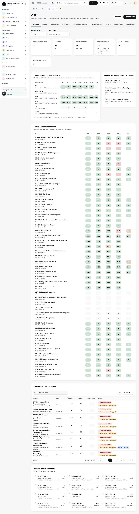
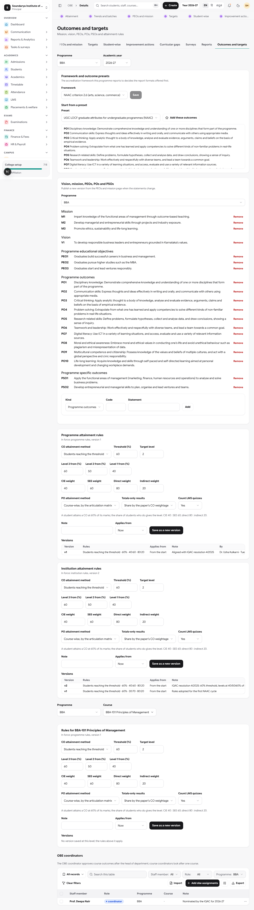
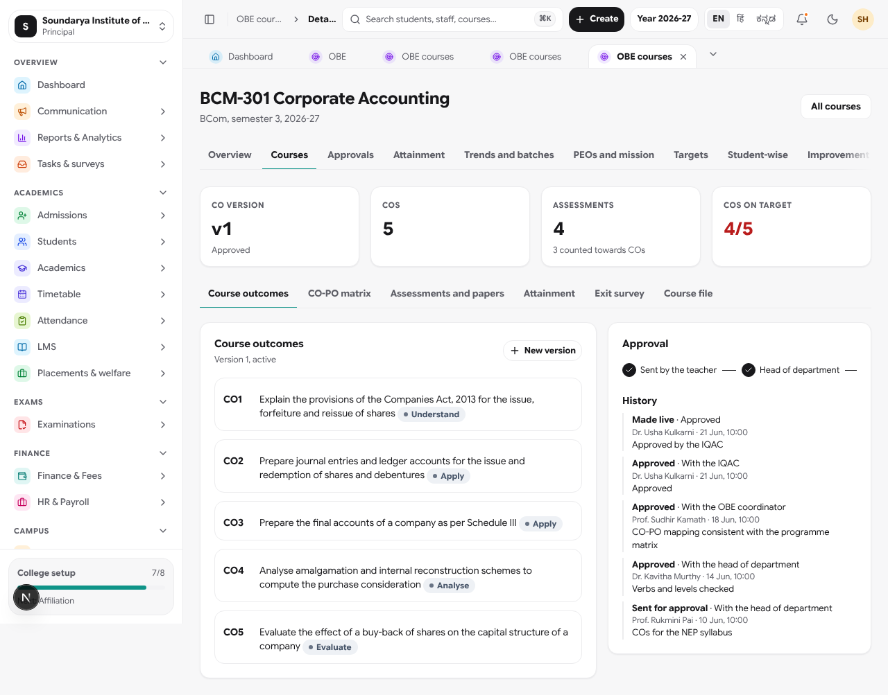
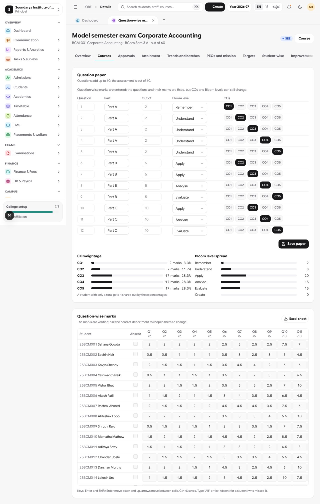
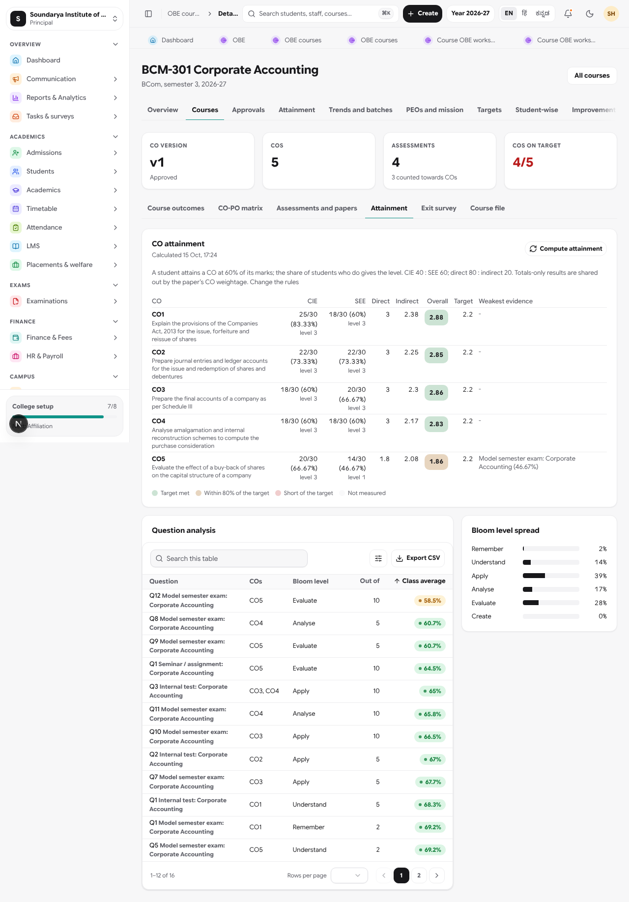
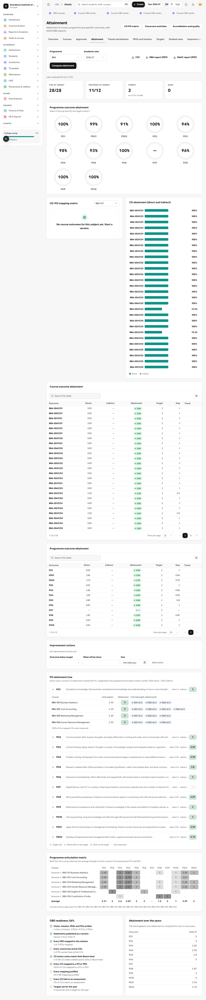
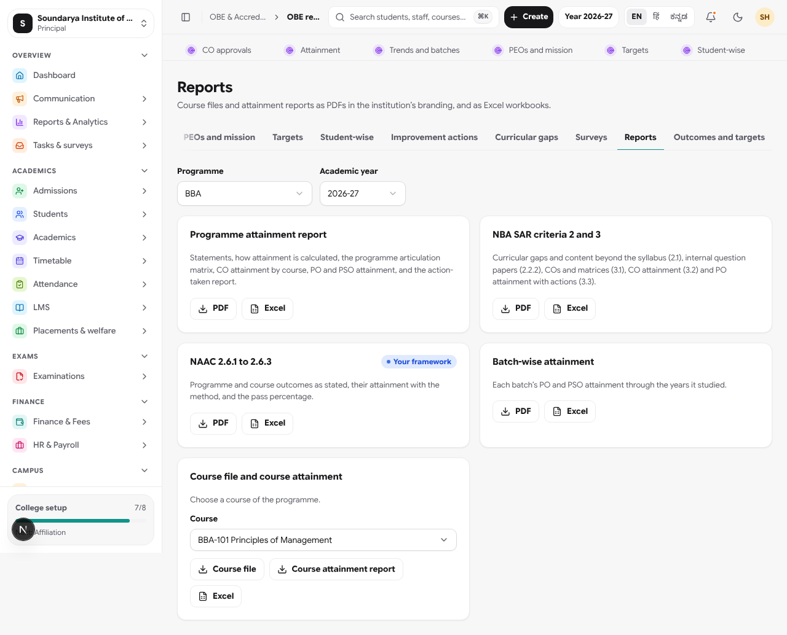
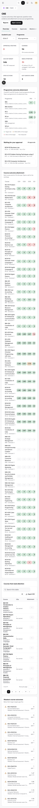

# Assessment, exams, results and OBE

API: `services/api/src/exams`, `src/obe`, and the workflow additions in `src/marks`. ERP: `/exams`, `/exams/schemes`, `/exams/[id]`, `/results/[id]` (marks entry panel), `/obe`, `/obe/setup`, `/obe/matrix`. Migrations 0046 to 0050.

## Assessment
- A **scheme** per subject and academic year: components (kind internal/external/practical/project/viva, weights adding to 100), credits, pass rules, and a **grade scale** (bands plus `band` or `percentOver10` grade points). Presets: `bu-nep`, `ugc-10`, `cbse` (`GET /v1/scheme-presets`). Everything board-specific is configuration; the maths is in `exams/grading.ts`.
- **Marks workflow** on assessments: draft, submitted (teacher), verified (head of department or principal; not the creator), moderated (adjustments with a reason; original kept). `reopen` clears moderation. Marks of an exam are frozen once its session is processed. Existing class tests are unaffected (they stay `draft`).
- **Exam session**: papers (each creates the exam assessment, linked to the scheme's external component), clash check, seating (papers at the same time share halls, neighbours write different papers), hall tickets (withholding with a reason), PDF.
- **Processing** refuses until every component has verified marks. SGPA = credit points / credits attempted (a failed subject counts as 0); CGPA = all credit points / all credits attempted, a later attempt replacing an earlier one. Publish notifies classes and publishes the exam assessments, so the Student and Parent apps' `GET /v1/marks/students/:id` keep working (it now returns moderated marks). New: `GET /v1/results/students/:id`, marks-card and transcript PDFs.
- **Revaluation**: student or family requests while published; principal accepts, enters the re-checked marks, the student is re-graded. **Lock** ends the window.
- PDFs are produced by a small built-in writer (`common/pdf.ts`); only Latin text is drawn.

## OBE: user guide

Outcome-based education covers the whole cycle: statements, COs and their approval, question papers tagged to COs, question-wise marks, attainment, surveys, gaps and actions, and the accreditation documents. It works for NBA (engineering Tier I and II, management, pharmacy) and NAAC 2.6, with each programme choosing its framework. The Soundarya demo seed shows BCom, BBA and BCA in full: three years of history, batches, approvals in progress, exit surveys and gaps.

Code: API `services/api/src/obe` (`attainment.ts` holds the maths, `obe.service.ts` gathers the evidence, plus the `workflow`, `questions`, `insights`, `reports` controllers). ERP `/obe/*` (`components/obe`). Teacher app: Profile, Course outcomes. Student app: Profile, My course outcomes. Migrations `0184_obe_flagship` and `0185_obe_audit` (difficulty, verification, PEO-PO matrix, course plan). The completeness audit is `docs/requirements/OBE_COMPLETENESS.md`.

### Roles
| Role | What they do |
| --- | --- |
| Teacher / course coordinator | Drafts COs (Bloom checker suggests verbs), justifies the CO-PO mapping, sets question papers, enters question-wise marks, opens the course exit survey. A course coordinator is named per course in **Outcomes and targets**. |
| Head of department | First approval of CO versions; sees the department's courses. |
| OBE coordinator | Named per programme (Outcomes and targets, OBE coordinators). Second approval; watches the programme's dashboard. |
| IQAC (`quality_officer`) | Final approval makes a version live; owns rules, surveys, gaps, actions and reports. |
| Principal / admin | Everything; may approve at any step. |

Each person's **OBE home** shows what concerns them: approvals waiting, courses that need attention (no approved COs, untagged papers, missing marks), heat maps of course x CO and programme x PO, and the weakest COs.

### 1. Set up a programme
**OBE, Outcomes and targets.** Choose the framework (NBA engineering, NBA 2025 engineering, NBA management, NBA pharmacy, NAAC 2.6) and start from a preset (NBA graduate attributes, UGC LOCF, BCom/BBA/BCA PSOs). Write the vision, mission, PEOs, POs and PSOs in the statements list (add, edit, Excel import and export, history; a statement in use cannot be deleted). **PEOs and mission** maps PEOs to the mission, and PEOs to the POs and PSOs that serve them; each PEO's attainment is its POs' overall attainment weighted by that matrix.

### 2. Attainment rules (configurable, versioned)
Rules apply at three levels: institution, programme, course; the most specific wins. Saving publishes a new version with a note and the academic year it applies from, so earlier years keep the rules they were computed with.

| Setting | Default |
| --- | --- |
| CO method | Students reaching the threshold (alternatives: class average, average percentage) |
| Student threshold | 60% of the CO's marks |
| Levels | 3 when 60% of students reach it, 2 at 50%, 1 at 40% |
| CIE : SEE | 40 : 60 |
| Direct : indirect | 80 : 20 (indirect = course exit survey) |
| Target level | 2 (per CO and PO per year in **Targets**, also as an Excel sheet to download and upload; each target shows who set it) |
| PO method | Course-wise, weighted by the articulation matrix (alternatives: CO-weighted, plain course average) |
| Totals-only results | Shared out by the paper's CO weightage (or equally, or not counted) |
| LMS quizzes | Counted when their questions carry a CO |

### 3. COs and their approval
**OBE, Courses**, open a course. Draft the COs (the Bloom checker flags a verb that does not fit the level and suggests statements), map each CO to POs/PSOs with strength 1 to 3 and a justification (the CAM). **Course plan** ties each unit of the course's syllabus to the COs it serves and names the COs no unit serves; the course file prints it. **Send for approval**: head of department, then the programme's OBE coordinator, then the IQAC (a step is skipped when nobody holds it). Reviewers approve, return with a comment (it goes back to the teacher, who edits and resends) or comment on a single CO. Nobody approves their own submission. The history keeps every step; a new version copies the COs, mapping and justification. The same flow is in the Teacher app (Course outcomes, CO approvals).

### 4. Question papers and question-wise marks
In the course's **Assessments and papers**, open an assessment. Add questions (number, part, maximum, Bloom level, difficulty, COs), or copy them from another assessment, a question-bank paper or a marking rubric (each criterion becomes a question, for labs, projects and vivas). The CO weightage, Bloom spread and difficulty spread show as you edit. Enter marks in the grid: arrows and Enter move, paste a block straight from Excel, type `AB` for absent, Ctrl+S saves; each student's assessment mark becomes the sum of the questions. Or download the **Excel sheet**, fill it and upload it (checked first, then saved). Teachers can also enter question-wise marks in the Teacher app. Results that only have totals (a university SEE) are shared out to COs by the paper's blueprint.

### 5. Attainment
**Compute attainment** on a course or on **Attainment** for a programme. Per CO: CIE and SEE (each to a level), direct, indirect (exit survey), overall against the target, and the weakest piece of evidence; question analysis and Bloom spread below. The programme view shows PO/PSO attainment, the PAM built from the course matrices, and the PO tree (each course's articulation and attainment). **Trends and batches** compares years and computes batch-wise attainment over the years a batch studied. Students see their own CO-wise result in the Student app (and staff on the student's profile, Course outcomes tab).

### 6. Surveys, gaps and actions
**Surveys**: open the course exit survey from a course (one question per CO); students get it in the Student app and a daily reminder until it closes; **Remind** sends one now. Programme exit, alumni and employer surveys feed PO attainment. **Curricular gaps** records gaps and content beyond the syllabus with resource persons and POs. COs below target become **Improvement actions** (identified, assigned, in progress, evidence added, done). Recording the action taken, its date and evidence (or the re-measured attainment) lets the IQAC or principal, never the owner, **verify** it, which closes the entry in the action-taken report. Reopening the action withdraws the verification.

### 7. Reports
**Reports** gives, in the institution's branding: course file and course attainment report (PDF, Excel), programme attainment report, batch-wise report, NBA SAR criteria 2 and 3 (numbered for the programme's framework: Tier I adds the curriculum structure and components, management reports criteria 3 and 4; attainment for CAY, CAYm1 and CAYm2), and NAAC 2.6.1 to 2.6.3. The programme report includes PEO attainment.

### Hand-checked formulas
`services/api/src/obe/attainment.spec.ts` and `test/obe-flagship.e2e.spec.ts` check the threshold and class-average methods, levels, CIE/SEE weighting, blueprint apportioning of totals, direct/indirect combination, PO roll-up by articulation, the approval workflow and question-wise marks.

## Testing
`ZYNETIX_PG_ADMIN_URL` (or `ZYNETIX_TEST_ADMIN_URL`) is a superuser connection URL used by `test/global-setup.ts`; without it the old `sudo -u postgres psql` is used. `ZYNETIX_TEST_DB` picks the database.
